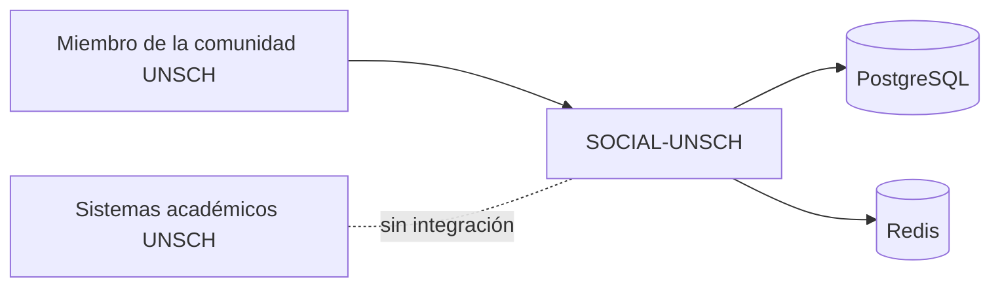

# Contexto y alcance

## Problema que atiende

La vida universitaria en la UNSCH depende de información que cambia en minutos y que hoy circula por canales informales: si el comedor tiene cola, si hay sitio en la biblioteca, quién busca compañeros para una tesis, quién comparte movilidad desde un distrito. Esa información está dispersa en grupos de mensajería, no está restringida a la comunidad universitaria y se pierde con rapidez.

SOCIAL-UNSCH reúne esas necesidades en una sola plataforma con acceso limitado a correos `@unsch.edu.pe`.

## Beneficiarios

| Beneficiario | Qué obtiene |
|---|---|
| Estudiantes | Estado del campus en tiempo casi real, publicaciones de su escuela, búsqueda de compañeros de proyecto, movilidad compartida |
| Egresados y docentes | Acceso a la misma comunidad con su rol declarado |
| La universidad | Un canal cerrado a su dominio de correo |

## Alcance actual

Lo que el sistema hace hoy de extremo a extremo, con persistencia compartida entre usuarios:

| Capacidad | Estado | Evidencia |
|---|---|---|
| Registro e inicio de sesión con correo institucional | Implementado | [auth.routes.ts](../../apps/api/src/modules/auth/auth.routes.ts) |
| Aceptación de términos y condiciones | Parcial | [users.routes.ts](../../apps/api/src/modules/users/users.routes.ts), [RouteGuard.tsx](../../apps/web/components/ui/RouteGuard.tsx) |
| Radar del campus (comedor, rectorado, biblioteca, alertas) | Implementado | [radar.service.ts](../../apps/api/src/modules/radar/radar.service.ts) |
| Feed de publicaciones | Implementado | [feed.service.ts](../../apps/api/src/modules/feed/feed.service.ts) |
| Descubrimiento de perfiles e interacción (matchmaking) | Parcial | [matchmaking.repository.ts](../../apps/api/src/modules/matchmaking/matchmaking.repository.ts) |
| Catálogo de facultades, escuelas y pabellones | Implementado | [catalogs.controller.ts](../../apps/api/src/modules/catalogs/catalogs.controller.ts) |
| Carpooling: listar, solicitar y confirmar asiento | Parcial: la API existe, la pantalla no la usa | [carpooling.routes.ts](../../apps/api/src/modules/carpooling/carpooling.routes.ts), [CarpoolingDashboard.tsx](../../apps/web/components/ui/CarpoolingDashboard.tsx) |

Pantallas que existen pero no comparten datos entre usuarios (**Simulado**): wiki-banco de archivos, moderación, marketplace, bolsa de empleo y ajustes de perfil. El detalle está en el [inventario de implementación](../07-evaluacion-y-evolucion/01-inventario-de-implementacion.md).

## Alcance futuro (propuesto)

- Conectar las pantallas simuladas a servicios reales, empezando por carpooling, cuya API ya existe.
- Exponer por API el banco de archivos y los créditos, cuyo esquema de datos ya está creado.
- Exponer por API la moderación, cuyo esquema y disparador ya existen.
- Separar el sistema en servicios por dominio de forma gradual. Ver [plan de migración](../07-evaluacion-y-evolucion/03-plan-de-migracion.md).

## Funciones excluidas

No forman parte del sistema ni del plan documentado:

| Exclusión | Motivo |
|---|---|
| Integración con sistemas académicos oficiales de la UNSCH (matrícula, notas) | No hay código ni acuerdo documentado |
| Verificación de propiedad del correo (enlace o código) | El registro solo valida el formato del dominio; ver [roles.ts](../../apps/api/src/shared/auth/roles.ts) |
| Pagos en línea | El campo `price_soles` de carpooling es informativo; no hay pasarela |
| Mensajería o chat | Se genera un identificador de canal al producirse un match, pero no existe ningún servicio de chat |
| Aplicación móvil nativa | Solo hay aplicación web |
| Almacenamiento de archivos | El esquema guarda una URL (`file_url`); no hay servicio de subida |

## Límite del sistema

El sistema no consume ni expone datos de otros sistemas de la universidad. Sus únicas dependencias externas son sus propios almacenes de datos y las plataformas donde se despliega.

[← Índice](../README.md)
