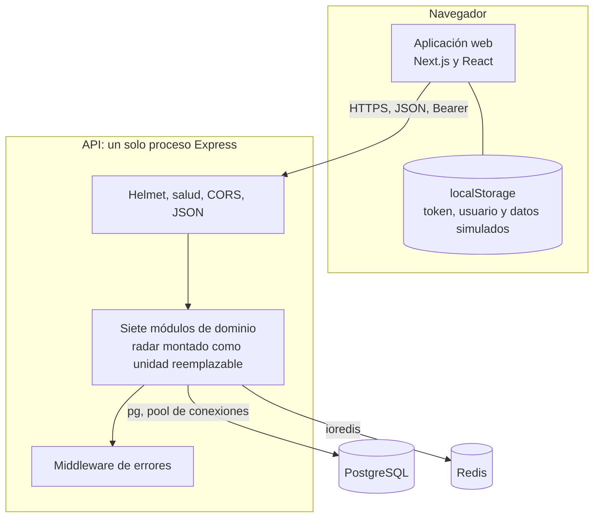

# Arquitectura actual

Descripción del sistema en el commit `8e56bfa`, actualizada con la etapa 3 ([ETAPA_03](../migracion/ETAPA_03_PREPARACION_SEPARACION.md), rama pendiente de fusión). Todo lo que aparece aquí tiene evidencia en el código; lo que no pudo comprobarse se indica.

## En una frase

SOCIAL-UNSCH es hoy un **monolito modular**: una aplicación web y **una sola API** que se compila y se despliega como una unidad, organizada por dentro en módulos de dominio. No es una arquitectura de microservicios.

## Unidades de despliegue

Una unidad de despliegue es lo que se publica y se ejecuta por separado.

| Unidad | Tecnología | Cómo se construye | Cómo se ejecuta | Evidencia |
|---|---|---|---|---|
| Aplicación web | Next.js 14 (App Router), React 18 | `npm run build:frontend` (workspace `apps/web`) | Plataforma de alojamiento del frontend | [apps/web/package.json](../../apps/web/package.json) |
| API | Express 4 sobre Node.js, TypeScript | `npm run build` (workspace `apps/api`; compila antes el contrato) | `npm start` → `node dist/server.js` en `apps/api`, un proceso | [server.ts](../../apps/api/src/server.ts), [bootstrap.ts](../../apps/api/src/bootstrap.ts) |
| Migraciones | Scripts TypeScript con `ts-node` | No se compilan | Ejecución manual por comando | [migrator.ts](../../apps/api/src/database/migrations/migrator.ts) |

Desde la etapa 3 son workspaces de npm con dependencias propias y un único lockfile; `packages/contracts` es una biblioteca de contratos, no una unidad desplegable. Las migraciones no forman parte del arranque de la API: nadie las ejecuta automáticamente.

## Vista general

## Aplicación web

- Once pantallas agrupadas en `(auth)` y `(dashboard)` ([app/](../../apps/web/app)).
- Un único cliente HTTP, [api.ts](../../apps/web/app/lib/api.ts), que añade el token a cada solicitud y, ante un 401, borra la sesión y redirige al inicio de sesión.
- La sesión se guarda en `localStorage` (claves `token` y `user`).
- [RouteGuard.tsx](../../apps/web/components/ui/RouteGuard.tsx) decide en el navegador si se muestra el aviso de términos.
- Todas las páginas se generan como estáticas; el frontend no tiene rutas de servidor propias ni accede a las bases de datos.

Qué pantallas consumen la API y cuáles trabajan con datos del navegador:

| Pantalla | Fuente de datos | Estado |
|---|---|---|
| Inicio de sesión, registro | API | Implementado |
| Inicio (feed) | API; los «me gusta» son locales | Parcial |
| Radar | API | Implementado |
| Matchmaking | API para perfiles e interacción; habilidades generadas en el cliente | Parcial |
| Carpooling | `localStorage` | Simulado |
| Wiki-banco de archivos | `localStorage` | Simulado |
| Moderación | `localStorage` | Simulado |
| Marketplace | `localStorage` | Simulado |
| Empleo | Datos fijos en el cliente | Simulado |
| Ajustes | `localStorage`; solo el catálogo de escuelas viene de la API | Simulado |

## API

### Cadena de procesamiento

Definida en [app.ts](../../apps/api/src/app.ts), en este orden:

1. `helmet()`: cabeceras de seguridad.
2. `/health/live` y `/health/ready` (etapa 3), fuera de `/api/v1` y antes de CORS.
3. `cors()`: lista de orígenes de `ALLOWED_ORIGINS`; las solicitudes sin cabecera `Origin` se aceptan.
4. Análisis de JSON y formularios.
5. Enrutadores de los siete módulos bajo `/api/v1`. El radar se monta desde la unidad `RadarModule` que recibe `createApp()`: local por defecto ([radar.module.ts](../../apps/api/src/modules/radar/radar.module.ts)) o proxy si `RADAR_MODE=proxy` ([radar.proxy.ts](../../apps/api/src/modules/radar/radar.proxy.ts)).
6. Middleware de errores.

Desde la etapa 3, `createApp()` construye la aplicación sin abrir conexiones; [composition.ts](../../apps/api/src/composition.ts) crea el cliente Redis y [bootstrap.ts](../../apps/api/src/bootstrap.ts) arranca el servidor y cierra las conexiones al detenerse.

### Módulos

| Módulo | Prefijo | Rutas | Almacén | Protegido |
|---|---|---|---|---|
| `auth` | `/auth` | `POST /register`, `POST /login`, `GET /profile-me` | PostgreSQL | Solo `profile-me` |
| `users` | `/users` | `PATCH /accept-terms` | PostgreSQL | Sí |
| `radar` | `/radar` | `GET /status`, `POST /report` | Redis | Sí |
| `feed` | `/feed` | `GET /`, `POST /` | PostgreSQL | Sí |
| `matchmaking` | `/matchmaking` | `POST /score`, `GET /profiles`, `POST /interact` | PostgreSQL | Sí |
| `carpooling` | `/carpooling` | `GET /`, `POST /:route_id/request`, `PATCH /:route_id/confirm` | PostgreSQL | Sí |
| `catalogs` | `/catalogs` | `GET /`, `GET /schools` | PostgreSQL | No |

Son 16 rutas. Cada módulo vive en `src/modules/<nombre>/` y, salvo `catalogs`, se compone de rutas, controlador, servicio y repositorio. La estructura interna se detalla en [Organización interna](../03-diseno-de-software/01-organizacion-interna.md).

### Acceso a datos

| Recurso | Cómo se accede | Configuración | Evidencia |
|---|---|---|---|
| PostgreSQL | Un `Pool` de `pg` compartido por todos los módulos | Máximo 20 conexiones, 2 s de espera de conexión, sin opción TLS explícita | [database.ts](../../apps/api/src/config/database.ts) |
| Redis | Un cliente `ioredis` compartido | Hasta 5 reintentos de conexión; si no se define URL, intenta `127.0.0.1:6379` | [redis.ts](../../apps/api/src/config/redis.ts) |

No hay ORM (herramienta de mapeo objeto-relacional): los repositorios escriben SQL parametrizado. El esquema está en [src/database/migrations/sql](../../apps/api/src/database/migrations/sql) y se describe en [Datos y propiedad por dominio](06-datos-y-propiedad-por-dominio.md).

## Autenticación y autorización observadas

| Aspecto | Comportamiento | Evidencia |
|---|---|---|
| Credenciales | Correo institucional y contraseña; hash con bcrypt | [auth.service.ts](../../apps/api/src/modules/auth/auth.service.ts) |
| Token | JWT firmado con RS256, vigencia de 24 horas | [jwt.ts](../../apps/api/src/config/jwt.ts) |
| Contenido del token | Identificador de usuario, rol, escuela, facultad, ciclo y si aceptó términos | [auth.service.ts](../../apps/api/src/modules/auth/auth.service.ts) |
| Verificación | `requireAuth` valida la firma con la clave pública y adjunta el contenido a la solicitud | [auth.middleware.ts](../../apps/api/src/middlewares/auth.middleware.ts) |
| Autorización por rol | No existe en la API, salvo impedir el registro como administrador | [roles.ts](../../apps/api/src/shared/auth/roles.ts) |
| Autorización por propiedad | Solo en carpooling: únicamente el conductor confirma asientos | [carpooling.repository.ts](../../apps/api/src/modules/carpooling/carpooling.repository.ts) |
| Renovación y revocación | No existen | — |

Dos consecuencias del diseño del token:

- Los datos que viajan en el token quedan fijos durante 24 horas. Si el usuario acepta los términos, el token sigue indicando que no lo hizo hasta el siguiente inicio de sesión; la API no usa ese dato, así que no tiene efecto práctico hoy.
- Como la verificación solo necesita la clave pública, cualquier proceso que la tenga puede validar tokens sin consultar al módulo de autenticación. Esto facilita la separación futura en servicios.

## Lo que no existe

Para evitar suposiciones, se enumera lo que un lector podría esperar y no está en el repositorio:

- Puerta de enlace de API, balanceador o proxy inverso propios.
- Colas de mensajes, eventos o tareas en segundo plano.
- Caché de consultas (Redis se usa solo como almacén del radar).
- Métricas o trazas (las rutas de salud existen desde la etapa 3).
- Limitación de frecuencia de solicitudes.
- Integración continua o archivos de despliegue versionados.
- Contenedor Docker de la aplicación: [docker-compose.yml](../../docker-compose.yml) solo define PostgreSQL y Redis para desarrollo local.

## Puntos de acoplamiento

Resumen; el análisis completo está en [Componentes y dependencias](03-componentes-y-dependencias.md).

| Acoplamiento | Dónde |
|---|---|
| Todos los módulos con PostgreSQL comparten una base y un pool | [database.ts](../../apps/api/src/config/database.ts) |
| Feed, matchmaking y carpooling leen la tabla `users` con consultas propias | Repositorios de esos módulos |
| Frontend y backend comparten lockfile, no paquete (etapa 3) | [package.json](../../package.json) |
| Catálogos duplicados en constantes del frontend y del backend | [app/lib/unsch.constants.ts](../../apps/web/app/lib/unsch.constants.ts), [src/shared/constants/unsch.constants.ts](../../apps/api/src/shared/constants/unsch.constants.ts) |

[← Índice](../README.md)
