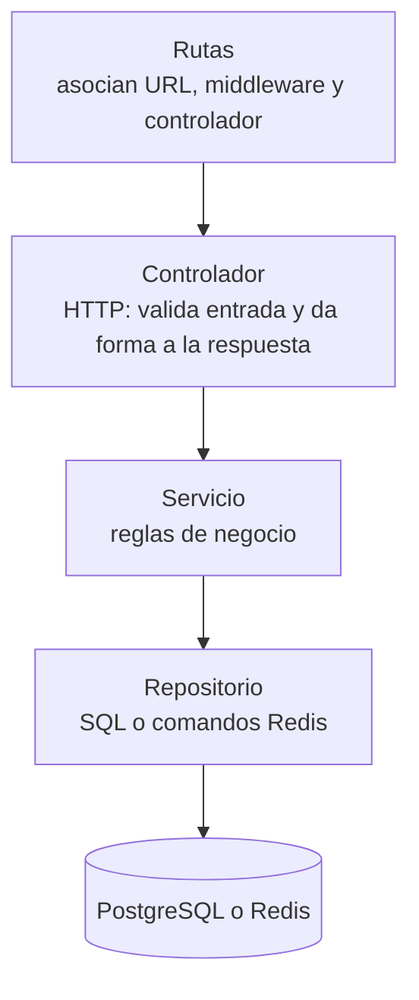

# Estilos y enfoques

Varios términos de arquitectura se usan a menudo como si fueran lo mismo. Este documento los separa, explica cada uno y dice cuál aplica a SOCIAL-UNSCH hoy y cuál es solo una propuesta.

## Cinco preguntas distintas

| Pregunta | Categoría | Respuesta hoy | Respuesta propuesta |
|---|---|---|---|
| ¿En cuántas unidades se despliega la lógica de servidor? | Estilo arquitectónico | Una en operación: monolito modular. Radar con código propio sin desplegar | Varios servicios por dominio |
| ¿Cómo se ordena el código dentro de una unidad? | Enfoque de organización interna | Capas; Radar con un puerto e inyección | Hexagonal en cada servicio |
| ¿Qué soluciones recurrentes aparecen en el código? | Patrones de diseño | Repositorio, middleware, error tipado, script atómico, composición explícita | Puertos y adaptadores generalizados |
| ¿Cómo se guarda el código en Git? | Organización del repositorio | Monorepo con npm workspaces | Sin cambios |
| ¿Dónde se ejecuta? | Plataforma de despliegue | Vercel, Render y servicios de datos gestionados | Las mismas, con más servicios |

Cada fila puede cambiar sin que cambien las demás. Un monolito puede ser hexagonal; un conjunto de microservicios puede vivir en un monorepo; cambiar de plataforma no cambia el estilo.

## Estilo actual: monolito modular

Un **monolito** es un sistema cuya lógica de servidor se compila y despliega como una sola unidad. Es **modular** cuando su código está dividido en partes con responsabilidades separadas y dependencias controladas.

Evidencia de que es un monolito:

- Un solo punto de arranque, [server.ts](../../apps/api/src/server.ts), y una sola aplicación Express, [app.ts](../../apps/api/src/app.ts), que registra todos los enrutadores.
- Un solo comando de compilación y uno de arranque en [package.json](../../package.json).
- Un solo pool de PostgreSQL y un solo cliente Redis compartidos ([database.ts](../../apps/api/src/config/database.ts), [redis.ts](../../apps/api/src/config/redis.ts)).

Evidencia de que es modular:

- Un directorio por dominio en [src/modules](../../apps/api/src/modules).
- Ningún módulo importa código de otro módulo. Los módulos solo comparten `config`, `middlewares` y `shared`.

Límite de esa modularidad: los módulos están separados en el código, pero no en los datos. Varios leen las mismas tablas. Ver [Componentes y dependencias](03-componentes-y-dependencias.md).

## Enfoque interno actual: capas

En una **arquitectura en capas**, cada capa solo usa a la inmediatamente inferior.

Esto es lo que hay en seis de los siete módulos. Ejemplo: [feed.routes.ts](../../apps/api/src/modules/feed/feed.routes.ts) → [feed.controller.ts](../../apps/api/src/modules/feed/feed.controller.ts) → [feed.service.ts](../../apps/api/src/modules/feed/feed.service.ts) → [feed.repository.ts](../../apps/api/src/modules/feed/feed.repository.ts).

La excepción es `catalogs`, cuyo controlador consulta la base directamente ([catalogs.controller.ts](../../apps/api/src/modules/catalogs/catalogs.controller.ts)).

## Por qué no es arquitectura hexagonal

> **Estado: IMPLEMENTACIÓN PARCIAL / DIRECCIÓN ARQUITECTÓNICA PROPUESTA.** Desde la etapa 3, Radar tiene un puerto (`RadarStore`) e inyección por constructor; el resto del análisis describe los demás módulos. Detalle en [C4, nivel de código](../04-modelo-c4/04-codigo-y-secuencias.md#e-nivel-de-código-y-arquitectura-hexagonal).

La **arquitectura hexagonal** (o de puertos y adaptadores) coloca las reglas de negocio en el centro y hace que todo lo externo dependa de ellas. El centro define **puertos**, que son interfaces que expresan lo que necesita; los **adaptadores** las implementan para una tecnología concreta. La **Arquitectura Limpia** sigue la misma regla de dependencias con más capas nombradas.

Tener controladores, servicios y repositorios no basta para llamarla hexagonal. Se comprobaron tres condiciones:

| Condición | Qué se encontró | Evidencia |
|---|---|---|
| ¿El negocio define interfaces para sus dependencias? | Solo en Radar: `RadarStore`, declarada junto a su adaptador. En los demás módulos, no | [radar.repository.ts](../../apps/api/src/modules/radar/radar.repository.ts) |
| ¿Las dependencias apuntan hacia el negocio? | No. El servicio importa la clase concreta del repositorio, y este importa el pool | `import { FeedRepository } from './feed.repository'` en [feed.service.ts](../../apps/api/src/modules/feed/feed.service.ts) |
| ¿Hay un punto de composición que conecte las piezas? | Solo para Radar y las conexiones: [composition.ts](../../apps/api/src/composition.ts). Los demás crean su dependencia con `new` en un campo privado | `private feedRepository = new FeedRepository()` en [feed.service.ts](../../apps/api/src/modules/feed/feed.service.ts) |

Además, algunas reglas de negocio están fuera de los servicios: en SQL dentro de los repositorios (la máquina de estados del matchmaking, en [matchmaking.repository.ts](../../apps/api/src/modules/matchmaking/matchmaking.repository.ts)), en un script de Redis (el consenso del radar) y en disparadores de la base de datos (créditos y moderación).

Conclusión: el sistema es **en capas**, con dependencias directas hacia la infraestructura salvo en Radar. La arquitectura hexagonal es una dirección **propuesta**, no una descripción del código actual.

Una señal práctica de la diferencia: las pruebas sustituyen la base de datos interceptando el módulo de configuración con `jest.mock`, no entregando un repositorio alternativo ([tests/unit](../../apps/api/tests/unit)).

## Estilo propuesto: servicios por dominio

Un **servicio por dominio** es una unidad desplegable que es dueña de una parte del negocio y de sus datos. La propuesta agrupa los módulos actuales en pocos servicios en lugar de uno por módulo, por la restricción de un solo operador.

| Servicio propuesto | Módulos actuales que absorbería |
|---|---|
| Identidad | `auth`, `users`, `catalogs` |
| Radar | `radar` |
| Comunidad | `feed`, `matchmaking` y la moderación futura |
| Movilidad | `carpooling` |
| Recursos | Banco de archivos y créditos (hoy sin módulo) |

Detalle en [Arquitectura objetivo](05-arquitectura-objetivo.md). **Estado: PROPUESTO**, con Radar IMPLEMENTADO PARCIALMENTE, sin desplegar.

## Estrategia de transición: Strangler Fig

**Strangler Fig** (higuera estranguladora) es una estrategia para reemplazar un sistema por partes: se coloca una entrada delante del sistema existente, se construye cada pieza nueva al lado y se redirige hacia ella una ruta cada vez, hasta que la pieza antigua deja de recibir tráfico y puede retirarse.

Es una estrategia de migración, no un estilo: describe el camino, no el destino. Aquí, la API decide con `RADAR_MODE` si `/api/v1/radar` se atiende en proceso o en el servicio nuevo. Detalle en [Estrategia de migración](../migracion/README.md). **Estado: IMPLEMENTADO PARCIALMENTE;** el redireccionamiento real no se ha activado.

## Eventos asíncronos

Una integración por **eventos** consiste en que un servicio publica un hecho ya ocurrido y otros reaccionan más tarde, sin que el primero espere. Conviene cuando la reacción puede tardar y no debe bloquear ni revertir la operación original.

Hoy no hay ningún mecanismo de eventos. Lo más parecido son los disparadores de la base de datos, que se ejecutan dentro de la misma transacción y, por tanto, son síncronos.

La propuesta los limita a casos justificados, por ejemplo acreditar créditos tras una descarga o registrar un reporte de moderación. Las operaciones que exigen respuesta inmediata y consistente, como confirmar un asiento, seguirían siendo síncronas. **Estado: Propuesto.**

## Organización del repositorio: monorepo

Un **monorepo** es un único repositorio que contiene varios paquetes con dependencias y construcción propias. No es un estilo arquitectónico: un monorepo puede contener un monolito o veinte servicios.

Desde la etapa 3 el repositorio es un **monorepo con npm workspaces**: `apps/web`, `apps/api` y `packages/contracts`, con un único lockfile. Sigue habiendo una sola API desplegable: el monorepo organiza el código, no cambia el estilo ([ADR-007](../06-decisiones-arquitectonicas/ADR-007-workspaces-y-montaje-de-radar.md)).

## Resumen

| Concepto | Categoría | Estado en SOCIAL-UNSCH |
|---|---|---|
| Monolito modular | Estilo | Implementado |
| Capas | Enfoque interno | Implementado en seis de siete módulos |
| Puertos e inyección | Enfoque interno | Implementado parcialmente: solo Radar |
| Arquitectura hexagonal o limpia | Enfoque interno | Dirección propuesta |
| Servicios por dominio | Estilo | Propuesto; Radar con código en `main`, sin desplegar |
| Strangler Fig | Estrategia de migración | Implementado parcialmente: entrada y pieza nueva, sin redirección activa |
| Eventos asíncronos | Mecanismo de integración | Propuesto, selectivo |
| Monorepo con varios paquetes | Organización del repositorio | Implementado en la etapa 3 (npm workspaces) |

[← Índice](../README.md)
