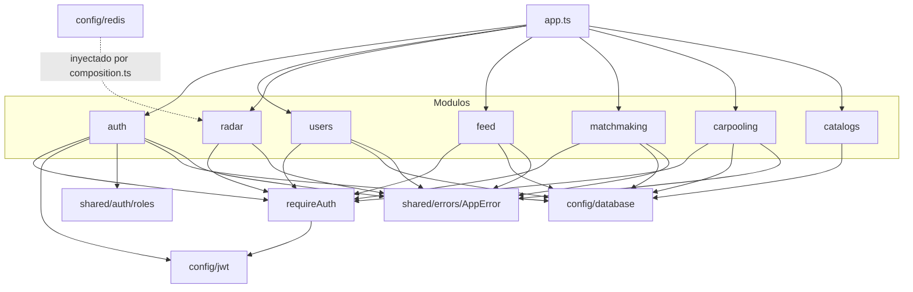
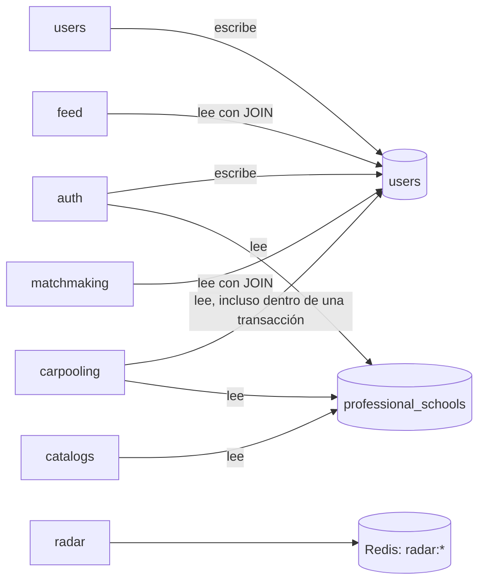

# Componentes y dependencias

Qué piezas componen el backend, de qué depende cada una y dónde están los acoplamientos que condicionan la migración. Revisado el 2026-10-30 sobre `f480728`. Desde la etapa 3, `radar` recibe Redis por inyección desde [composition.ts](../../apps/api/src/composition.ts) y no importa `config/redis`; el servicio `apps/radar` se describe en [C3](../04-modelo-c4/03-componentes-del-backend.md#diagrama-del-servicio-radar).

## Componentes del backend

| Componente | Ubicación | Responsabilidad |
|---|---|---|
| Arranque | [server.ts](../../apps/api/src/server.ts) | Lee el puerto, inicia el servidor y atiende `SIGTERM` |
| Aplicación | [app.ts](../../apps/api/src/app.ts) | Monta middlewares globales, enrutadores y manejo de errores |
| Configuración | [src/config](../../apps/api/src/config) | Pool de PostgreSQL, cliente Redis, firma y verificación de JWT |
| Middlewares | [src/middlewares](../../apps/api/src/middlewares) | `requireAuth` y `errorMiddleware` |
| Compartido | [src/shared](../../apps/api/src/shared) | `AppError`, política de roles, constantes de la universidad |
| Módulos | [src/modules](../../apps/api/src/modules) | Siete módulos de dominio |
| Migraciones | [src/database/migrations](../../apps/api/src/database/migrations) | Migrador, carga de catálogos y seed de demostración |

## Dependencias entre componentes

Lectura del diagrama:

- **No hay flechas entre módulos.** Ninguno importa código de otro.
- `radar` es el único que usa Redis y el único que no usa PostgreSQL.
- `catalogs` es el único que no pasa por `requireAuth`.
- `auth` es el único que firma tokens; los demás solo los verifican a través del middleware.

## Dependencias de datos

El diagrama anterior muestra dependencias de código. La dependencia real entre módulos está en la base de datos, donde no se ve en las importaciones.

| Módulo | Tablas propias (las escribe) | Tablas ajenas que lee | Evidencia |
|---|---|---|---|
| `auth` | `users` (crea) | `professional_schools` (para obtener la facultad) | [auth.repository.ts](../../apps/api/src/modules/auth/auth.repository.ts) |
| `users` | `users` (actualiza la aceptación de términos) | — | [users.repository.ts](../../apps/api/src/modules/users/users.repository.ts) |
| `catalogs` | — | `faculties`, `professional_schools`, `campus_pavilions` | [catalogs.controller.ts](../../apps/api/src/modules/catalogs/catalogs.controller.ts) |
| `feed` | `feed_posts` | `users` (nombre y rol del autor) | [feed.repository.ts](../../apps/api/src/modules/feed/feed.repository.ts) |
| `matchmaking` | `matchmaking_profiles`, `matchmaking_interactions` | `matchmaking_projects`, `users` (nombre, rol y correo) | [matchmaking.repository.ts](../../apps/api/src/modules/matchmaking/matchmaking.repository.ts) |
| `carpooling` | `carpooling_requests`, `carpooling_routes` (descuenta asientos) | `users` (nombre, ciclo, correo, teléfono), `professional_schools` | [carpooling.repository.ts](../../apps/api/src/modules/carpooling/carpooling.repository.ts) |
| `radar` | Claves `radar:*` en Redis | — | [radar.repository.ts](../../apps/api/src/modules/radar/radar.repository.ts) |

## Puntos de acoplamiento

Ordenados por cuánto dificultan separar el sistema en servicios.

| N.º | Acoplamiento | Efecto sobre la migración | Evidencia |
|---|---|---|---|
| 1 | La tabla `users` la escriben dos módulos (`auth` y `users`) y la leen tres más mediante `JOIN` | Para separar identidad hay que sustituir cada `JOIN` por un contrato o por datos copiados | Repositorios citados arriba |
| 2 | `carpooling` lee datos de contacto de `users` dentro de la misma transacción que confirma el asiento | La confirmación dejaría de ser una transacción local si los usuarios estuvieran en otra base | `confirmBookingTransaction` en [carpooling.repository.ts](../../apps/api/src/modules/carpooling/carpooling.repository.ts) |
| 3 | Claves foráneas entre dominios: publicaciones, perfiles, rutas y archivos referencian `users`; usuarios y publicaciones referencian catálogos | Separar las bases obliga a eliminar esas restricciones y asumir la validación en el código | [001_base_schema.sql](../../apps/api/src/database/migrations/sql/001_base_schema.sql), [004_moderation_and_carpooling.sql](../../apps/api/src/database/migrations/sql/004_moderation_and_carpooling.sql) |
| 4 | Disparadores que cruzan dominios: la descarga de un archivo modifica el saldo en `users`; un reporte de moderación oculta filas de `feed_posts` | La lógica está en la base, fuera del alcance de cualquier servicio | [003_credits_and_wiki.sql](../../apps/api/src/database/migrations/sql/003_credits_and_wiki.sql), [004_moderation_and_carpooling.sql](../../apps/api/src/database/migrations/sql/004_moderation_and_carpooling.sql) |
| 5 | Un solo pool y una sola variable `DATABASE_URL` | Todos los módulos tienen acceso a todas las tablas | [database.ts](../../apps/api/src/config/database.ts) |
| 6 | Un solo lockfile para todos los workspaces | Los paquetes se construyen por separado, pero sus dependencias siguen coordinadas | [package.json](../../package.json) |
| 7 | Los servicios crean sus repositorios con `new`, salvo `radar` | No se puede sustituir el almacén sin tocar el servicio | Por ejemplo, [feed.service.ts](../../apps/api/src/modules/feed/feed.service.ts) |
| 8 | Catálogos duplicados entre frontend y backend. Los valores de Radar ya salen de `packages/contracts` | Un cambio de catálogo exige tocar varios archivos | [app/lib/unsch.constants.ts](../../apps/web/app/lib/unsch.constants.ts), [src/shared/constants/unsch.constants.ts](../../apps/api/src/shared/constants/unsch.constants.ts) |
| 9 | Lógica de Radar duplicada en `apps/api` y `apps/radar` durante la convivencia | Pueden divergir y comprometer la reversión | [Extracción de Radar](../migracion/EXTRACCION_RADAR.md) |

Sobre el punto 8: las constantes del backend en `src/shared/constants` solo las usa la carga de catálogos ([load_catalogs.ts](../../apps/api/src/database/migrations/load_catalogs.ts)); ningún módulo las importa.

## Qué es fácil de separar y qué no

| Módulo | Dependencias de datos ajenos | Dificultad estimada de extracción |
|---|---|---|
| `radar` | Ninguna; solo necesita el identificador del usuario, que viaja en el token | Baja; confirmada por la extracción en código, sin validar en producción |
| `catalogs` | Solo lectura de tres tablas de referencia | Baja |
| `feed` | Nombre y rol del autor | Media |
| `matchmaking` | Nombre, rol y correo; transacciones propias | Media |
| `carpooling` | Datos de contacto dentro de una transacción | Alta |
| `auth` y `users` | Son la fuente de `users`; todos dependen de ellos | Alta: conviene dejarlos para cuando los demás ya no lean `users` directamente |

La dificultad es una estimación por análisis del código, no una medición. Esta tabla es la base del orden propuesto en el [plan de migración](../07-evaluacion-y-evolucion/03-plan-de-migracion.md).

[← Índice](../README.md)
