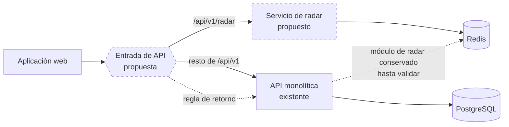

# Arquitectura de transición

> **Estado: Propuesto.** Nada de lo descrito aquí está implementado. Describe cómo convivirían el monolito y los servicios nuevos durante la migración.

## Por qué hace falta una arquitectura intermedia

Pasar de una API a varios servicios en un solo paso obligaría a cambiar código, datos, despliegues y frontend a la vez, sin posibilidad de volver atrás. La transición busca lo contrario: que en cada momento el sistema funcione, que cada paso sea pequeño y que cada paso pueda deshacerse.

La estrategia es Strangler Fig, explicada en [Estilos y enfoques](02-estilos-y-enfoques.md).

## Principios

| Principio | Significado práctico |
|---|---|
| El contrato no cambia al mover | Una ruta extraída conserva URL, cuerpo, códigos de estado y errores |
| Un dominio cada vez | No se extraen dos servicios en la misma etapa |
| Reversible por configuración | Volver al monolito es cambiar una regla de enrutamiento, no redesplegar código |
| El monolito sigue completo hasta validar | El código del módulo extraído no se borra hasta que el servicio nuevo esté validado |
| Primero el código, después los datos | Un servicio puede empezar leyendo la misma base y recibir sus propias tablas más tarde |

## Paso previo: ordenar el repositorio (etapa 3)

> **Estado: implementado en la etapa 3** (rama pendiente de fusión). Detalle y resultados en [ETAPA_03](../migracion/ETAPA_03_PREPARACION_SEPARACION.md).

Antes de extraer nada hay que poder construir cada parte por separado.

| Hoy | Transición |
|---|---|
| Un `package.json` para todo | Paquetes separados para la aplicación web, la API y los contratos |
| Tipos de la API repetidos a mano en el frontend | Un paquete de contratos del que dependen ambos |
| Configuración de despliegue en los paneles | Archivos de despliegue versionados |
| Sin ruta de salud | `/health/live` y `/health/ready` en la API (implementado) |

Esta reorganización no cambia el comportamiento ni el estilo: el resultado sigue siendo un monolito modular, ahora dentro de un monorepo.

## La entrada reversible

La pieza central de la transición es un punto único de entrada que decide qué proceso atiende cada ruta.

Leyenda: trazo continuo, existente; trazo discontinuo, propuesto.

Opciones para realizar la entrada, de menor a mayor costo de operación:

| Opción | Descripción | Ventaja | Costo |
|---|---|---|---|
| A. Reescrituras en la plataforma del frontend | El frontend llama a rutas propias y la plataforma las redirige al servicio que corresponda | Sin un servicio adicional | Acopla el enrutamiento a la plataforma del frontend |
| B. El monolito como entrada | El monolito reenvía las rutas extraídas | Sin componentes nuevos | El monolito sigue siendo punto único de fallo y añade un salto |
| C. Puerta de enlace dedicada | Un servicio ligero solo para enrutar | Separación clara, reversibilidad sencilla | Un despliegue más que operar |

**Elección de la etapa 3: opción B, preparada y desactivada.** La API monta el radar en `/api/v1/radar` como unidad reemplazable y ya incluye un modo proxy (`RADAR_MODE=proxy`) que reenviaría esas rutas a un servicio de radar con un solo intento, límite de tiempo y destino fijado en la configuración del servidor. Por defecto el radar sigue siendo local. Así el frontend no cambia de URL y revertir es cambiar una variable. Detalle en [ETAPA_03](../migracion/ETAPA_03_PREPARACION_SEPARACION.md#6-enrutamiento-reversible).

## Identidad durante la transición

Los servicios nuevos necesitan saber quién hace la solicitud. El diseño actual lo permite sin cambios de fondo:

- El token se firma con clave privada y se verifica con clave pública ([jwt.ts](../../apps/api/src/config/jwt.ts)).
- Un servicio nuevo solo necesita la clave pública para validar tokens; no llama al monolito.
- La clave privada permanece únicamente donde se emiten tokens.

Lo que debe resolverse antes de la primera extracción: que el middleware `requireAuth` y el tipo del contenido del token estén en un paquete compartido en lugar de copiarse.

## Datos durante la transición

Se distinguen tres situaciones:

| Situación | Ejemplo | Tratamiento propuesto |
|---|---|---|
| El servicio ya tiene almacén propio | Radar y Redis | Se lleva su almacén desde el primer día |
| El servicio usa tablas que nadie más escribe | `feed_posts`, `carpooling_requests` | Empieza usando la misma base con un usuario de base de datos limitado a sus tablas; la separación física es posterior |
| El servicio necesita datos de otro dominio | Nombre del autor de una publicación | Se sustituye el `JOIN` por una consulta al contrato del dueño o por una copia local mantenida por eventos |

La propiedad tabla por tabla está en [Datos y propiedad por dominio](06-datos-y-propiedad-por-dominio.md).

## Estados intermedios previstos

| Tras la etapa | Unidades de servidor desplegadas | Qué queda en el monolito |
|---|---|---|
| 3 | 1 (más la entrada, si se elige la opción C) | Todo |
| 4 | 2 | Todo menos radar |
| 5 | 3 o 4 | Movilidad, y lo que no se haya separado de identidad o comunidad |
| 6 | 4 o 5 | Nada, o un resto mínimo |
| 7 | 5 o 6 | Nada |

Los números son una proyección de la propuesta, no un compromiso.

## Riesgos propios de la transición

| Riesgo | Mitigación propuesta |
|---|---|
| Dos implementaciones del mismo módulo divergen mientras conviven | Congelar cambios funcionales en el módulo mientras se extrae; mismas pruebas para ambas |
| Más despliegues con planes que se suspenden por inactividad multiplican los arranques en frío | Medir antes de extraer el segundo servicio; ver [criterios de validación](../07-evaluacion-y-evolucion/04-criterios-de-validacion.md) |
| El operador único no da abasto | Limitar el número de servicios; no avanzar de etapa sin observabilidad mínima |
| Orígenes CORS y variables duplicados entre servicios | Configuración versionada por servicio desde la etapa 3 |

El diagrama de contenedores correspondiente está en [C2 de transición](../04-modelo-c4/05-contenedores-de-transicion.md).

[← Índice](../README.md)
