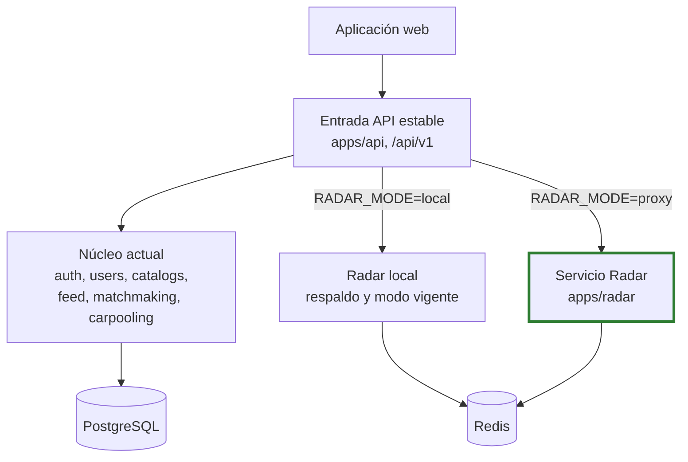

# Arquitectura de transición

> **Estado: IMPLEMENTADO PARCIALMENTE.** La preparación de la etapa 3 está en `main` y en producción. El servicio Radar y el proxy probado de la etapa 4 están en el [PR n.º 5](https://github.com/pillacarodriguezuriel-a11y/social_unsch/pull/5), sin fusionar ni desplegar. En producción, Radar se atiende dentro de la API.

## Por qué hace falta una arquitectura intermedia

Pasar de una API a varios servicios en un solo paso obligaría a cambiar código, datos, despliegues y frontend a la vez, sin posibilidad de volver atrás. La transición busca lo contrario: que en cada momento el sistema funcione, que cada paso sea pequeño y que cada paso pueda deshacerse.

La estrategia es **Strangler Fig**: la pieza nueva crece junto a la antigua, una entrada estable decide cuál atiende y la antigua se retira solo cuando deja de hacer falta. Se explica en [Estrategia de migración](../migracion/README.md).

## Vista general

Trazo grueso verde: con código, sin desplegar.

## Principios

| Principio | Significado práctico | Estado |
|---|---|---|
| El contrato no cambia al mover | Una ruta extraída conserva URL, cuerpo, códigos de estado y errores | IMPLEMENTADO para Radar, con pruebas de contrato |
| Un dominio cada vez | No se extraen dos servicios en la misma etapa | IMPLEMENTADO |
| Reversible por configuración | Volver es cambiar una variable, sin tocar código ni datos | IMPLEMENTADO; **sin ensayar en producción** |
| El módulo antiguo sigue hasta validar | El Radar local no se borra hasta tener estabilidad verificada | IMPLEMENTADO |
| Primero el código, después los datos | Un servicio puede usar el almacén actual y separarlo después | IMPLEMENTADO: Radar sigue en el mismo Redis |

## Coexistencia

| Aspecto | Cómo funciona | Evidencia |
|---|---|---|
| Selección | `createAppResources` lee `RADAR_MODE` y construye una `RadarModule`; `createApp` la monta sin conocer el modo | [composition.ts](../../apps/api/src/composition.ts), [app.ts](../../apps/api/src/app.ts) |
| Estado inicial | `local` es el valor por defecto | [env.ts](../../apps/api/src/config/env.ts) |
| Límites | La API y Radar no pueden importarse entre sí | [check-boundaries.js](../../scripts/check-boundaries.js) |

## Contratos y compatibilidad

`packages/contracts` define rutas, nodos, estados, umbral, vigencia y códigos de error. Ambas implementaciones toman de ahí sus valores.

- El frontend solo importa tipos, con `import type`.
- Los esquemas Zod se usan en pruebas de contrato; **en ejecución, las dos implementaciones validan con código propio**, no con esos esquemas.
- Los estados se aceptan en español e inglés y se cuentan por separado. Unificarlos es una decisión pendiente.

## Enrutamiento

El frontend siempre llama a `/api/v1/radar/*` en la API. Se eligió que la propia API fuera la entrada porque no añade componentes, no exige cambiar el frontend ni CORS y permite revertir con una variable. A cambio, la API sigue siendo punto único de entrada y suma un salto de red.

| Opción considerada | Motivo por el que no se eligió |
|---|---|
| Reescrituras en la plataforma del frontend | Acopla el enrutamiento a Vercel |
| Puerta de enlace dedicada | Un despliegue más que operar para un solo servicio extraído |
| Exponer Radar al frontend | Exige recompilar el frontend para activar y para revertir |

## Reversión

Procedimiento vigente:

1. Definir `RADAR_MODE=local` en la API, con `REDIS_URL` definida.
2. Reiniciar el servicio, porque la configuración se lee solo al arrancar.
3. Comprobar `/health/ready` y `/api/v1/radar/status`.

No exige redesplegar código ni migrar datos, pero **sí** un reinicio: no es una conmutación en caliente. Procedimiento completo en [Extracción de Radar](../migracion/EXTRACCION_RADAR.md#estrategia-de-rollback).

## Datos

| Situación | Ejemplo | Tratamiento |
|---|---|---|
| El servicio tiene almacén propio | Radar y Redis | IMPLEMENTADO: Radar no usa PostgreSQL y una regla de límites lo vigila |
| El servicio usa tablas que nadie más escribe | `feed_posts`, `carpooling_requests` | PROPUESTO: misma base con un usuario limitado a sus tablas |
| El servicio necesita datos de otro dominio | Nombre del autor de una publicación | PROPUESTO: sustituir el `JOIN` por un contrato o por una copia |

La propiedad tabla por tabla está en [Datos y propiedad por dominio](06-datos-y-propiedad-por-dominio.md).

## Autenticación

| Aspecto | Comportamiento | Estado |
|---|---|---|
| Emisión | Solo la API firma; `JWT_PRIVATE_KEY` no llega a Radar | IMPLEMENTADO |
| Verificación en Radar | RS256 con clave pública, sin llamar a la API | IMPLEMENTADO |
| Identidad | Solo del token; `x-user-id` y `x-role` se ignoran | IMPLEMENTADO |
| En modo proxy | La API no verifica el token; lo reenvía y decide Radar | IMPLEMENTADO |
| Acceso directo | Radar exige token igualmente. No hay credencial entre servicios ni restricción de red | IMPLEMENTADO PARCIALMENTE |

El paquete compartido de autenticación previsto en el plan original no se creó: Radar tiene su propia guarda.

## Observabilidad

| Señal | Estado |
|---|---|
| Registro JSON por solicitud en ambos procesos | IMPLEMENTADO |
| Correlación con `x-request-id` | IMPLEMENTADO |
| Métricas, trazas y alertas | NO IMPLEMENTADO |

## Salud

| Ruta | API | Servicio Radar |
|---|---|---|
| `/health/live` | 200 si el proceso atiende | 200 si el proceso atiende |
| `/health/ready` | 503 si cae PostgreSQL; 200 `degraded` si falla Radar | 503 si Redis no responde |

La comprobación de la API tiene un tope de 2 s, aunque el proxy admita más tiempo. Si Radar está suspendido, la API informará `degraded` mientras despierta.

## Estados intermedios

| Tras | Unidades de servidor | Qué queda en la API | Estado |
|---|---|---|---|
| Etapa 3 | 1 | Todo | IMPLEMENTADO: es la producción actual |
| Etapa 4 | 2 | Todo menos Radar, con el módulo local de respaldo | IMPLEMENTADO PARCIALMENTE |
| Etapa 5 | 3 o 4 | Movilidad y lo no separado | PROPUESTO |
| Etapas 6 y 7 | 4 a 6 | Nada, o un resto mínimo | PROPUESTO |

## Riesgos propios de la transición

Riesgos completos en [Riesgos de la extracción](../migracion/EXTRACCION_RADAR.md#riesgos) y en [Riesgos y deuda técnica](../07-evaluacion-y-evolucion/02-riesgos-y-deuda-tecnica.md).

Ver también: [Arquitectura actual](01-arquitectura-actual.md) · [Arquitectura objetivo](05-arquitectura-objetivo.md) · [C2 de transición](../04-modelo-c4/05-contenedores-de-transicion.md)

[← Índice](../README.md)
