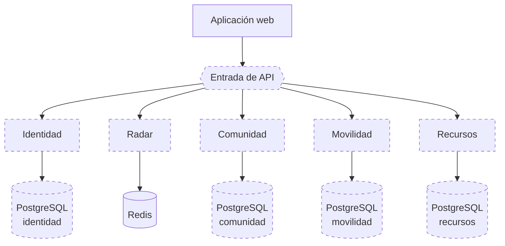
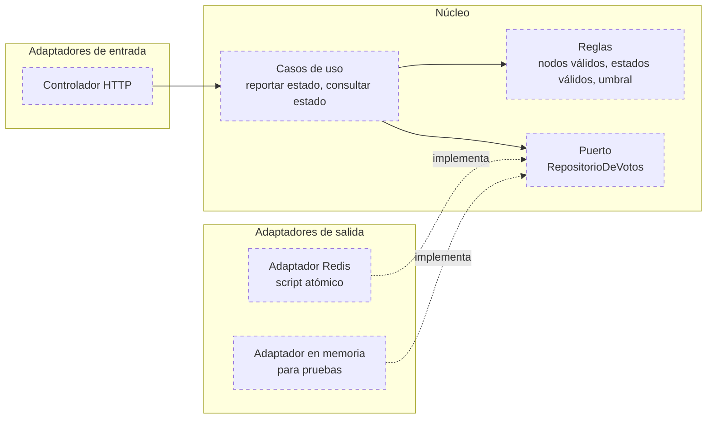

# Arquitectura objetivo

> **Estado: PROPUESTO.** Describe el destino de la migración, no el sistema actual. Solo Radar tiene código de servicio, en un PR sin desplegar. Ningún otro servicio existe, ni se ha aprobado este destino.

## Qué es real y qué no

| Elemento | Clasificación |
|---|---|
| Monorepo, contratos de Radar, límites comprobados, entrada `/api/v1` | Implementado |
| Servicio Radar | Siguiente etapa: código en PR, falta validar, desplegar y activar |
| Identidad y Comunidad separadas | Futuro |
| Movilidad como servicio | Futuro |
| Recursos y créditos como servicio | Futuro; primero hay que construirlo |
| Puerta de enlace dedicada | Hipótesis: hoy la API cumple esa función |
| Canal de eventos | Hipótesis: mecanismo sin elegir, solo si aporta valor |
| Bases separadas por dominio | Hipótesis: el primer paso es propiedad lógica |
| Radar, Identidad, Comunidad, Movilidad y Recursos como cinco servicios | Hipótesis: agrupar Identidad y Comunidad es una variante válida |

## Idea general

Sustituir la API única por un conjunto reducido de **servicios por dominio**, cada uno dueño de sus reglas y de sus datos, organizados por dentro con arquitectura hexagonal y comunicados por contratos explícitos. Los eventos asíncronos se usan solo donde la operación lo admite.

El número de servicios se mantiene bajo a propósito: el proyecto lo opera una persona ([restricciones](../01-analisis-del-sistema/06-restricciones.md)).

## Servicios propuestos

| Servicio | Responsabilidad | Origen en el código actual | Almacén propio |
|---|---|---|---|
| Identidad | Registro, inicio de sesión, emisión de tokens, perfil, términos, catálogos de la universidad | `auth`, `users`, `catalogs` | PostgreSQL: usuarios y catálogos |
| Radar | Estado del campus por consenso | `radar` | Redis |
| Comunidad | Publicaciones, matchmaking y moderación | `feed`, `matchmaking`; moderación hoy sin módulo | PostgreSQL: publicaciones, perfiles, interacciones, reportes |
| Movilidad | Rutas compartidas y reservas | `carpooling` | PostgreSQL: rutas y solicitudes |
| Recursos | Banco de archivos y créditos | Sin módulo; existen tablas y un disparador | PostgreSQL: archivos, descargas y saldo de créditos |

Leyenda: todo el diagrama es propuesto salvo la aplicación web y Redis, que ya existen. Las relaciones entre servicios, incluidos los eventos, se muestran en [C2 objetivo](../04-modelo-c4/06-contenedores-objetivo.md#comunicación-entre-servicios).

«PostgreSQL identidad», «comunidad», etc. representan propiedad lógica separada. Que sean bases distintas, esquemas distintos de una misma instancia o usuarios con permisos distintos es una decisión de la etapa correspondiente; ver [ADR-005](../06-decisiones-arquitectonicas/ADR-005-propiedad-gradual-de-datos.md).

## Por qué esta agrupación

| Decisión de agrupación | Motivo |
|---|---|
| `auth`, `users` y `catalogs` juntos | Los dos primeros escriben la misma tabla; los catálogos son referenciados por los usuarios y cambian muy poco |
| `feed` y `matchmaking` juntos | Ambos muestran al autor o al dueño de un perfil y comparten la futura moderación, que actúa sobre publicaciones |
| Radar aparte | No comparte datos con nadie y tiene un patrón de carga distinto |
| Movilidad aparte | Tiene transacciones propias con bloqueo y revela datos de contacto: conviene aislar ese riesgo |
| Recursos aparte | Maneja saldo de créditos, que exige las garantías más estrictas |

Una alternativa válida es mantener Comunidad e Identidad en un mismo servicio durante más tiempo si el costo de operación resulta alto. El plan lo contempla: la etapa 5 se decide «según sus dependencias».

## Organización interna de cada servicio

Cada servicio seguiría arquitectura hexagonal. Usando el radar como ejemplo:

Diferencias respecto al código actual:

| Aspecto | Hoy | Objetivo |
|---|---|---|
| Dependencia del servicio | Clase concreta de repositorio | Interfaz definida por el núcleo |
| Creación de dependencias | `new` dentro de cada clase | Un punto de composición por servicio |
| Sustitución en pruebas | Interceptar módulos con `jest.mock` | Entregar un adaptador alternativo |
| Reglas de negocio | Repartidas entre servicio, SQL, Lua y disparadores | En el núcleo; la infraestructura solo persiste |

Los nombres del diagrama (`RepositorioDeVotos`, etc.) son ilustrativos; no existen en el código.

## Comunicación entre servicios

| Tipo | Cuándo | Ejemplo propuesto |
|---|---|---|
| Sin comunicación | El dato necesario ya viaja en el token | Radar necesita solo el identificador del usuario |
| Consulta síncrona por contrato | Se necesita un dato actual de otro dominio para responder | Movilidad pide a Identidad los datos de contacto al confirmar un asiento |
| Copia local mantenida por eventos | El dato se muestra a menudo y tolera cierto retraso | Comunidad conserva nombre y rol del autor |
| Evento asíncrono | Una reacción que no debe bloquear la operación | Recursos publica «archivo descargado»; un reporte de publicación desencadena la revisión |

Regla propuesta: ninguna operación que hoy sea una transacción local se reparte entre dos servicios. Si dos datos deben cambiar juntos, pertenecen al mismo servicio.

El mecanismo de eventos no está elegido. Con las plataformas en uso, las opciones son las colas o *streams* del propio Redis, o una tabla de salida (*outbox*) en PostgreSQL leída periódicamente. Queda como decisión de la etapa 7.

## Qué se conserva

- La aplicación web y su contrato con `/api/v1`.
- El token RS256: cada servicio lo verifica con la clave pública.
- PostgreSQL y Redis como tecnologías de datos.
- El migrador versionado, aplicado por servicio.
- Las pruebas contra servicios reales en contenedores, repartidas por servicio.

## Lo que la arquitectura objetivo no promete

- No mejora por sí sola la disponibilidad: más servicios en planes que se suspenden por inactividad pueden empeorarla.
- No reduce el costo de operación; lo aumenta.
- No resuelve las funciones simuladas: esas requieren construirse, con independencia del estilo.

Su beneficio esperado es de modificabilidad y aislamiento de fallos, y debe validarse en cada etapa con los [criterios de validación](../07-evaluacion-y-evolucion/04-criterios-de-validacion.md).

Diagrama de contenedores correspondiente: [C2 objetivo](../04-modelo-c4/06-contenedores-objetivo.md).

[← Índice](../README.md)
