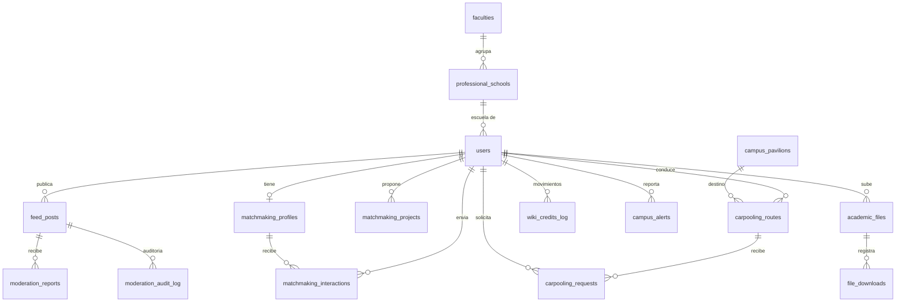

# Datos y propiedad por dominio

Qué datos guarda el sistema, quién los usa hoy y qué servicio sería su dueño en la arquitectura propuesta. El esquema corresponde a las cinco migraciones de [src/database/migrations/sql](../../apps/api/src/database/migrations/sql).

## Modelo relacional actual

Además existe `schema_migrations`, que registra las migraciones aplicadas ([migrator.ts](../../apps/api/src/database/migrations/migrator.ts)).

## Tablas: uso actual

«En uso por la API» significa que algún módulo de [src/modules](../../apps/api/src/modules) la lee o escribe.

| Tabla | Migración | En uso por la API | Observación |
|---|---|---|---|
| `users` | 001 | Sí: `auth`, `users`, `feed`, `matchmaking`, `carpooling` | Tabla más compartida del sistema |
| `faculties`, `professional_schools`, `campus_pavilions` | 001 | Sí: `catalogs`, `auth`, `carpooling` | Se cargan con `npm run db:catalogs` |
| `feed_posts` | 001 | Sí: `feed` | |
| `matchmaking_profiles`, `matchmaking_interactions` | 002 | Sí: `matchmaking` | No hay API para crear perfiles |
| `matchmaking_projects` | 002 | Solo lectura: `matchmaking` | No hay API para crear proyectos |
| `carpooling_routes`, `carpooling_requests` | 004 | Sí: `carpooling` | No hay API para crear rutas |
| `academic_files`, `file_downloads`, `wiki_credits_log` | 003 | **No** | Esquema y disparador listos, sin módulo |
| `moderation_reports`, `moderation_audit_log` | 004 | **No** | Esquema y disparador listos, sin módulo |
| `campus_alerts` | 005 | **No** | Las alertas del radar se guardan en Redis, no en esta tabla |
| `schema_migrations` | Migrador | Solo el migrador | |

Tres grupos de tablas existen sin código que las use. No deben contarse como funcionalidad implementada.

## Lógica dentro de la base de datos

| Objeto | Qué hace | Dominio que cruza | Evidencia |
|---|---|---|---|
| Disparador `trg_process_file_download` | Al insertar una descarga, cobra créditos al comprador, los abona al dueño y registra ambos movimientos | Recursos modifica `users` | [003_credits_and_wiki.sql](../../apps/api/src/database/migrations/sql/003_credits_and_wiki.sql) |
| Disparador `trg_auto_suppress_reported_post` | Al tercer reporte activo por el mismo motivo, oculta la publicación y la registra en auditoría | Moderación modifica `feed_posts` | [004_moderation_and_carpooling.sql](../../apps/api/src/database/migrations/sql/004_moderation_and_carpooling.sql) |
| Restricción `chk_users_institutional_email` | Exige dominio `@unsch.edu.pe` | — | [001_base_schema.sql](../../apps/api/src/database/migrations/sql/001_base_schema.sql) |
| Índice único parcial `uq_active_carpooling_request` | Una sola solicitud activa por ruta y pasajero | — | [005_canonical_extensions.sql](../../apps/api/src/database/migrations/sql/005_canonical_extensions.sql) |

Ninguno de los dos disparadores se ejecuta hoy en uso normal, porque ninguna ruta inserta en esas tablas.

## Datos en Redis

Solo el radar usa Redis ([radar.repository.ts](../../apps/api/src/modules/radar/radar.repository.ts)).

| Patrón de clave | Tipo | Contenido | Vigencia |
|---|---|---|---|
| `radar:<nodo>:reports:<estado>` | Conjunto | Identificadores de los usuarios que votaron ese estado | 900 s desde el último voto |
| `radar:comedor:status`, `radar:rectorado:status`, `radar:campus_alert:status` | Hash | Estado vigente, número de reportes y marca de tiempo | 900 s |
| `radar:biblioteca:floor:<n>:occupancy` | Hash | Porcentaje de aforo del piso | 900 s |

Todos los datos de Redis son efímeros y reconstruibles: si se pierden, el radar muestra «indefinido» hasta que haya nuevos reportes. No hay copia de estos datos en PostgreSQL.

## Datos en el navegador

| Clave de `localStorage` | Contenido | Naturaleza |
|---|---|---|
| `token`, `user` | Sesión | Real; copia de la respuesta de inicio de sesión |
| `carpooling_routes_list`, `academic_files`, `downloaded_files`, `user_credits`, `marketplace_items`, `moderation_reports_list` | Datos de las pantallas simuladas | Simulado; no se comparte entre usuarios ni dispositivos |
| `privacy_settings`, `notif_settings` | Preferencias | Simulado |

## Propiedad propuesta

> **Estado: Propuesto.** Hoy no hay propiedad: todos los módulos comparten una base y una credencial.

Ser **dueño** de un dato significa ser el único servicio que lo escribe y la única fuente autorizada para leerlo.

| Dato | Dueño propuesto | Quién más lo necesita | Cómo lo obtendría |
|---|---|---|---|
| `users` (credenciales, rol, escuela, términos, contacto) | Identidad | Comunidad, Movilidad, Recursos | Identificador y rol en el token; el resto por contrato |
| `faculties`, `professional_schools`, `campus_pavilions` | Identidad | Todos | Consulta de catálogos; admite caché por su baja frecuencia de cambio |
| Claves `radar:*` | Radar | Nadie | — |
| `feed_posts`, `matchmaking_*`, `moderation_*` | Comunidad | Nadie | — |
| `carpooling_routes`, `carpooling_requests` | Movilidad | Nadie | — |
| `academic_files`, `file_downloads`, `wiki_credits_log` | Recursos | Nadie | — |
| Saldo de créditos (`users.credits_balance`, `users.wiki_credits_penalty`) | Recursos | Identidad lo devuelve hoy en el inicio de sesión | Debe salir de `users`; ver abajo |
| `campus_alerts` | Por decidir | — | Tabla sin uso: decidir si se elimina o si Radar la adopta como histórico |

## Conflictos que hay que resolver antes de separar datos

| Conflicto | Detalle | Etapa en que se aborda |
|---|---|---|
| El saldo de créditos vive en `users` | Lo modificaría Recursos, pero la tabla es de Identidad. El disparador actual lo actualiza en la misma transacción que la descarga | 7 |
| Columnas de ciclo académico duplicadas | `users` tiene `current_academic_cycle` y `academic_cycle`; carpooling las combina con `COALESCE` | 5 |
| Valor inicial de créditos contradictorio | El esquema define 5 por defecto; el registro inserta 0 explícitamente ([auth.repository.ts](../../apps/api/src/modules/auth/auth.repository.ts)) | 7 |
| Claves foráneas hacia `users` desde todos los dominios | Se pierden al separar bases; la integridad pasa a depender del código | 5 a 7 |
| Borrado en cascada | Eliminar un usuario borra hoy sus publicaciones, perfiles, rutas y solicitudes | Requiere un evento «usuario eliminado» si los datos se separan |
| Datos de contacto en la confirmación de carpooling | Se leen dentro de la transacción | 6 |

## Orden propuesto de separación de datos

1. Radar: ya está separado físicamente (Redis).
2. Permisos por dominio dentro de la misma base: un usuario de base de datos por servicio, limitado a sus tablas.
3. Sustituir los `JOIN` hacia `users` por contratos o copias.
4. Retirar las claves foráneas entre dominios.
5. Separación física, solo si aporta un beneficio demostrado.

Los pasos 2 a 5 son propuestos. Las instrucciones de respaldo y validación previas a cualquier cambio de datos están en [Proceso de entrega](../05-despliegue-y-operacion/03-proceso-de-entrega.md).

[← Índice](../README.md)
