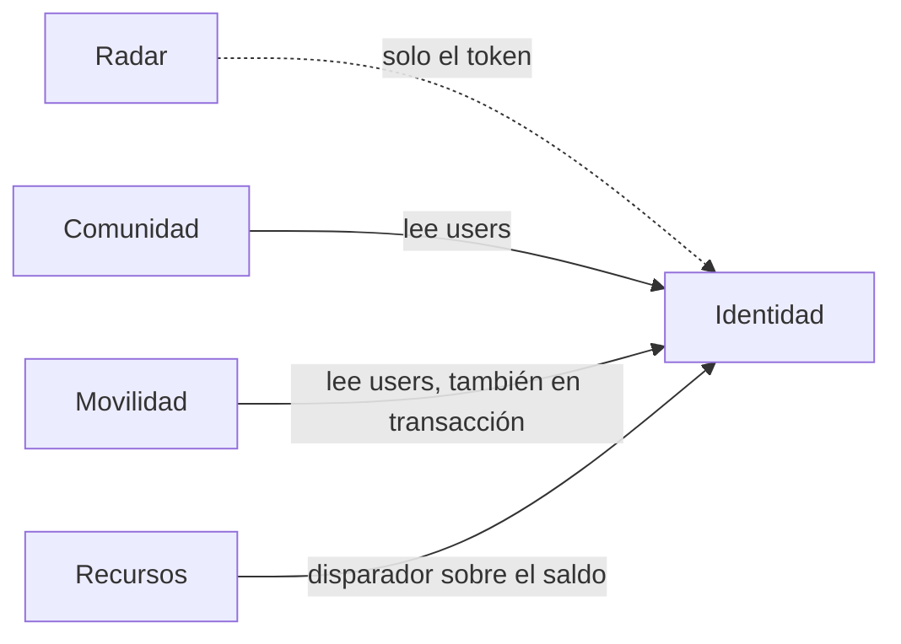

# Dominios del sistema

Un **dominio** es un área del negocio con reglas y datos propios. Aquí se identifican los de SOCIAL-UNSCH y se distingue el límite que existe en el código del que solo está propuesto.

| Dominio | Qué resuelve | Módulos actuales | Datos | Límite real | Dificultad de extracción |
|---|---|---|---|---|---|
| Identidad | Cuentas, sesión, términos, catálogos | `auth`, `users`, `catalogs` | `users`, `faculties`, `professional_schools`, `campus_pavilions` | Módulos separados; `users` es la tabla más compartida | Alta |
| Radar | Estado del campus por consenso | `radar`; `apps/radar` sin desplegar | Redis `radar:*` | Fuerte: sin SQL ni dependencias de otros módulos | Baja |
| Comunidad | Publicaciones y búsqueda de compañeros | `feed`, `matchmaking` | `feed_posts`, `matchmaking_*` | Parcial: `JOIN` con `users` | Media |
| Movilidad | Rutas y reservas | `carpooling` | `carpooling_*` | Parcial: contactos de `users` dentro de una transacción | Alta |
| Recursos y créditos | Material académico y saldo | Ninguno | `academic_files`, `file_downloads`, `wiki_credits_log`, `users.credits_balance` | Solo en esquema y disparadores | Por construir |

Las dificultades son estimaciones por análisis del código, no mediciones.

## Áreas sin dominio asignado

| Área | Situación |
|---|---|
| Moderación | Tablas y disparador sin API. La propuesta la ubica en Comunidad |
| Marketplace y empleo | Solo pantallas simuladas, sin tablas. Sin decisión sobre si forman parte del producto |

## Relaciones entre dominios

Línea discontinua: sin acceso a datos, solo verifica el token. Línea continua: acoplamiento por base de datos.

## Estado de los límites

| Límite | Estado | Evidencia |
|---|---|---|
| Módulos sin importaciones entre sí | IMPLEMENTADO | Regla `modulos-aislados` en [check-boundaries.js](../../scripts/check-boundaries.js) |
| Radar sin SQL | IMPLEMENTADO | Reglas `radar-sin-conexiones` y `radar-sin-pg` |
| Contratos por dominio | IMPLEMENTADO PARCIALMENTE | Solo Radar y el formato de error en [packages/contracts](../../packages/contracts/src/index.ts) |
| Propiedad de datos por dominio | PROPUESTO | Una sola `DATABASE_URL`; ver [Datos y propiedad por dominio](06-datos-y-propiedad-por-dominio.md) |

Ver también: [Componentes y dependencias](03-componentes-y-dependencias.md) · [Arquitectura objetivo](05-arquitectura-objetivo.md) · [Trazabilidad C4](../04-modelo-c4/07-trazabilidad-c4.md)

[← Índice](../README.md)
