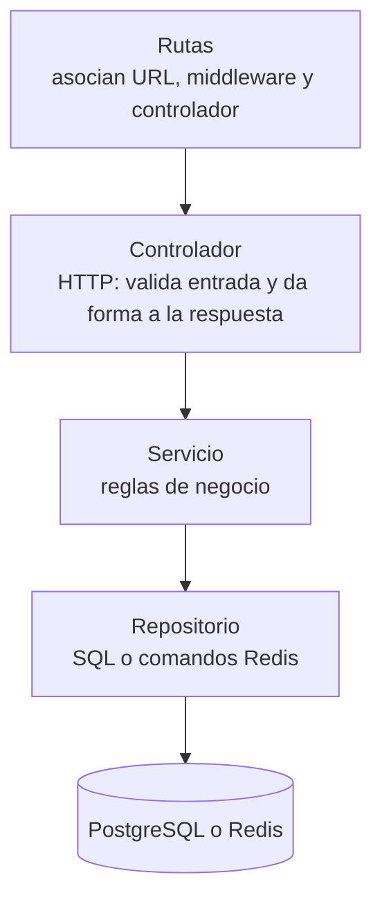
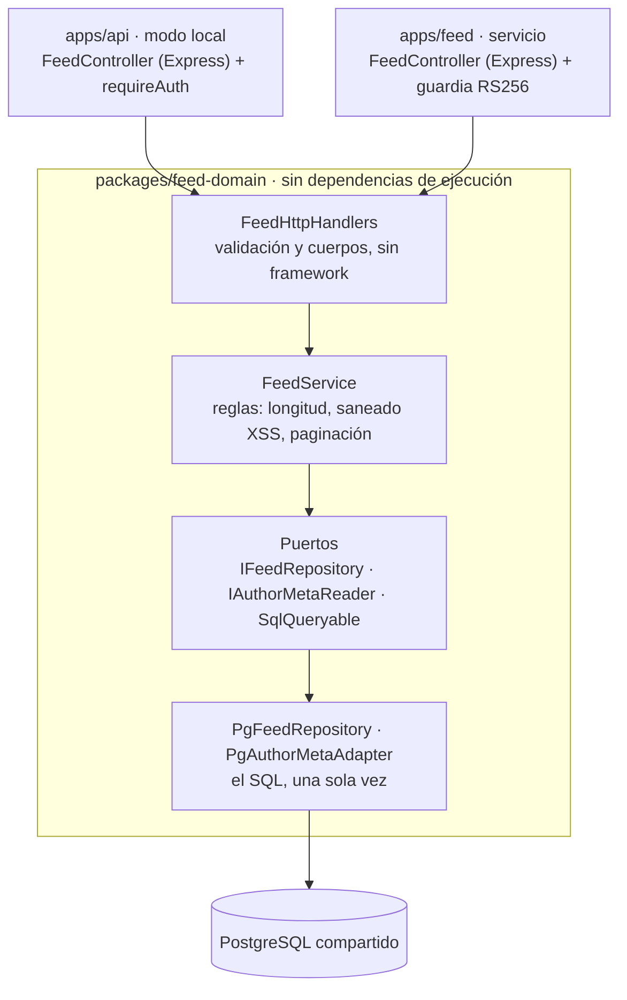

# Enfoque arquitectónico

En Social-UNSCH, las capas separan el acceso HTTP, las reglas de negocio y la persistencia. Radar y Feed van más allá: definen puertos que permiten cambiar su almacenamiento, y Feed además comparte su dominio entre dos procesos.

## Enfoque interno actual: capas

El flujo habitual de una petición de escritura parte de la ruta y termina en el repositorio.

Esto es lo que hay en seis de los siete módulos. Ejemplo con `matchmaking`: ruta → controlador → servicio → repositorio.

La excepción es `catalogs`, cuyo controlador consulta la base directamente ([catalogs.controller.ts](../../apps/api/src/modules/catalogs/catalogs.controller.ts)).

### El caso de Feed: un dominio compartido por dos procesos

Feed sigue las mismas capas, pero no viven en el módulo de la API: están en [`packages/feed-domain`](../../packages/feed-domain/src/index.ts), que usan tanto la API en modo local como el servicio `apps/feed`.

Los manejadores devuelven `{ status, body }` en lugar de escribir en la respuesta, así que no necesitan Express y cada proceso aporta un adaptador de unas quince líneas. El acceso a datos entra por `SqlQueryable`, un puerto estructural que `pg.Pool` satisface sin que el paquete importe `pg`: eso mantiene la regla `feed-domain-puro` de [check-boundaries.js](../../scripts/check-boundaries.js).

**Lo único que difiere entre los dos modos** es de dónde sale el identificador del usuario (`req.user.user_id` en la API, `req.user.userId` en el servicio), porque cada proceso verifica el token con su propio middleware. Todo lo demás —validación, códigos de error, SQL, mensajes— es el mismo código.

## Por qué no es arquitectura hexagonal

> **Estado: IMPLEMENTACIÓN PARCIAL / DIRECCIÓN ARQUITECTÓNICA PROPUESTA.** Desde la etapa 3 Radar tiene un puerto (`RadarStore`) e inyección por constructor, y desde las etapas 6 a 8 Feed cumple las tres condiciones. El análisis que sigue describe **los cinco módulos restantes**. Detalle en [C4, nivel de código](../04-modelo-c4/Nivel4-DiagramadeCodigo.md#e-nivel-de-código-y-arquitectura-hexagonal).

La **arquitectura hexagonal** (o de puertos y adaptadores) coloca las reglas de negocio en el centro y hace que todo lo externo dependa de ellas. El centro define **puertos**, que son interfaces que expresan lo que necesita; los **adaptadores** las implementan para una tecnología concreta. La **Arquitectura Limpia** sigue la misma regla de dependencias con más capas nombradas.

Tener controladores, servicios y repositorios no basta para llamarla hexagonal. Se comprobaron tres condiciones:

| Condición | Radar | Feed | Los otros cinco módulos |
|---|---|---|---|
| ¿El negocio define interfaces para sus dependencias? | Sí: `RadarStore` | Sí: `IFeedRepository`, `IAuthorMetaReader`, `SqlQueryable` en [ports.ts](../../packages/feed-domain/src/ports.ts) y [sql.ts](../../packages/feed-domain/src/sql.ts) | No |
| ¿Las dependencias apuntan hacia el negocio? | Sí | Sí: el paquete no importa `pg`, `express` ni nada de las aplicaciones; son ellas las que lo importan | No: el servicio importa la clase concreta del repositorio, y este el pool |
| ¿Hay un punto de composición que conecte las piezas? | Sí: [composition.ts](../../apps/api/src/composition.ts) | Sí: [composition.ts](../../apps/api/src/composition.ts) y [feed.module.ts](../../apps/feed/src/modules/feed/feed.module.ts) | No: crean su dependencia con `new` en un campo privado |

Evidencia del caso contrario: `private matchmakingRepository = new MatchmakingRepository()` en [matchmaking.service.ts](../../apps/api/src/modules/matchmaking/matchmaking.service.ts), con el mismo patrón en `auth`, `users` y `carpooling`.

Además, algunas reglas de negocio están fuera de los servicios: en SQL dentro de los repositorios (la máquina de estados del matchmaking, en [matchmaking.repository.ts](../../apps/api/src/modules/matchmaking/matchmaking.repository.ts)), en un script de Redis (el consenso del radar) y en disparadores de la base de datos (créditos y moderación).

Conclusión: **Radar y Feed sí cumplen el patrón de puertos y adaptadores; los otros cinco módulos siguen en capas con dependencias directas hacia la infraestructura.** Decir que el sistema «es hexagonal» sería inexacto, y decir que «no lo es en ningún sitio» también. La dirección está validada en los dos dominios extraídos y sigue **propuesta** para el resto.

En las [pruebas de Radar](../../apps/api/tests/unit/radar.service.test.ts) se entrega un cliente Redis de prueba al repositorio; en las de [Feed](../../packages/feed-domain/tests/pg-feed.repository.test.ts) basta un objeto con un método `query`, sin tocar `pg`. Los servicios con dependencias concretas siguen requiriendo mocks del módulo de configuración.

[Estilo arquitectónico](estilo-arquitectonico.md) · [Índice](../README.md)
