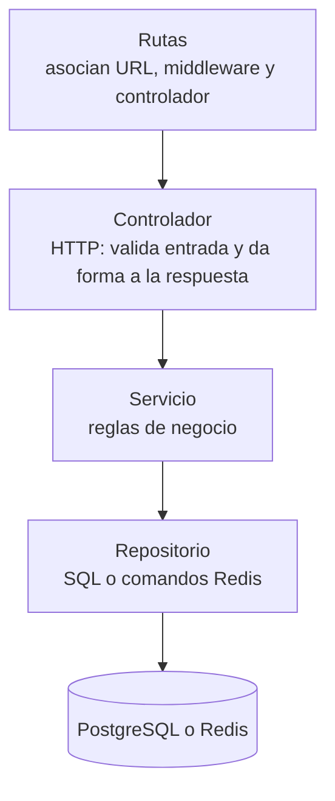

# Enfoque arquitectónico

En Social-UNSCH, las capas separan el acceso HTTP, las reglas de negocio y la persistencia. Radar también define un puerto que permite cambiar su almacenamiento durante las pruebas.

## Enfoque interno actual: capas

El flujo habitual de una petición de escritura parte de la ruta y termina en el repositorio.

Esto es lo que hay en seis de los siete módulos. Ejemplo: [feed.routes.ts](../../apps/api/src/modules/feed/feed.routes.ts) → [feed.controller.ts](../../apps/api/src/modules/feed/feed.controller.ts) → [feed.service.ts](../../apps/api/src/modules/feed/feed.service.ts) → [feed.repository.ts](../../apps/api/src/modules/feed/feed.repository.ts).

La excepción es `catalogs`, cuyo controlador consulta la base directamente ([catalogs.controller.ts](../../apps/api/src/modules/catalogs/catalogs.controller.ts)).

## Por qué no es arquitectura hexagonal

> **Estado: IMPLEMENTACIÓN PARCIAL / DIRECCIÓN ARQUITECTÓNICA PROPUESTA.** Desde la etapa 3, Radar tiene un puerto (`RadarStore`) e inyección por constructor; el resto del análisis describe los demás módulos. Detalle en [C4, nivel de código](../04-modelo-c4/Nivel4-DiagramadeCodigo.md#e-nivel-de-código-y-arquitectura-hexagonal).

La **arquitectura hexagonal** (o de puertos y adaptadores) coloca las reglas de negocio en el centro y hace que todo lo externo dependa de ellas. El centro define **puertos**, que son interfaces que expresan lo que necesita; los **adaptadores** las implementan para una tecnología concreta. La **Arquitectura Limpia** sigue la misma regla de dependencias con más capas nombradas.

Tener controladores, servicios y repositorios no basta para llamarla hexagonal. Se comprobaron tres condiciones:

| Condición | Qué se encontró | Evidencia |
|---|---|---|
| ¿El negocio define interfaces para sus dependencias? | Solo en Radar: `RadarStore`, declarada junto a su adaptador. En los demás módulos, no | [radar.repository.ts](../../apps/api/src/modules/radar/radar.repository.ts) |
| ¿Las dependencias apuntan hacia el negocio? | No. El servicio importa la clase concreta del repositorio, y este importa el pool | `import { FeedRepository } from './feed.repository'` en [feed.service.ts](../../apps/api/src/modules/feed/feed.service.ts) |
| ¿Hay un punto de composición que conecte las piezas? | Solo para Radar y las conexiones: [composition.ts](../../apps/api/src/composition.ts). Los demás crean su dependencia con `new` en un campo privado | `private feedRepository = new FeedRepository()` en [feed.service.ts](../../apps/api/src/modules/feed/feed.service.ts) |

Además, algunas reglas de negocio están fuera de los servicios: en SQL dentro de los repositorios (la máquina de estados del matchmaking, en [matchmaking.repository.ts](../../apps/api/src/modules/matchmaking/matchmaking.repository.ts)), en un script de Redis (el consenso del radar) y en disparadores de la base de datos (créditos y moderación).

Conclusión: el sistema es **en capas**, con dependencias directas hacia la infraestructura salvo en Radar. La arquitectura hexagonal es una dirección **propuesta**, no una descripción del código actual.

En las [pruebas de Radar](../../apps/api/tests/unit/radar.service.test.ts), un cliente Redis de prueba se entrega al repositorio. Los servicios con dependencias concretas suelen requerir mocks del módulo de configuración.

[Estilo arquitectónico](estilo-arquitectonico.md) · [Índice](../README.md)
