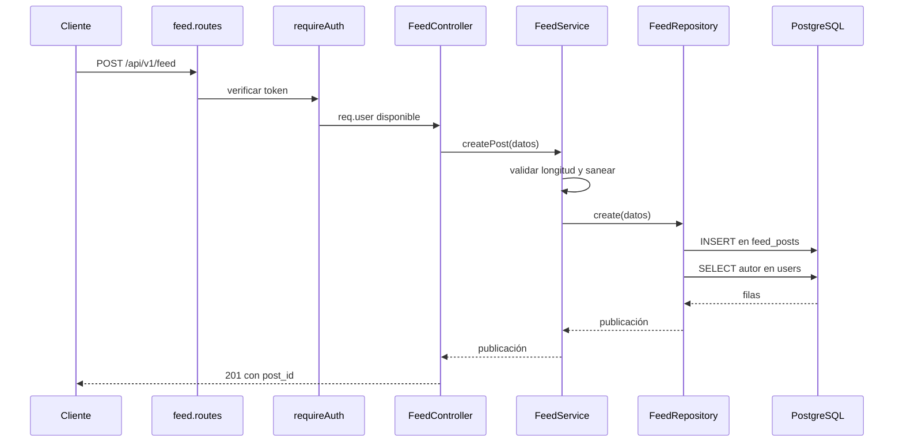

# Organización interna

Cómo está ordenado el código del backend por dentro. Descrito en el commit `8e56bfa` y actualizado con la etapa 3 ([ETAPA_03](../migracion/ETAPA_03_PREPARACION_SEPARACION.md)), que movió el backend a `apps/api` y separó composición y arranque.

## Estructura de directorios

```text
apps/api/src/
├── server.ts              Punto de entrada: valida configuración, arranca y atiende SIGTERM/SIGINT
├── bootstrap.ts           startServer(): escucha y cierra conexiones al detenerse
├── composition.ts         Único lugar que crea conexiones (Redis) y elige radar local o proxy
├── app.ts                 createApp(dependencias): middlewares, salud y enrutadores
├── health/                /health/live y /health/ready
├── config/                Configuración, conexiones y JWT
│   ├── env.ts             Validación de variables al arrancar
│   ├── load-env.ts        Carga de apps/api/.env (y .env de la raíz por compatibilidad)
│   ├── database.ts        Pool de PostgreSQL
│   ├── redis.ts           createRedisClient(): no conecta al importarse
│   ├── jwt.ts             Firma y verificación de tokens
│   └── generate_keys.ts   Utilidad para generar un par de claves
├── middlewares/
│   ├── auth.middleware.ts   requireAuth
│   └── error.middleware.ts  Traducción de errores a HTTP
├── shared/
│   ├── auth/roles.ts        Política de roles de registro
│   ├── errors/AppError.ts   Error de negocio tipado
│   └── constants/           Catálogos de la universidad
├── modules/               Un directorio por dominio
│   ├── auth/  users/  radar/ (incluye radar.module.ts y radar.proxy.ts)  feed/
│   ├── matchmaking/  carpooling/  catalogs/
└── database/migrations/   Migrador, catálogos, seed y SQL
```

## Anatomía de un módulo

Seis de los siete módulos tienen los mismos cuatro archivos.

| Archivo | Responsabilidad | No debería |
|---|---|---|
| `<modulo>.routes.ts` | Asociar método y ruta con middleware y controlador | Contener lógica |
| `<modulo>.controller.ts` | Leer la solicitud, validar su forma, llamar al servicio y construir la respuesta HTTP | Acceder a la base de datos |
| `<modulo>.service.ts` | Aplicar reglas de negocio y traducir fallos a `AppError` | Conocer `req` o `res` |
| `<modulo>.repository.ts` | Ejecutar SQL o comandos Redis y devolver datos tipados | Decidir códigos HTTP |

`auth` añade `auth.validators.ts` con esquemas Zod. `catalogs` solo tiene rutas y controlador.

Recorrido de una solicitud, con el feed como ejemplo:



Archivos: [feed.routes.ts](../../apps/api/src/modules/feed/feed.routes.ts), [feed.controller.ts](../../apps/api/src/modules/feed/feed.controller.ts), [feed.service.ts](../../apps/api/src/modules/feed/feed.service.ts), [feed.repository.ts](../../apps/api/src/modules/feed/feed.repository.ts).

## Cómo se conectan las piezas

No hay contenedor de dependencias ni punto de composición. Cada clase crea la siguiente al definirse:

| Dónde | Qué crea |
|---|---|
| Archivo de rutas | `new XController()` |
| Controlador | `private xService = new XService()` |
| Servicio | `private xRepository = new XRepository()` |
| Repositorio | Importa `pool` o `redis` desde `config` |

Las conexiones (`pool`, `redis`) son objetos únicos del proceso, creados al importar su módulo de configuración. La conexión a Redis se abre en ese momento; la de PostgreSQL, al ejecutar la primera consulta.

## Cumplimiento real de las capas

La separación se respeta en general, con estas desviaciones observadas:

| Desviación | Dónde | Evidencia |
|---|---|---|
| Controlador que consulta la base | `catalogs` | [catalogs.controller.ts](../../apps/api/src/modules/catalogs/catalogs.controller.ts) |
| Ruta con lógica en línea | `GET /auth/profile-me` responde desde el archivo de rutas | [auth.routes.ts](../../apps/api/src/modules/auth/auth.routes.ts) |
| Controladores que construyen respuestas de error sin pasar por `AppError` | Comprobaciones de usuario ausente y de parámetros en `feed`, `radar`, `carpooling`, `matchmaking` y `users` | Por ejemplo, [radar.controller.ts](../../apps/api/src/modules/radar/radar.controller.ts) |
| Reglas de negocio en el repositorio | La máquina de estados del matchmaking y las comprobaciones de la confirmación de asiento están dentro de transacciones SQL | [matchmaking.repository.ts](../../apps/api/src/modules/matchmaking/matchmaking.repository.ts), [carpooling.repository.ts](../../apps/api/src/modules/carpooling/carpooling.repository.ts) |
| Reglas de negocio en el almacén | Consenso del radar en un script Lua; créditos y moderación en disparadores | [radar.repository.ts](../../apps/api/src/modules/radar/radar.repository.ts), [003_credits_and_wiki.sql](../../apps/api/src/database/migrations/sql/003_credits_and_wiki.sql) |
| Código de prueba dentro del código de producción | Parámetro `injectedFailure` y cliente alternativo cuando `pool.connect` no existe | [carpooling.repository.ts](../../apps/api/src/modules/carpooling/carpooling.repository.ts), [carpooling.service.ts](../../apps/api/src/modules/carpooling/carpooling.service.ts) |

Colocar una regla dentro de una transacción o de un script atómico no es en sí un defecto: es la forma de garantizar que la comprobación y el cambio ocurran juntos. El costo es que la regla queda ligada a la tecnología de almacenamiento.

El parámetro `injectedFailure` no es alcanzable desde HTTP: el controlador no lo pasa. Aun así, es código de prueba que viaja a producción.

## Convenciones de código observadas

| Convención | Detalle |
|---|---|
| Nombres de archivo | `<modulo>.<capa>.ts` |
| Clases | Una clase por archivo de capa; métodos de controlador como funciones flecha para conservar `this` |
| Consultas | Parametrizadas; muchas con nombre (`name`) para reutilizar el plan en PostgreSQL |
| Errores | `AppError(mensaje, estado, código)`; códigos con prefijo `ERR_` |
| Transacciones | Cliente dedicado del pool con `BEGIN`, `COMMIT` y `ROLLBACK` en `try/catch/finally` |
| Idioma | Mensajes al usuario y comentarios en español; identificadores en inglés |

## Organización del frontend

| Ubicación | Contenido |
|---|---|
| [app/(auth)](../../apps/web/app/%28auth%29) | Inicio de sesión y registro |
| [app/(dashboard)](../../apps/web/app/%28dashboard%29) | Pantallas tras iniciar sesión, con un `layout` común |
| [components/ui](../../apps/web/components/ui) | 19 componentes; mezclan presentación con llamadas a la API o a `localStorage` |
| [app/lib/api.ts](../../apps/web/app/lib/api.ts) | Cliente HTTP |
| [app/lib/unsch.constants.ts](../../apps/web/app/lib/unsch.constants.ts) | Catálogos y valores permitidos |

No hay capa de servicios ni gestor de estado en el frontend: cada componente llama directamente al cliente HTTP o a `localStorage`.

## Organización propuesta

> **Estado: Propuesto.**

Para los servicios futuros se propone la estructura hexagonal descrita en [Arquitectura objetivo](../02-arquitectura-de-software/05-arquitectura-objetivo.md): un núcleo con casos de uso y puertos, adaptadores de entrada y salida, y un único archivo de composición por servicio. Los módulos existentes no necesitan reescribirse antes de migrar; la reorganización puede hacerse al extraer cada uno.

[← Índice](../README.md)
