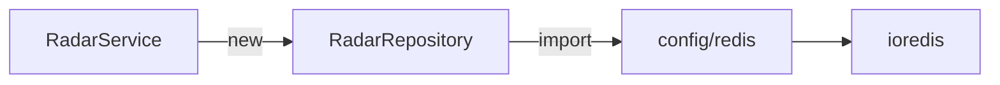
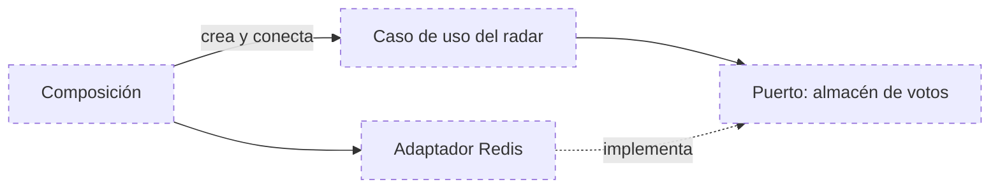

# Principios SOLID

> **Actualización 2026-10-30.** Este documento conserva su análisis original. Desde entonces: Radar recibe sus dependencias por constructor y tiene el puerto `RadarStore`; existe composición explícita en `composition.ts`. Ver [C4, nivel de código](../04-modelo-c4/04-codigo-y-secuencias.md).

SOLID agrupa cinco principios de diseño orientado a objetos. Para cada uno se indica dónde se cumple en el código, dónde solo en parte y qué se recomienda. Las recomendaciones no están implementadas.

## Resumen

| Principio | Cumplimiento observado |
|---|---|
| S: responsabilidad única | Bueno a nivel de archivo; con excepciones |
| O: abierto a extensión, cerrado a modificación | Parcial |
| L: sustitución de Liskov | Apenas aplicable: casi no hay herencia |
| I: segregación de interfaces | No aplicable hoy: no hay interfaces de comportamiento |
| D: inversión de dependencias | No se cumple |

## S: responsabilidad única

Cada pieza debería tener un solo motivo para cambiar.

**Se cumple:**

| Ejemplo | Por qué | Archivo |
|---|---|---|
| `errorMiddleware` | Su única tarea es convertir un error en una respuesta HTTP | [error.middleware.ts](../../apps/api/src/middlewares/error.middleware.ts) |
| `requireAuth` | Solo verifica el token y adjunta la identidad | [auth.middleware.ts](../../apps/api/src/middlewares/auth.middleware.ts) |
| `UsersRepository` | Una consulta, sin reglas | [users.repository.ts](../../apps/api/src/modules/users/users.repository.ts) |
| `roles.ts` | Concentra la política de qué roles admite el registro | [roles.ts](../../apps/api/src/shared/auth/roles.ts) |
| Migrador, carga de catálogos y seed | Tres archivos para tres tareas que antes iban juntas | [migrator.ts](../../apps/api/src/database/migrations/migrator.ts), [load_catalogs.ts](../../apps/api/src/database/migrations/load_catalogs.ts), [load_demo_seed.ts](../../apps/api/src/database/migrations/load_demo_seed.ts) |

**Se cumple en parte:**

| Caso | Responsabilidades mezcladas | Archivo |
|---|---|---|
| `MatchmakingRepository.submitInteraction` | Acceso a datos y la decisión de qué estado corresponde (pendiente, aceptado, rechazado) | [matchmaking.repository.ts](../../apps/api/src/modules/matchmaking/matchmaking.repository.ts) |
| `CatalogsController` | Protocolo HTTP y consultas SQL | [catalogs.controller.ts](../../apps/api/src/modules/catalogs/catalogs.controller.ts) |
| `CarpoolingController` | Protocolo HTTP y una función de escape de caracteres | [carpooling.controller.ts](../../apps/api/src/modules/carpooling/carpooling.controller.ts) |
| `FeedService` | Reglas de publicación y saneamiento de HTML | [feed.service.ts](../../apps/api/src/modules/feed/feed.service.ts) |
| `RadarService` | Reglas del radar y el catálogo de valores permitidos, escrito dentro de la clase | [radar.service.ts](../../apps/api/src/modules/radar/radar.service.ts) |
| Componentes del frontend | Presentación, estado y acceso a datos en el mismo componente | Por ejemplo, [CampusRadar.tsx](../../apps/web/components/ui/CampusRadar.tsx) |

**Recomendación:** llevar las funciones de escape a un único lugar compartido (hoy hay dos implementaciones distintas, en `feed.service.ts` y `carpooling.controller.ts`) y mover los valores permitidos del radar a las constantes compartidas, que ya los definen.

## O: abierto/cerrado

Debería poder añadirse comportamiento sin modificar el código existente.

**Se cumple:**

| Ejemplo | Cómo | Archivo |
|---|---|---|
| Nuevos módulos | Añadir un dominio consiste en crear su directorio y registrar una línea en `app.ts`; los demás módulos no cambian | [app.ts](../../apps/api/src/app.ts) |
| Nuevas migraciones | Añadir un archivo numerado en `sql/` basta; el migrador las descubre | [migrator.ts](../../apps/api/src/database/migrations/migrator.ts) |
| Nuevos errores de negocio | Se crean instancias de `AppError` sin tocar el middleware | [AppError.ts](../../apps/api/src/shared/errors/AppError.ts) |

**No se cumple:**

| Caso | Problema | Archivo |
|---|---|---|
| Añadir un punto al radar | Hay que modificar la lista de nodos, añadir una rama al `if/else` de validación y otra consulta al *pipeline* de lectura | [radar.service.ts](../../apps/api/src/modules/radar/radar.service.ts), [radar.repository.ts](../../apps/api/src/modules/radar/radar.repository.ts) |
| Traducción de errores del repositorio | Cadenas de `if` que comparan mensajes de texto (`'ROUTE_NOT_FOUND'`, etc.) | [carpooling.service.ts](../../apps/api/src/modules/carpooling/carpooling.service.ts) |

**Recomendación:** describir cada punto del radar con una tabla de configuración (nombre, tipo de valor, valores permitidos, clave) recorrida por un único algoritmo; y sustituir los mensajes de texto por errores de dominio con tipo propio.

## L: sustitución de Liskov

Un subtipo debe poder usarse donde se espera su tipo base sin alterar el comportamiento.

En el código solo hay una relación de herencia: `AppError` extiende `Error` ([AppError.ts](../../apps/api/src/shared/errors/AppError.ts)). Se comporta correctamente como un `Error`, y restablece la cadena de prototipos para que `instanceof` funcione, de lo que depende el middleware de errores.

No hay más jerarquías, así que el principio no tiene más casos que evaluar. Cobrará importancia si se introducen puertos con varias implementaciones: un adaptador en memoria para pruebas deberá respetar las mismas garantías que el real, por ejemplo la atomicidad del voto del radar.

## I: segregación de interfaces

Ningún consumidor debería depender de operaciones que no usa.

Las interfaces de TypeScript del código describen **datos** (`User`, `FeedPost`, `RouteDetail`, `TokenPayload`), no comportamiento. No hay interfaces de repositorio o de servicio que segregar.

Indicio de lo que ocurriría al introducirlas: `CarpoolingRepository` tiene métodos que ya nadie usa en el flujo actual, como `createRequest`, `deleteRequest` y `getPassengerMeta`, sustituidos por `createRequestTransaction` ([carpooling.repository.ts](../../apps/api/src/modules/carpooling/carpooling.repository.ts)). Una interfaz única heredaría ese exceso.

**Recomendación:** al definir puertos, hacerlos por caso de uso y no por tabla; y retirar los métodos sin uso.

## D: inversión de dependencias

El código de negocio no debería depender de detalles de infraestructura; ambos deberían depender de abstracciones.

**No se cumple.** La cadena de dependencias va del negocio a la infraestructura sin abstracciones intermedias:

| Evidencia | Archivo |
|---|---|
| `private radarRepository = new RadarRepository()` | [radar.service.ts](../../apps/api/src/modules/radar/radar.service.ts) |
| `import { redis } from '../../config/redis'` | [radar.repository.ts](../../apps/api/src/modules/radar/radar.repository.ts) |
| `AuthService` importa directamente `bcrypt` y `signAccessToken` | [auth.service.ts](../../apps/api/src/modules/auth/auth.service.ts) |

Consecuencia visible en las pruebas: para aislar un servicio hay que interceptar los módulos de configuración con `jest.mock('../../src/config/database')`, porque no hay forma de entregarle otra dependencia ([tests/unit](../../apps/api/tests/unit)).

Un caso parcial de inyección: `runMigrations`, `loadCatalogs` y `loadDemoSeed` aceptan un pool como parámetro opcional, lo que permite a las pruebas reales entregar el suyo ([migrator.ts](../../apps/api/src/database/migrations/migrator.ts)).

**Recomendación (coincide con la arquitectura objetivo):** que cada servicio reciba sus dependencias por constructor, tipadas con una interfaz definida junto al negocio.

Este segundo diagrama es una propuesta; ninguno de sus elementos existe.

[← Índice](../README.md)
