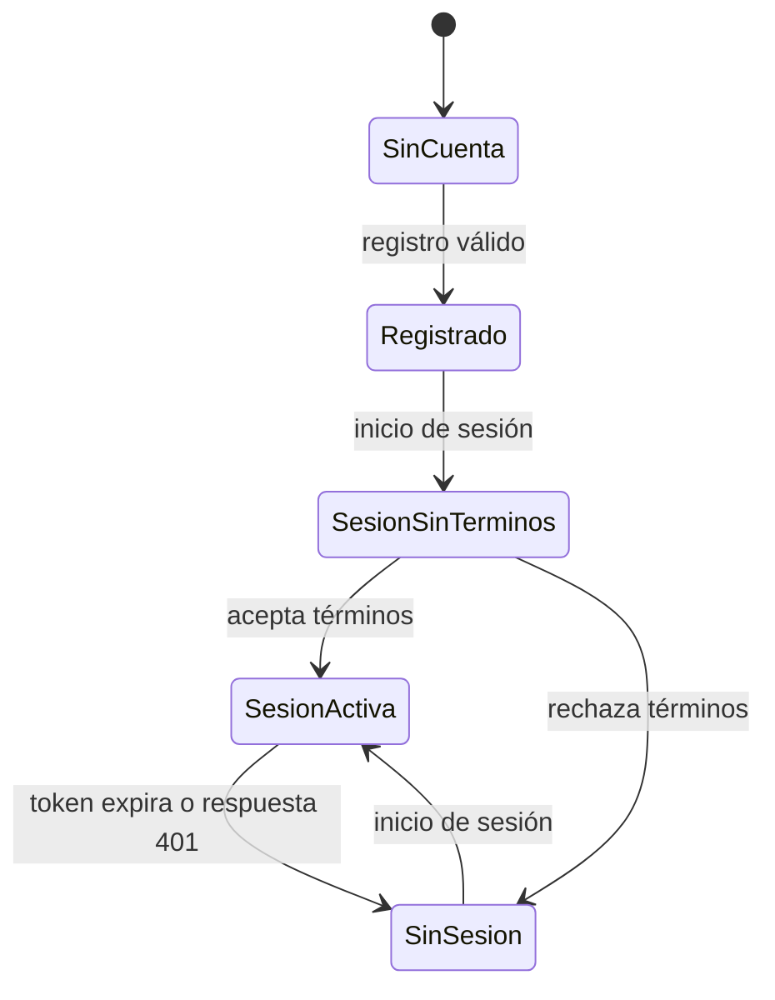
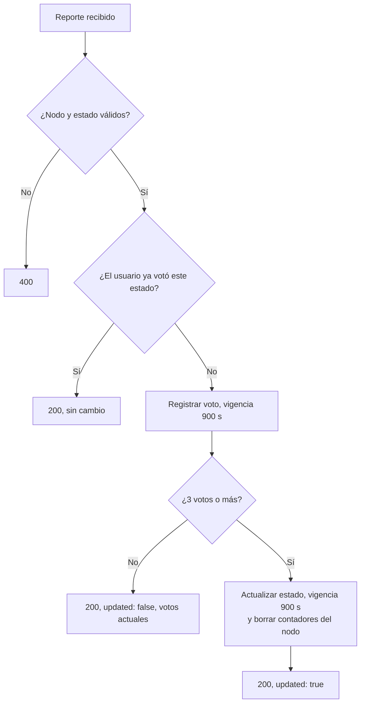
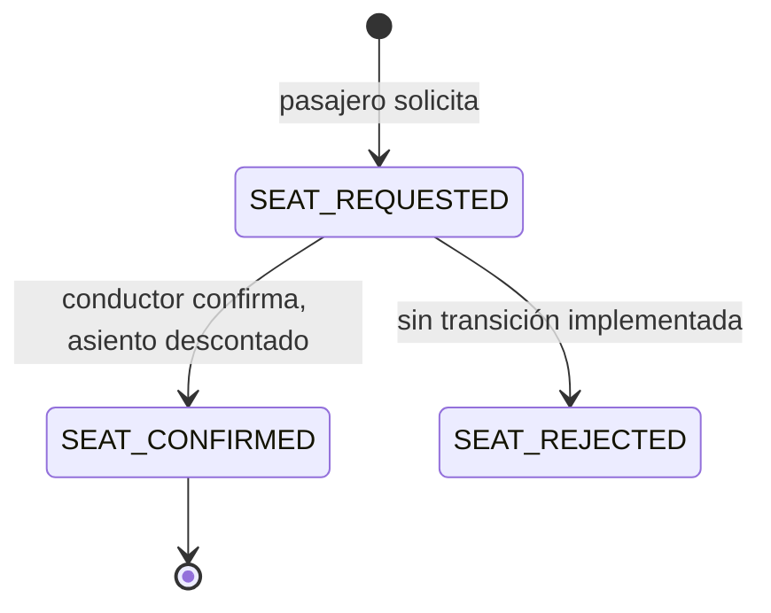
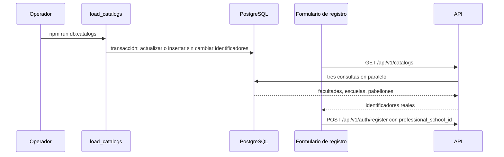

# Flujos principales

Cinco flujos implementados, con sus pasos, errores y persistencia según el código del commit `8e56bfa`. Los diagramas de secuencia detallados de dos de ellos están en [C4: código y secuencias](../04-modelo-c4/04-codigo-y-secuencias.md).

## 1. Registro e inicio de sesión

Archivos: [auth.controller.ts](../../apps/api/src/modules/auth/auth.controller.ts), [auth.validators.ts](../../apps/api/src/modules/auth/auth.validators.ts), [auth.service.ts](../../apps/api/src/modules/auth/auth.service.ts), [auth.repository.ts](../../apps/api/src/modules/auth/auth.repository.ts), [roles.ts](../../apps/api/src/shared/auth/roles.ts).

### Registro: `POST /api/v1/auth/register`

| Paso | Qué ocurre | Dónde |
|---|---|---|
| 1 | Se valida la forma: nombre, correo institucional, contraseña robusta, rol público, escuela y ciclo opcionales | `registerSchema` |
| 2 | Se vuelve a comprobar el rol con la política central | `assertPublicRegistrationRole` |
| 3 | Se busca si el correo ya existe | `findByEmail` |
| 4 | Se calcula el hash de la contraseña con bcrypt, costo 12 | `AuthService.register` |
| 5 | Se inserta el usuario con 0 créditos y términos sin aceptar | `AuthRepository.create` |
| 6 | Respuesta 201 con el identificador | Controlador |

| Error | Estado | Código |
|---|---|---|
| Datos con forma inválida | 400 | `ERR_VALIDATION_INVALID_FIELDS` |
| Correo ya registrado | 400 | `ERR_AUTH_EMAIL_EXISTS` |
| Rol administrador, si se salta el validador | 403 | `ERR_AUTH_FORBIDDEN_ROLE` |

Persistencia: una fila en `users`. El registro no inicia sesión: no devuelve token.

### Inicio de sesión: `POST /api/v1/auth/login`

| Paso | Qué ocurre |
|---|---|
| 1 | Se valida la forma del correo y la presencia de la contraseña |
| 2 | Se busca el usuario por correo, junto con la facultad de su escuela |
| 3 | Se compara la contraseña con el hash |
| 4 | Se firma un token RS256 de 24 horas con identificador, rol, escuela, facultad, ciclo y aceptación de términos |
| 5 | Respuesta 200 con el token y los datos básicos del usuario |

Correo inexistente y contraseña incorrecta devuelven la misma respuesta: 401 `ERR_AUTH_INVALID_CREDENTIALS`.

En el navegador, la pantalla guarda el token y el usuario en `localStorage` ([login/page.tsx](../../apps/web/app/%28auth%29/login/page.tsx)). Si el usuario no ha aceptado los términos, [RouteGuard.tsx](../../apps/web/components/ui/RouteGuard.tsx) muestra el aviso; al aceptar se llama a `PATCH /api/v1/users/accept-terms` y se actualiza la copia local ([TermsAgreementModal.tsx](../../apps/web/components/ui/TermsAgreementModal.tsx)).

El estado «sesión sin términos» solo lo hace cumplir el navegador.

## 2. Consulta y creación de publicaciones

Archivos: [feed.controller.ts](../../apps/api/src/modules/feed/feed.controller.ts), [feed.service.ts](../../apps/api/src/modules/feed/feed.service.ts), [feed.repository.ts](../../apps/api/src/modules/feed/feed.repository.ts).

### Consulta: `GET /api/v1/feed`

| Paso | Qué ocurre |
|---|---|
| 1 | Se leen `faculty_id`, `school_id`, `page` y `limit`; si alguno no es numérico, 400 |
| 2 | La página mínima es 1; el límite se acota entre 1 y 50, con 20 por defecto |
| 3 | Se consultan las publicaciones visibles, unidas con `users` para obtener nombre y rol, de la más reciente a la más antigua |

### Creación: `POST /api/v1/feed`

| Paso | Qué ocurre |
|---|---|
| 1 | El identificador del autor se toma del token, nunca del cuerpo |
| 2 | El contenido no puede estar vacío ni superar 2000 caracteres |
| 3 | Se escapan los caracteres especiales de HTML |
| 4 | Se inserta la publicación y, en una segunda consulta, se leen los datos del autor |
| 5 | Respuesta 201 con el identificador |

Persistencia: una fila en `feed_posts`. La inserción y la lectura del autor no están en una transacción; no hace falta, porque la segunda solo lee.

Observación: el contenido se guarda ya escapado. Como React escapa de nuevo al mostrar, un carácter como `<` puede verse como `&lt;` en pantalla. Es una inferencia a partir del código; no se comprobó en el navegador.

## 3. Interacción con el radar

Archivos: [radar.controller.ts](../../apps/api/src/modules/radar/radar.controller.ts), [radar.service.ts](../../apps/api/src/modules/radar/radar.service.ts), [radar.repository.ts](../../apps/api/src/modules/radar/radar.repository.ts), [CampusRadar.tsx](../../apps/web/components/ui/CampusRadar.tsx).

### Consulta: `GET /api/v1/radar/status`

Una sola ida y vuelta a Redis lee siete hashes: comedor, rectorado, cuatro pisos de biblioteca y alerta de campus. Un hash vacío o expirado se devuelve como `indefinido` con `is_definite: false`.

### Reporte: `POST /api/v1/radar/report`

| Paso | Qué ocurre | Dónde |
|---|---|---|
| 1 | Se exige `node` y `status` | Controlador |
| 2 | Se comprueba que el nodo sea uno de los siete permitidos | Servicio |
| 3 | Se comprueba que el estado sea válido para ese nodo; en biblioteca, un número de 0 a 100 | Servicio |
| 4 | Se ejecuta el script atómico | Repositorio |

El script, en una sola operación:

1. Si el usuario ya está en el conjunto de votantes de ese estado, termina sin contar.
2. Añade al usuario al conjunto y renueva su vigencia a 900 segundos.
3. Cuenta los votos.
4. Si hay 3 o más: escribe el estado en el hash del nodo con vigencia de 900 segundos y borra todos los conjuntos de votos de ese nodo.

| Error | Estado | Código |
|---|---|---|
| Falta `node` o `status` | 400 | `ERR_VALIDATION_INVALID_FIELDS` |
| Nodo no reconocido | 400 | `ERR_RADAR_INVALID_NODE` |
| Estado no válido para el nodo | 400 | `ERR_RADAR_INVALID_STATUS` |

Persistencia: solo Redis. Nada del radar llega a PostgreSQL.

Detalles de comportamiento que conviene conocer:

- Un voto repetido responde 200 con `votes_current: 0`, no con un error.
- El mismo usuario puede votar estados distintos del mismo nodo.
- En biblioteca, al alcanzarse el consenso se borran los contadores de una lista fija de porcentajes más el valor votado; contadores de otros valores no listados permanecen hasta expirar.

## 4. Solicitud y confirmación de carpooling

Archivos: [carpooling.controller.ts](../../apps/api/src/modules/carpooling/carpooling.controller.ts), [carpooling.service.ts](../../apps/api/src/modules/carpooling/carpooling.service.ts), [carpooling.repository.ts](../../apps/api/src/modules/carpooling/carpooling.repository.ts).

Este flujo existe en la API y está probado, pero **la pantalla no lo usa**.

### Solicitud: `POST /api/v1/carpooling/:route_id/request`

| Paso | Qué ocurre | ¿Dentro de transacción? |
|---|---|---|
| 1 | Se busca la ruta | No |
| 2 | Se rechaza si el solicitante es el conductor | No |
| 3 | Se rechaza si no quedan asientos | No |
| 4 | Se rechaza si ya hay una solicitud activa o confirmada | No |
| 5 | Se leen datos del pasajero y se inserta la solicitud en estado `SEAT_REQUESTED` | Sí |
| 6 | Respuesta 201 con el nombre de pila, la escuela y el ciclo del pasajero | — |

La solicitud **no descuenta** asiento; eso ocurre al confirmar.

### Confirmación: `PATCH /api/v1/carpooling/:route_id/confirm`

Todo ocurre en una transacción con bloqueo de filas:

1. Se bloquea la ruta. Se comprueba que exista, que quien confirma sea su conductor y que queden asientos.
2. Se bloquea la solicitud. Se comprueba que exista y esté en `SEAT_REQUESTED`.
3. La solicitud pasa a `SEAT_CONFIRMED`.
4. Se descuenta un asiento.
5. Se leen los datos de contacto de conductor y pasajero.
6. Se confirma la transacción.

El estado `SEAT_REJECTED` existe en el esquema, pero ninguna ruta lo asigna.

| Error | Estado | Código |
|---|---|---|
| Ruta inexistente | 404 | `ERR_CARPOOLING_ROUTE_NOT_FOUND` |
| Solicitar en la propia ruta | 400 | `ERR_CARPOOLING_SELF_BOOKING` |
| Sin asientos | 400 | `ERR_CARPOOLING_NO_SEATS` |
| Solicitud duplicada | 400 | `ERR_CARPOOLING_DUPLICATE_REQUEST` |
| Confirmar sin ser el conductor | 403 | `ERR_CARPOOLING_FORBIDDEN` |
| Solicitud inexistente | 404 | `ERR_CARPOOLING_REQUEST_NOT_FOUND` |
| Solicitud ya confirmada o rechazada | 400 | `ERR_CARPOOLING_INVALID_STATE` |
| Falta `passenger_id` | 400 | `ERR_VALIDATION_MISSING_FIELDS` |

Persistencia: `carpooling_requests` y `carpooling_routes`.

## 5. Carga y consumo de catálogos

Archivos: [load_catalogs.ts](../../apps/api/src/database/migrations/load_catalogs.ts), [catalogs.controller.ts](../../apps/api/src/modules/catalogs/catalogs.controller.ts), [register/page.tsx](../../apps/web/app/%28auth%29/register/page.tsx).

### Carga: `npm run db:catalogs`

Es una operación de mantenimiento, no una ruta. En una sola transacción:

1. Recorre las facultades, escuelas y pabellones canónicos.
2. Para cada uno busca una fila existente por nombre normalizado o por código.
3. Si la correspondencia es ambigua, por ejemplo cuando el nombre apunta a una escuela y el código a otra, lanza un error y revierte todo.
4. Si existe, actualiza sus datos **sin cambiar su identificador**.
5. Si no existe, la inserta. Si el identificador preferido está ocupado, usa el siguiente libre.
6. Ajusta las secuencias y confirma.

### Consumo: `GET /api/v1/catalogs`

Ruta pública. Devuelve facultades, escuelas y pabellones con los identificadores que tienen en la base. El formulario de registro los agrupa por facultad; si la llamada falla, conserva una lista local de respaldo.

Riesgo conocido: si el catálogo de la base y la lista de respaldo del frontend tienen identificadores distintos y la llamada falla, el formulario enviaría un identificador de la lista local.

[← Índice](../README.md)
