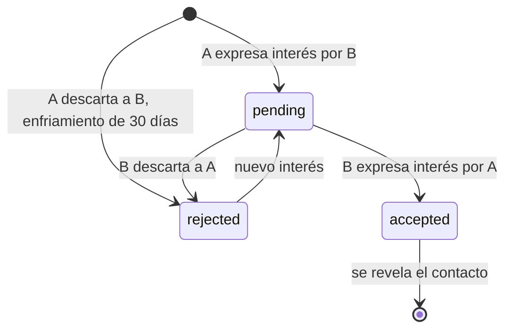

# Reglas de negocio

Reglas que el sistema hace cumplir, dónde se aplican y con qué garantía. La columna «Se aplica en» importa: una regla que solo vive en el navegador puede saltarse llamando a la API directamente.

## Identidad

| ID | Regla | Se aplica en | Evidencia |
|---|---|---|---|
| RN-01 | El correo debe pertenecer al dominio `@unsch.edu.pe` | Validador de la API y restricción de la base de datos; el formulario lo avisa | [auth.validators.ts](../../apps/api/src/modules/auth/auth.validators.ts), [001_base_schema.sql](../../apps/api/src/database/migrations/sql/001_base_schema.sql) |
| RN-02 | La contraseña tiene al menos 8 caracteres, con mayúscula, minúscula, número y símbolo | Validador de la API | [auth.validators.ts](../../apps/api/src/modules/auth/auth.validators.ts) |
| RN-03 | El nombre completo tiene entre 3 y 200 caracteres y solo letras y espacios | Validador de la API | [auth.validators.ts](../../apps/api/src/modules/auth/auth.validators.ts) |
| RN-04 | El registro público solo admite los roles estudiante, egresado y docente | Validador y servicio | [roles.ts](../../apps/api/src/shared/auth/roles.ts) |
| RN-05 | El correo es único | Servicio (búsqueda previa) y restricción única de la base | [auth.service.ts](../../apps/api/src/modules/auth/auth.service.ts), [001_base_schema.sql](../../apps/api/src/database/migrations/sql/001_base_schema.sql) |
| RN-06 | El ciclo académico declarado está entre 1 y 12 | Validador de la API | [auth.validators.ts](../../apps/api/src/modules/auth/auth.validators.ts) |
| RN-07 | La sesión dura 24 horas | Firma del token | [jwt.ts](../../apps/api/src/config/jwt.ts) |
| RN-08 | El usuario debe aceptar los términos antes de usar la plataforma | **Solo en el navegador** | [RouteGuard.tsx](../../apps/web/components/ui/RouteGuard.tsx) |
| RN-09 | Un usuario nuevo empieza con 0 créditos | Repositorio | [auth.repository.ts](../../apps/api/src/modules/auth/auth.repository.ts) |

Discrepancias dentro del propio código:

- **RN-06:** la API admite ciclos hasta 12, pero la columna heredada `academic_cycle` de la base limita a 10. El registro escribe en `current_academic_cycle`, que no tiene límite en la base, así que no hay error; quedan dos definiciones distintas del rango.
- **RN-09:** el esquema define 5 créditos por defecto, pero el registro inserta 0 de forma explícita.

## Radar

| ID | Regla | Se aplica en | Evidencia |
|---|---|---|---|
| RN-10 | Solo existen siete puntos: comedor, rectorado, cuatro pisos de biblioteca y alerta de campus | Servicio | [radar.service.ts](../../apps/api/src/modules/radar/radar.service.ts) |
| RN-11 | Cada punto admite un conjunto cerrado de estados; la biblioteca, un porcentaje de 0 a 100 | Servicio | [radar.service.ts](../../apps/api/src/modules/radar/radar.service.ts) |
| RN-12 | Un estado se publica cuando 3 usuarios distintos lo reportan | Script atómico en Redis | [radar.repository.ts](../../apps/api/src/modules/radar/radar.repository.ts) |
| RN-13 | Un usuario cuenta una sola vez por estado dentro de la ventana | Script atómico en Redis | [radar.repository.ts](../../apps/api/src/modules/radar/radar.repository.ts) |
| RN-14 | Votos y estados caducan a los 15 minutos | Vigencia de las claves | [radar.repository.ts](../../apps/api/src/modules/radar/radar.repository.ts) |
| RN-15 | Sin consenso vigente, el estado es «indefinido» | Repositorio | [radar.repository.ts](../../apps/api/src/modules/radar/radar.repository.ts) |

Los valores 3 y 900 están escritos en el repositorio. Las mismas cifras existen como constantes (`RADAR_VOTE_THRESHOLD`, `RADAR_TTL_SECONDS`) en [unsch.constants.ts](../../apps/api/src/shared/constants/unsch.constants.ts), pero el radar no las importa.

El [README](../../README.md) describe la biblioteca como «sótano a tercer piso»; el código nombra los pisos del 1 al 4.

## Feed

| ID | Regla | Se aplica en | Evidencia |
|---|---|---|---|
| RN-16 | Una publicación tiene entre 1 y 2000 caracteres | Servicio | [feed.service.ts](../../apps/api/src/modules/feed/feed.service.ts) |
| RN-17 | El autor es siempre el usuario del token | Controlador | [feed.controller.ts](../../apps/api/src/modules/feed/feed.controller.ts) |
| RN-18 | Solo se listan publicaciones visibles | Consulta | [feed.repository.ts](../../apps/api/src/modules/feed/feed.repository.ts) |
| RN-19 | Una página tiene como máximo 50 publicaciones | Servicio | [feed.service.ts](../../apps/api/src/modules/feed/feed.service.ts) |

## Matchmaking

| ID | Regla | Se aplica en | Evidencia |
|---|---|---|---|
| RN-20 | Nadie ve su propio perfil ni los que tiene pendientes, aceptados o rechazados en enfriamiento | Consulta | [matchmaking.repository.ts](../../apps/api/src/modules/matchmaking/matchmaking.repository.ts) |
| RN-21 | Nadie puede interactuar con su propio perfil | Transacción | [matchmaking.repository.ts](../../apps/api/src/modules/matchmaking/matchmaking.repository.ts) |
| RN-22 | Hay coincidencia cuando existe un interés pendiente en sentido contrario y el usuario responde con interés | Transacción | [matchmaking.repository.ts](../../apps/api/src/modules/matchmaking/matchmaking.repository.ts) |
| RN-23 | Un descarte impide que el perfil reaparezca durante 30 días | Transacción y consulta | [matchmaking.repository.ts](../../apps/api/src/modules/matchmaking/matchmaking.repository.ts) |
| RN-24 | Tras una coincidencia, ambos perfiles dejan de ser visibles | Transacción | [matchmaking.repository.ts](../../apps/api/src/modules/matchmaking/matchmaking.repository.ts) |
| RN-25 | El correo del otro usuario solo se entrega si hay una interacción aceptada | Consulta | `getMatchedContactInfo` en [matchmaking.repository.ts](../../apps/api/src/modules/matchmaking/matchmaking.repository.ts) |
| RN-26 | La afinidad es el porcentaje de habilidades requeridas por el proyecto que el usuario tiene: alta desde 75, media desde 40 | Servicio | [matchmaking.service.ts](../../apps/api/src/modules/matchmaking/matchmaking.service.ts) |
| RN-27 | Un usuario tiene como máximo un perfil | Restricción única de la base | [002_matchmaking.sql](../../apps/api/src/database/migrations/sql/002_matchmaking.sql) |

Una condición del flujo: la coincidencia se detecta buscando un interés dirigido al perfil de quien responde. Si quien responde no tiene perfil propio, nunca habrá coincidencia. Como no existe API para crear perfiles, hoy solo pueden coincidir usuarios cuyos perfiles se hayan cargado por otra vía.

## Carpooling

| ID | Regla | Se aplica en | Evidencia |
|---|---|---|---|
| RN-28 | Solo se listan rutas con asientos disponibles | Consulta | [carpooling.repository.ts](../../apps/api/src/modules/carpooling/carpooling.repository.ts) |
| RN-29 | El conductor no puede solicitar asiento en su propia ruta | Servicio | [carpooling.service.ts](../../apps/api/src/modules/carpooling/carpooling.service.ts) |
| RN-30 | Un pasajero tiene como máximo una solicitud activa o confirmada por ruta | Servicio e índice único parcial | [carpooling.service.ts](../../apps/api/src/modules/carpooling/carpooling.service.ts), [005_canonical_extensions.sql](../../apps/api/src/database/migrations/sql/005_canonical_extensions.sql) |
| RN-31 | Solo el conductor de la ruta confirma solicitudes | Transacción | [carpooling.repository.ts](../../apps/api/src/modules/carpooling/carpooling.repository.ts) |
| RN-32 | El asiento se descuenta al confirmar, no al solicitar | Transacción | [carpooling.repository.ts](../../apps/api/src/modules/carpooling/carpooling.repository.ts) |
| RN-33 | Los asientos disponibles nunca son negativos | Transacción con bloqueo y restricción de la base | [carpooling.repository.ts](../../apps/api/src/modules/carpooling/carpooling.repository.ts), [004_moderation_and_carpooling.sql](../../apps/api/src/database/migrations/sql/004_moderation_and_carpooling.sql) |
| RN-34 | Los datos de contacto se revelan a ambas partes solo al confirmar | Transacción | [carpooling.repository.ts](../../apps/api/src/modules/carpooling/carpooling.repository.ts) |
| RN-35 | Antes de confirmar, el conductor solo conoce el nombre de pila, la escuela y el ciclo del pasajero | Servicio | [carpooling.service.ts](../../apps/api/src/modules/carpooling/carpooling.service.ts) |
| RN-36 | El ciclo mostrado es el vigente; si se desconoce, se usa el heredado y, si tampoco existe, queda vacío | Consulta | [carpooling.repository.ts](../../apps/api/src/modules/carpooling/carpooling.repository.ts) |

Sobre RN-36: la columna heredada `academic_cycle` tiene valor por defecto 1 en el esquema, de modo que un usuario sin ciclo declarado puede aparecer con ciclo 1.

## Reglas definidas en la base de datos sin uso desde la API

Existen como disparadores y restricciones, pero ninguna ruta las ejercita. Estado: **Parcial** (lógica lista, flujo inexistente).

| ID | Regla | Evidencia |
|---|---|---|
| RN-37 | Descargar un archivo ajeno cuesta sus créditos, que se abonan al dueño | [003_credits_and_wiki.sql](../../apps/api/src/database/migrations/sql/003_credits_and_wiki.sql) |
| RN-38 | Descargar un archivo propio, o volver a descargar uno en el mismo semestre, no cuesta | [003_credits_and_wiki.sql](../../apps/api/src/database/migrations/sql/003_credits_and_wiki.sql) |
| RN-39 | No se puede descargar sin saldo suficiente | [003_credits_and_wiki.sql](../../apps/api/src/database/migrations/sql/003_credits_and_wiki.sql) |
| RN-40 | Una publicación con 3 reportes activos por el mismo motivo se oculta y pasa a auditoría | [004_moderation_and_carpooling.sql](../../apps/api/src/database/migrations/sql/004_moderation_and_carpooling.sql) |

## Reglas de operación

| ID | Regla | Evidencia |
|---|---|---|
| RN-41 | Una migración ya aplicada no se repite. Se guarda la suma de verificación de cada archivo, pero el migrador no la compara en ejecuciones posteriores: un archivo modificado después de aplicarse no se detecta | [migrator.ts](../../apps/api/src/database/migrations/migrator.ts) |
| RN-42 | No pueden ejecutarse dos migraciones a la vez | [migrator.ts](../../apps/api/src/database/migrations/migrator.ts) |
| RN-43 | La carga de catálogos nunca cambia un identificador existente | [load_catalogs.ts](../../apps/api/src/database/migrations/load_catalogs.ts) |
| RN-44 | Los datos de demostración solo se cargan con confirmación explícita, fuera de producción y contra una base local | [load_demo_seed.ts](../../apps/api/src/database/migrations/load_demo_seed.ts) |

[← Índice](../README.md)
