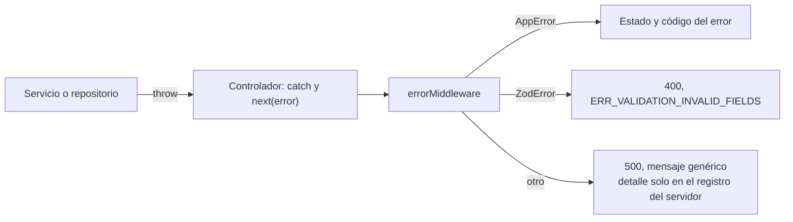

# Errores y consistencia

Cómo trata el sistema los errores y qué garantías de consistencia ofrece realmente cada operación. Las garantías se describen según el código; donde hay una condición o un hueco, se dice.

## Manejo de errores

### Mecanismo



Evidencia: [error.middleware.ts](../../src/middlewares/error.middleware.ts), [AppError.ts](../../src/shared/errors/AppError.ts).

Forma de toda respuesta de error:

```json
{ "error": true, "message": "Texto para el usuario", "code": "ERR_DOMINIO_CAUSA" }
```

### Aspectos correctos

- Los errores inesperados no exponen detalles internos al cliente.
- Cada error de negocio lleva un código estable que el cliente puede interpretar.
- El inicio de sesión no revela si un correo está registrado.

### Huecos observados

| Hueco | Efecto | Evidencia |
|---|---|---|
| Errores de la base de datos no traducidos | Una violación de restricción llega como 500 genérico, salvo el duplicado de carpooling | [auth.repository.ts](../../src/modules/auth/auth.repository.ts) no trata el código `23505` |
| Identificadores con formato inválido | En carpooling, un `route_id` que no sea UUID provoca un error de PostgreSQL y un 500 en lugar de un 400 o 404. Inferencia a partir del código: el parámetro no se valida antes de la consulta | [carpooling.controller.ts](../../src/modules/carpooling/carpooling.controller.ts) |
| Errores del repositorio identificados por texto | El servicio compara `error.message` con cadenas; un cambio de texto rompe la traducción sin que el compilador avise | [carpooling.service.ts](../../src/modules/carpooling/carpooling.service.ts), [matchmaking.service.ts](../../src/modules/matchmaking/matchmaking.service.ts) |
| Fallo de un servicio externo indistinguible | Base de datos o Redis caídos producen el mismo 500 que un defecto de programación | [error.middleware.ts](../../src/middlewares/error.middleware.ts) |
| Códigos tomados de otro dominio | Matchmaking usa `ERR_FEED_POST_NOT_FOUND` y `ERR_MOD_SELF_REPORT` | [matchmaking.service.ts](../../src/modules/matchmaking/matchmaking.service.ts) |
| Rechazo de CORS como error genérico | Un origen no permitido termina en 500 | [app.ts](../../src/app.ts) |
| Ruta inexistente | Responde con la página 404 por defecto de Express, no con el formato JSON del resto | [app.ts](../../src/app.ts) no registra un manejador de 404 |

## Límites transaccionales

Una **transacción** agrupa varias operaciones para que se apliquen todas o ninguna. Lo que queda fuera de la transacción puede quedar a medias o ser alterado por otra operación simultánea.

| Operación | Límite real | Garantía | Hueco |
|---|---|---|---|
| Registro | Sin transacción: una búsqueda y, después, una inserción | El correo es único gracias a la restricción de la base | Dos registros simultáneos con el mismo correo: uno recibe un 500 en lugar del mensaje «correo ya registrado» |
| Aceptar términos | Una sola sentencia | Atómica | — |
| Crear publicación | Inserción y, después, lectura del autor | La inserción es atómica | Si la lectura posterior fallara, la publicación existiría y el cliente recibiría un error |
| Interacción de matchmaking | Una transacción con todas las lecturas y escrituras | Todo o nada | Las lecturas no bloquean filas: dos intereses mutuos enviados en el mismo instante podrían quedar ambos como pendientes. Inferencia por análisis; no hay prueba de este caso |
| Consultar contacto tras coincidencia | Fuera de la transacción anterior | Solo lectura | — |
| Solicitar asiento | Las comprobaciones (ruta, conductor, asientos, duplicado) van **antes** de la transacción; dentro solo están la lectura del pasajero y la inserción | Sin duplicados activos, por el índice único | Ver «Solicitud de asiento» |
| Confirmar asiento | Una transacción con bloqueo de la ruta y de la solicitud | Todo o nada; sin sobreventa; una solicitud no se confirma dos veces | — |
| Voto del radar | Un script atómico en Redis | Comprobar, votar, contar y publicar ocurren sin intercalado | Ver «Radar» |
| Migración | Una transacción por archivo, con bloqueo consultivo | Una migración fallida no deja cambios ni queda registrada | Requiere conexión con sesión continua |
| Carga de catálogos | Una transacción para todo | Todo o nada | — |

### Solicitud de asiento

La garantía de «una sola solicitud activa por ruta y pasajero» descansa en el índice `uq_active_carpooling_request`, no en la comprobación previa del servicio, que no es atómica.

Tres precisiones:

1. **El índice puede no existir.** La migración [005_canonical_extensions.sql](../../src/database/migrations/sql/005_canonical_extensions.sql) lo omite si encuentra duplicados previos, emite solo un aviso y se registra como aplicada. En una base con duplicados heredados, la garantía no estaría vigente. Debe comprobarse en cada base con una consulta al catálogo de índices.
2. **La comprobación de asientos disponibles no es vinculante.** Se hace fuera de la transacción y la solicitud no reserva asiento. Es correcto por diseño: varias personas pueden solicitar el último asiento y el conductor decide. La sobreventa se evita al confirmar.
3. **La transacción de solicitud contiene una sola escritura.** Su utilidad práctica es de estructura y de prueba, no de atomicidad entre varias escrituras.

### Confirmación de asiento

Es la operación con garantías más fuertes del sistema. El bloqueo `FOR UPDATE` sobre la ruta hace que dos confirmaciones simultáneas se ejecuten una tras otra; la segunda ve el número de asientos ya actualizado. La restricción `available_seats >= 0` de la base es una segunda barrera. Hay pruebas contra PostgreSQL real de la competencia por el último asiento y de la confirmación repetida ([carpooling.real.test.ts](../../tests/real/carpooling.real.test.ts)).

### Radar

El script garantiza la atomicidad dentro de un nodo y un estado. Quedan fuera:

- **Estados contradictorios en paralelo.** Si tres usuarios votan «fluido» y otros tres «cola larga» casi a la vez, gana el primero en completar el consenso; al hacerlo se borran los contadores del otro.
- **Valores equivalentes en dos idiomas.** El servicio acepta, por ejemplo, `fluid` y `Fluido`; se cuentan en conjuntos distintos, por lo que tres personas que reportan lo mismo podrían no alcanzar el consenso. El frontend determina qué valor se envía.
- **Sin durabilidad.** Si Redis pierde los datos, el radar vuelve a «indefinido». Es aceptable por la naturaleza efímera del dato.

## Consistencia entre el navegador y el servidor

| Dato | Dónde está la verdad | Riesgo |
|---|---|---|
| Aceptación de términos | Base de datos | El navegador decide con su copia local; el token conserva el valor antiguo hasta el siguiente inicio de sesión |
| Datos del usuario mostrados | Copia en `localStorage` tomada al iniciar sesión | Los cambios hechos en la pantalla de ajustes solo modifican esa copia |
| Créditos | Base de datos (`users.credits_balance`) | La pantalla de archivos mantiene un saldo propio en `localStorage`, sin relación con el de la base |
| Rutas, archivos, artículos, reportes | Solo `localStorage` | No hay verdad compartida |

## Comportamiento ante fallos de infraestructura

| Fallo | Comportamiento según el código | Evidencia |
|---|---|---|
| Redis no disponible al arrancar | El proceso arranca; tras 5 reintentos deja de intentar conectar. Las rutas del radar fallan; las demás no dependen de Redis | [redis.ts](../../src/config/redis.ts) |
| Redis se recupera después de agotar los reintentos | **Pendiente de verificación:** al devolver `null` la estrategia de reintentos, el cliente podría no reconectar sin reiniciar el proceso | [redis.ts](../../src/config/redis.ts) |
| PostgreSQL no disponible | El proceso arranca; cada ruta con base de datos responde 500 tras agotar los 2 segundos de espera de conexión | [database.ts](../../src/config/database.ts); observado el 2026-10-10 en [RESULTADOS_VERIFICACION.md](../migracion/RESULTADOS_VERIFICACION.md) |
| Claves JWT ausentes | El proceso arranca; el inicio de sesión y toda ruta protegida fallan | [jwt.ts](../../src/config/jwt.ts) |
| Señal de apagado | Se cierra el servidor HTTP; no se cierran de forma explícita el pool ni el cliente Redis | [server.ts](../../src/server.ts) |

El sistema tiende a arrancar aunque falte una dependencia y a fallar después, solicitud a solicitud. Sin ruta de salud, ese estado no es visible desde fuera.

## Recomendaciones

> **Estado: Propuesto.** No implementadas.

| Recomendación | Atiende |
|---|---|
| Traducir los códigos de error de PostgreSQL más comunes (`23505`, `22P02`, `23503`) en un solo lugar | Errores 500 que deberían ser 4xx |
| Validar el formato de los identificadores de ruta en el controlador | Identificadores inválidos |
| Errores de dominio con tipo en lugar de mensajes de texto | Traducción frágil |
| Distinguir 503 para dependencias no disponibles y añadir una ruta de salud | Fallos de infraestructura |
| Bloquear o serializar la interacción de matchmaking | Coincidencia perdida por simultaneidad |
| Hacer que la migración 005 falle, o deje constancia verificable, si no puede crear el índice | Garantía condicional |
| Un único idioma para los valores del radar en el contrato | Consenso dividido |

[← Índice](../README.md)
