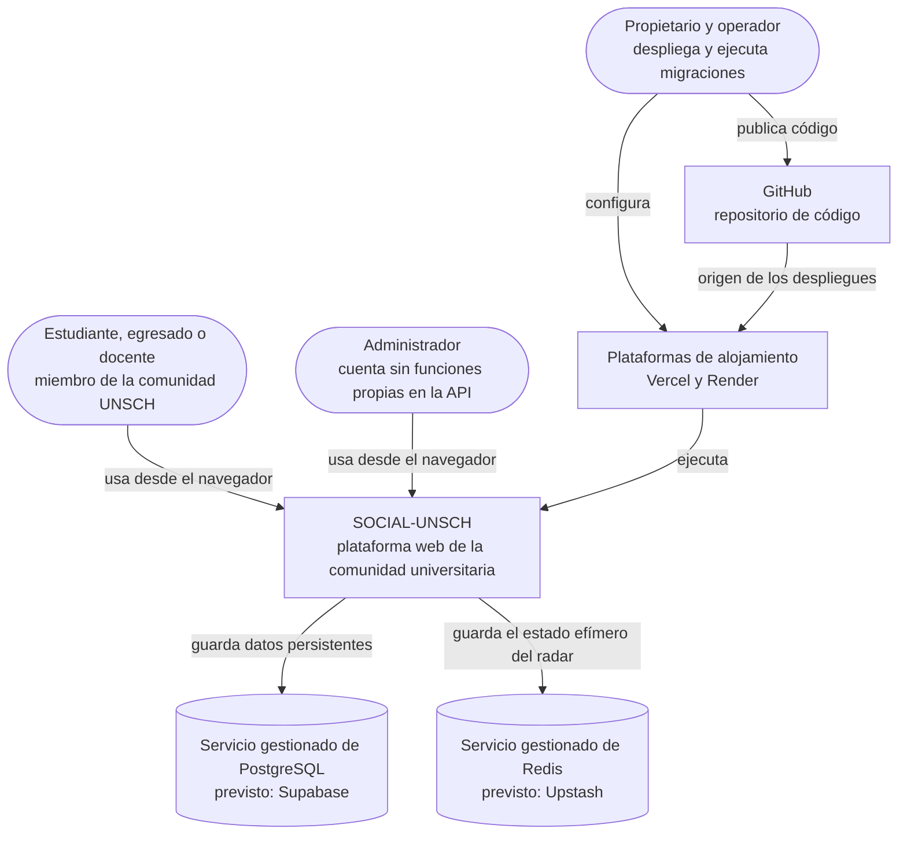

# C1 · Contexto del sistema

**Pregunta:** ¿quién usa SOCIAL-UNSCH y con qué otros sistemas se relaciona?
**Describe:** el estado actual.

## Diagrama

## Personas

| Persona | Qué hace con el sistema |
|---|---|
| Miembro de la comunidad | Se registra con su correo institucional, consulta y reporta el estado del campus, publica, busca compañeros de proyecto |
| Administrador | Inicia sesión como cualquier usuario. La consola de moderación que ve en el frontend trabaja con datos simulados |
| Propietario y operador | Mantiene el código, configura las plataformas y ejecuta las migraciones a mano |

El detalle de actores y roles está en [Actores](../01-analisis-del-sistema/02-actores.md).

## Sistemas externos

| Sistema | Relación | Estado de verificación |
|---|---|---|
| PostgreSQL gestionado | El sistema guarda en él usuarios, publicaciones, perfiles, rutas y solicitudes | La API de producción respondió con datos de catálogo el 2026-10-12, lo que prueba que tiene una base accesible. El proveedor no pudo confirmarse desde fuera |
| Redis gestionado | El sistema guarda en él los votos y estados del radar | Pendiente de verificación |
| Vercel | Aloja la aplicación web | Verificado por la API pública de despliegues de GitHub y por respuesta HTTP |
| Render | Aloja la API | Verificado por respuesta HTTP |
| GitHub | Contiene el código; cada cambio en `main` origina un despliegue del frontend | Verificado |

## Lo que no aparece porque no existe

- Sistemas académicos de la universidad: no hay integración.
- Proveedor de correo o de mensajería: el sistema no envía notificaciones.
- Pasarela de pagos.
- Servicio de almacenamiento de archivos.

Si alguno de ellos se incorpora, este diagrama debe actualizarse.

**Siguiente nivel:** [C2 · Contenedores actuales](02-contenedores-actuales.md)

[← Guía del modelo C4](README.md) · [← Índice](../README.md)
