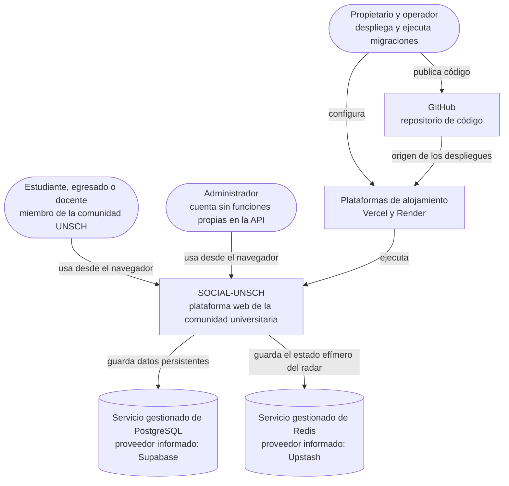

# C1 · Contexto del sistema

**Pregunta:** ¿qué es SOCIAL-UNSCH, quién lo utiliza y con qué sistemas externos interactúa?
**Describe:** la realidad actual, comprobada desde fuera el 2026-10-30.

## Propósito

SOCIAL-UNSCH es una plataforma web para la comunidad de la Universidad Nacional de San Cristóbal de Huamanga. Reúne, con acceso limitado a correos `@unsch.edu.pe`, información del campus en tiempo casi real, publicaciones, búsqueda de compañeros de proyecto y movilidad compartida.

**Límite del sistema:** incluye la aplicación web, la API, el servicio Radar cuando se active y sus herramientas de migración. Los almacenes y las plataformas son gestionados por terceros. El sistema no se integra con ningún sistema académico de la universidad.

## Diagrama

## Elementos

| Elemento | Tipo | Responsabilidad |
|---|---|---|
| Miembro de la comunidad (`student`, `alumnus`, `professor`) | Persona | Se registra con su correo institucional, consulta y reporta el estado del campus, publica y busca compañeros de proyecto |
| Administrador (`administrator`) | Persona | Inicia sesión como cualquier usuario. La consola de moderación del frontend usa datos simulados y la API no le da permisos propios |
| Propietario y operador | Persona | Mantiene el código, configura las plataformas y ejecuta las migraciones a mano |
| SOCIAL-UNSCH | Sistema de software | Autentica a la comunidad y ofrece radar, feed, matchmaking, catálogos y movilidad |
| PostgreSQL gestionado | Sistema externo | Guarda usuarios, catálogos, publicaciones, perfiles, rutas y solicitudes |
| Redis gestionado | Sistema externo | Guarda los votos y estados del radar con vigencia de 15 minutos |
| Vercel | Sistema externo | Compila y aloja la aplicación web |
| Render | Sistema externo | Ejecuta la API |
| GitHub | Sistema externo | Aloja el código, ejecuta la integración continua y origina los despliegues del frontend |

El detalle de actores y roles está en [Actores](../01-analisis-del-sistema/02-actores.md).

## Estado de verificación de los sistemas externos

Comprobación externa de solo lectura del 2026-10-30, salvo donde se indique.

| Sistema | Evidencia | Estado |
|---|---|---|
| PostgreSQL | `GET /health/ready` informó `database: up` y `GET /api/v1/catalogs/schools` devolvió datos | IMPLEMENTADO. Proveedor Supabase: PENDIENTE DE VALIDACIÓN |
| Redis | `GET /health/ready` informó `radar: up`, que en modo local equivale a un `PING` correcto a Redis | IMPLEMENTADO, de forma indirecta. Proveedor Upstash: PENDIENTE DE VALIDACIÓN |
| Vercel | `/login` respondió 200; GitHub registra el despliegue de producción de `b763885` | IMPLEMENTADO |
| Render | `GET /health/live` respondió 200 | IMPLEMENTADO |
| GitHub | Repositorio público, flujo de CI ejecutado | IMPLEMENTADO |

## Lo que no aparece porque no existe

- Sistemas académicos de la universidad: no hay integración.
- Proveedor de correo o de mensajería: el sistema no envía notificaciones.
- Pasarela de pagos.
- Servicio de almacenamiento de archivos.

Si alguno de ellos se incorpora, este diagrama debe actualizarse.

La extracción de Radar no cambia este nivel: para quien usa el sistema sigue siendo una sola plataforma, y Radar es un contenedor interno, no un sistema externo.

**Siguiente nivel:** [C2 · Contenedores actuales](02-contenedores-actuales.md)

[← Guía del modelo C4](README.md) · [← Índice](../README.md)
