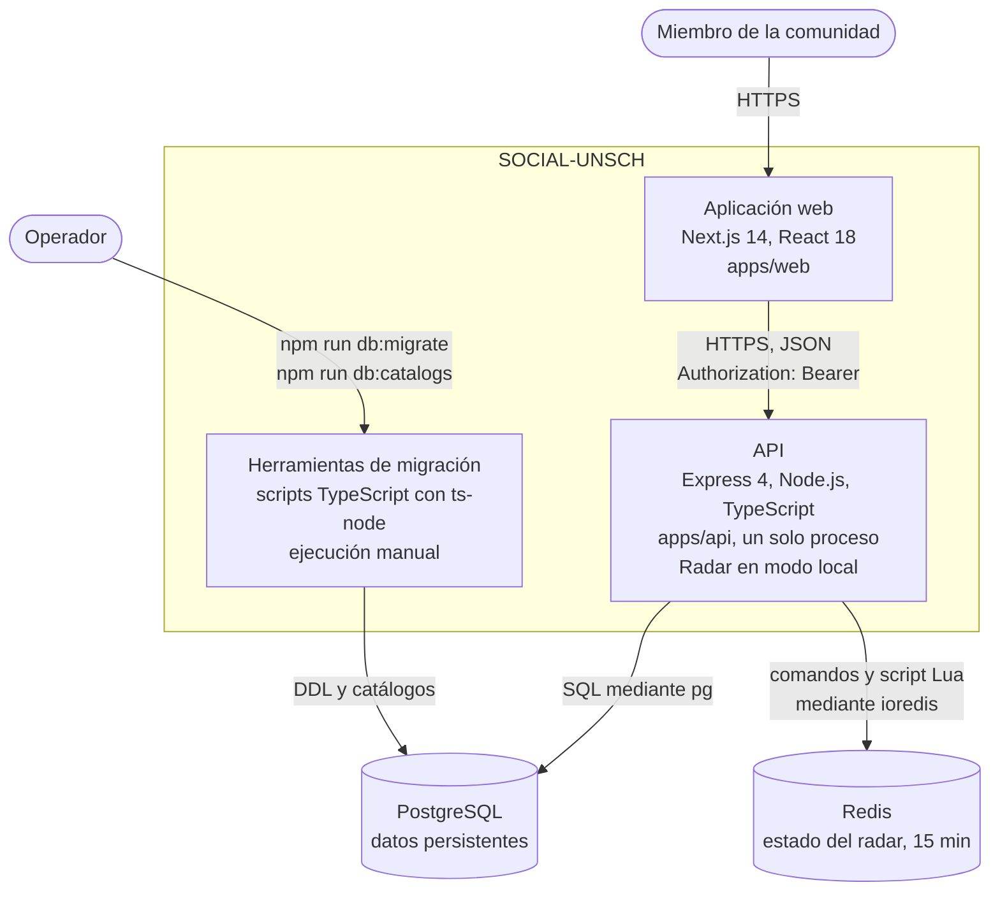

# C2 · Contenedores actuales

**Pregunta:** ¿qué aplicaciones y almacenes de datos conforman SOCIAL-UNSCH?
**Describe:** lo que opera en producción, comprobado el 2026-10-30. El servicio Radar no está aquí porque su código está en `main` pero no se ha desplegado: su diagrama es el de [transición](05-contenedores-de-transicion.md).

Recordatorio: «contenedor» en C4 no significa Docker. Ninguna de estas piezas se despliega hoy con Docker.

## Diagrama

## Contenedores

| Contenedor | Tecnología | Responsabilidad | Estado |
|---|---|---|---|
| Aplicación web (`apps/web`) | Next.js 14, React 18, Tailwind 4, Axios | Interfaz de usuario. Once pantallas estáticas; la lógica se ejecuta en el navegador. Guarda sesión y datos simulados en `localStorage` | IMPLEMENTADO; seis pantallas simuladas |
| API (`apps/api`) | Express 4, TypeScript, Zod, `pg`, `ioredis`, `jsonwebtoken`, `bcrypt` | Autenticación, reglas de negocio y acceso a datos. 16 rutas de negocio en 7 módulos y 2 rutas de salud. No guarda estado en memoria | IMPLEMENTADO |
| Herramientas de migración | TypeScript con `ts-node` | Evolución del esquema, sincronización de catálogos y datos de demostración. No se despliegan | IMPLEMENTADO |
| PostgreSQL | 15 en `docker-compose.yml`; versión de producción sin confirmar | Usuarios, catálogos, publicaciones, matchmaking y carpooling, además de tablas aún sin uso | IMPLEMENTADO |
| Redis | 7 en `docker-compose.yml`; versión de producción sin confirmar | Votos y estados del radar con vigencia de 15 minutos | IMPLEMENTADO |

`packages/contracts` es una biblioteca de contratos que se compila junto a las aplicaciones; no es un contenedor.

## Relaciones

| De | A | Protocolo | Detalle |
|---|---|---|---|
| Aplicación web | API | HTTPS, JSON | La URL base se fija al compilar con `NEXT_PUBLIC_API_URL`; el token viaja en `Authorization` |
| API | PostgreSQL | Protocolo de PostgreSQL | Un pool de hasta 20 conexiones compartido por todos los módulos |
| API | Redis | Protocolo de Redis | Un cliente creado en `composition.ts`; solo lo usa el módulo de radar |
| Herramientas de migración | PostgreSQL | Protocolo de PostgreSQL | Necesitan una conexión que mantenga la sesión, por el bloqueo consultivo |

No hay comunicación entre la aplicación web y las bases de datos, ni entre PostgreSQL y Redis.

## Características del conjunto

- **Dos unidades desplegables de aplicación**: la web y la API. Por eso el lado del servidor es hoy un **monolito modular**.
- **La API es el único camino a los datos compartidos.**
- **Usar Vercel, Render, Supabase y Upstash no convierte al sistema en microservicios**: son plataformas donde se ejecutan dos aplicaciones y dos almacenes.

## Dónde se ejecuta cada contenedor

El mapa de estos contenedores a las plataformas está en [Mapa de despliegue](../05-despliegue-y-operacion/01-mapa-de-despliegue.md).

**Nivel anterior:** [C1 · Contexto](01-contexto.md) · **Siguiente nivel:** [C3 · Componentes](03-componentes-del-backend.md) · **Evolución:** [C2 de transición](05-contenedores-de-transicion.md)

[← Guía del modelo C4](README.md) · [← Índice](../README.md)
