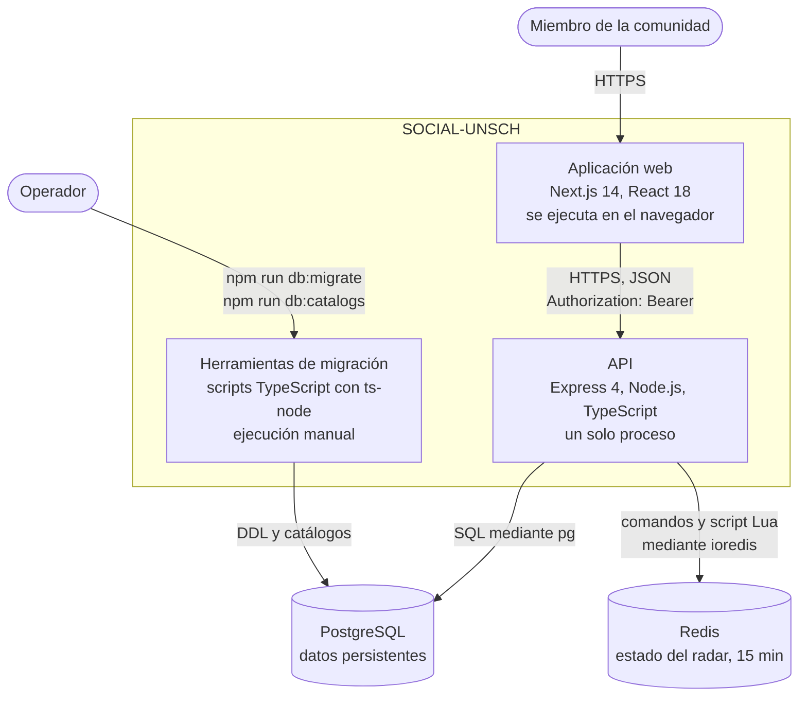

# C2 · Contenedores actuales

**Pregunta:** ¿qué piezas se ejecutan o almacenan datos por separado, y cómo se comunican?
**Describe:** el estado actual.

Recordatorio: «contenedor» en C4 no significa Docker. Ninguna de estas piezas se despliega hoy con Docker.

## Diagrama

## Contenedores

| Contenedor | Tecnología | Responsabilidad | Guarda datos | Evidencia |
|---|---|---|---|---|
| Aplicación web | Next.js 14, React 18, Tailwind 4, Axios | Interfaz de usuario. Once pantallas generadas como estáticas; toda la lógica se ejecuta en el navegador | Sesión y datos simulados en `localStorage` | [app/](../../app), [components/ui](../../components/ui) |
| API | Express 4, TypeScript, Zod, `pg`, `ioredis`, `jsonwebtoken`, `bcrypt` | Autenticación, reglas de negocio y acceso a datos. 16 rutas en 7 módulos | No; no guarda estado en memoria | [src/](../../src) |
| Herramientas de migración | TypeScript con `ts-node` | Evolución del esquema, sincronización de catálogos, datos de demostración | No | [src/database/migrations](../../src/database/migrations) |
| PostgreSQL | PostgreSQL 15 en desarrollo local | Usuarios, catálogos, publicaciones, matchmaking, carpooling y tablas aún sin uso | Sí | [sql/](../../src/database/migrations/sql) |
| Redis | Redis 7 en desarrollo local | Votos y estados del radar con vigencia de 15 minutos | Sí, efímeros | [radar.repository.ts](../../src/modules/radar/radar.repository.ts) |

Las versiones de PostgreSQL y Redis son las de [docker-compose.yml](../../docker-compose.yml) para desarrollo local. Las de producción están pendientes de verificación.

## Relaciones

| De | A | Protocolo | Detalle |
|---|---|---|---|
| Aplicación web | API | HTTPS, JSON | La URL base se fija al compilar con `NEXT_PUBLIC_API_URL`; el token viaja en la cabecera `Authorization` |
| API | PostgreSQL | Protocolo de PostgreSQL | Un pool de hasta 20 conexiones compartido por todos los módulos |
| API | Redis | Protocolo de Redis | Un cliente compartido; solo lo usa el módulo de radar |
| Herramientas de migración | PostgreSQL | Protocolo de PostgreSQL | Necesitan una conexión que mantenga la sesión, por el bloqueo consultivo |

No hay comunicación entre la aplicación web y las bases de datos, ni entre PostgreSQL y Redis.

## Características del conjunto

- **Dos unidades desplegables de aplicación**: la aplicación web y la API. Es lo que define al sistema como monolito en el lado del servidor.
- **Ambas se construyen desde el mismo paquete** ([package.json](../../package.json)).
- **La API es el único camino a los datos compartidos.**
- **Las herramientas de migración no se despliegan**: se ejecutan desde una máquina con el código fuente y acceso a la base.

## Dónde se ejecuta cada contenedor

El mapa de este diagrama a las plataformas está en [Mapa de despliegue](../05-despliegue-y-operacion/01-mapa-de-despliegue.md).

**Nivel anterior:** [C1 · Contexto](01-contexto.md) · **Siguiente nivel:** [C3 · Componentes del backend](03-componentes-del-backend.md)

[← Guía del modelo C4](README.md) · [← Índice](../README.md)
