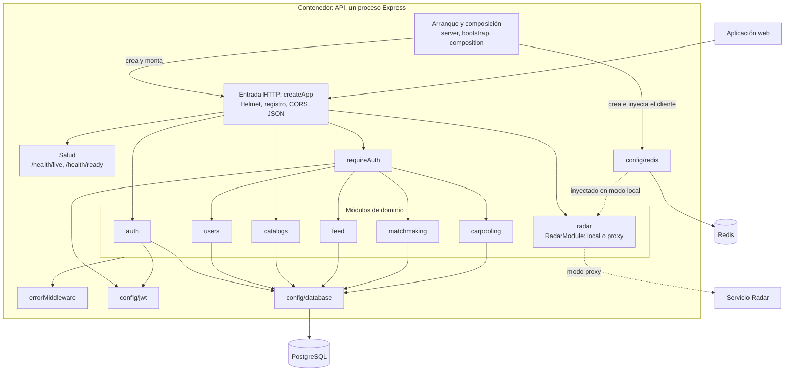
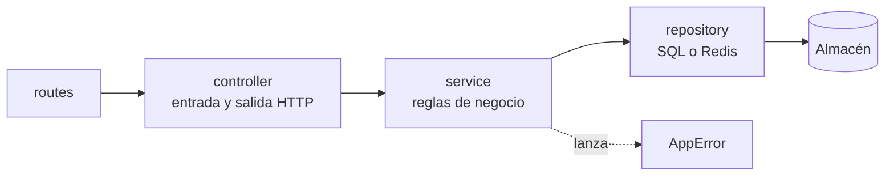
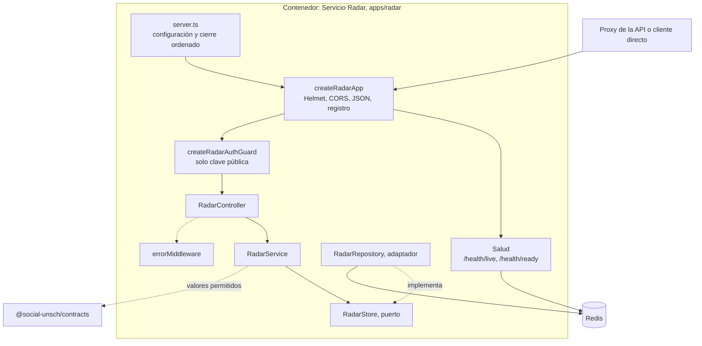
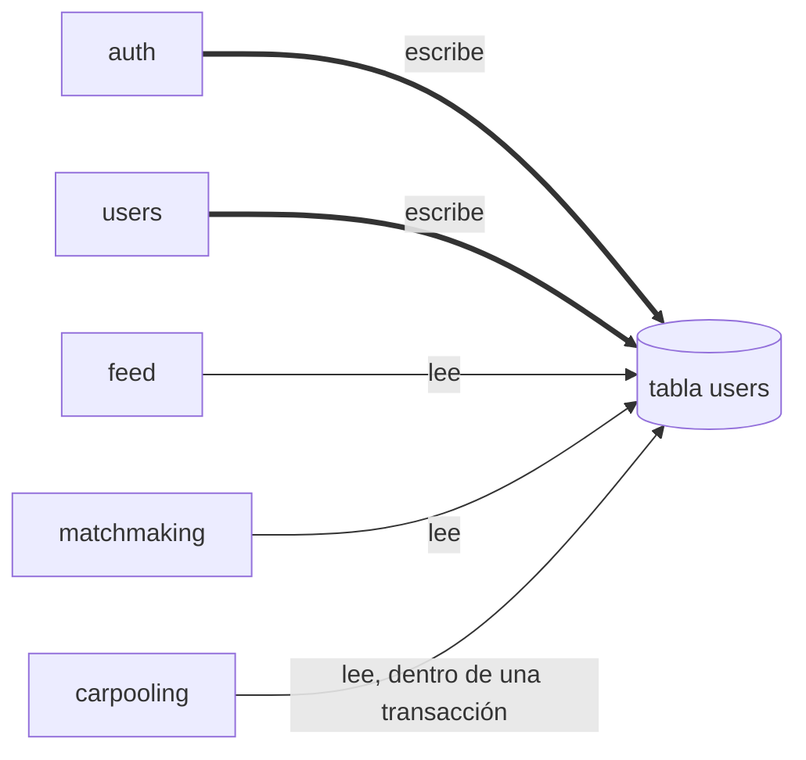

# C3 · Componentes del backend

**Pregunta:** ¿cómo se dividen internamente el contenedor «API» y el contenedor «Servicio Radar»?
**Describe:** el código de la `main` (`b763885`). La API de producción ya incluye este código, con Radar en modo local; `apps/radar` no está desplegado.

Los componentes son agrupaciones de código dentro de un mismo proceso. Ninguno se despliega por separado.

## Diagrama general de la API

Lectura:

- `auth` y `catalogs` reciben solicitudes sin `requireAuth`. En `auth`, solo `profile-me` lo usa.
- `radar` verifica el token dentro de sus propias rutas en modo local. En modo proxy la API **no** lo verifica: lo hace el servicio Radar.
- No hay flechas entre módulos: `scripts/check-boundaries.js` lo impide.

## Componentes de la API

| Componente | Responsabilidad | Dependencias | Datos |
|---|---|---|---|
| Arranque y composición: [server.ts](../../apps/api/src/server.ts), [bootstrap.ts](../../apps/api/src/bootstrap.ts), [composition.ts](../../apps/api/src/composition.ts) | Validar configuración, crear conexiones, elegir el modo de Radar y cerrar ordenadamente | `config/*`, `RadarModule` | Conexiones |
| Entrada HTTP: [app.ts](../../apps/api/src/app.ts) | `createApp()` compone middlewares y enrutadores sin abrir conexiones | Módulos, salud | — |
| Salud: [health.routes.ts](../../apps/api/src/health/health.routes.ts) | Vida y disponibilidad; PostgreSQL es crítico, Radar no | Comprobaciones inyectadas | — |
| Registro: [logging.middleware.ts](../../apps/api/src/middlewares/logging.middleware.ts) | Una línea JSON por solicitud y propagación de `x-request-id` | — | — |
| `requireAuth`: [auth.middleware.ts](../../apps/api/src/middlewares/auth.middleware.ts) | Verificar el token y adjuntar `req.user` | `config/jwt`, `AppError` | — |
| `auth`: [módulo](../../apps/api/src/modules/auth/auth.routes.ts) | Registro, inicio de sesión, emisión del token | `config/jwt`, `config/database`, `shared/auth/roles`, `bcrypt` | Escribe `users`; lee `professional_schools` |
| `users`: [módulo](../../apps/api/src/modules/users/users.routes.ts) | Aceptación de términos | `requireAuth`, `config/database` | Actualiza `users` |
| `catalogs`: [módulo](../../apps/api/src/modules/catalogs/catalogs.routes.ts) | Lectura pública de catálogos | `config/database` | Lee `faculties`, `professional_schools`, `campus_pavilions` |
| `radar`: [módulo](../../apps/api/src/modules/radar/radar.module.ts) | Consenso del campus en modo local o reenvío en modo proxy | `@social-unsch/contracts`, Redis inyectado o servicio remoto | Claves `radar:*` en Redis |
| `feed`: [módulo](../../apps/api/src/modules/feed/feed.routes.ts) | Publicaciones | `requireAuth`, `config/database` | Escribe `feed_posts`; lee `users` |
| `matchmaking`: [módulo](../../apps/api/src/modules/matchmaking/matchmaking.routes.ts) | Descubrimiento, interacción y afinidad | `requireAuth`, `config/database` | Escribe `matchmaking_profiles`, `matchmaking_interactions`; lee `matchmaking_projects`, `users` |
| `carpooling`: [módulo](../../apps/api/src/modules/carpooling/carpooling.routes.ts) | Rutas, solicitudes y confirmaciones | `requireAuth`, `config/database` | Escribe `carpooling_requests` y asientos de `carpooling_routes`; lee `users`, `professional_schools` |
| `errorMiddleware`: [error.middleware.ts](../../apps/api/src/middlewares/error.middleware.ts) | Convertir errores en la respuesta común | `AppError`, Zod | — |
| Compartido: [src/shared](../../apps/api/src/shared) | `AppError`, política de roles, constantes | — | — |

## Entradas y salidas por módulo

Todas las rutas llevan el prefijo `/api/v1`.

| Componente | Entradas | Salidas | Redis |
|---|---|---|---|
| `auth` | `POST /auth/register`, `POST /auth/login`, `GET /auth/profile-me` | Cuenta creada; token de 24 h y datos del usuario | No |
| `users` | `PATCH /users/accept-terms` | Confirmación | No |
| `catalogs` | `GET /catalogs`, `GET /catalogs/schools` | Facultades, escuelas y pabellones con IDs reales | No |
| `radar` | `GET /radar/status`, `POST /radar/report` | Estado de siete nodos; resultado del voto | Sí, en modo local |
| `feed` | `GET /feed`, `POST /feed` | Publicaciones con autor; publicación creada | No |
| `matchmaking` | `POST /matchmaking/score`, `GET /matchmaking/profiles`, `POST /matchmaking/interact` | Afinidad, perfiles anónimos, estado de la interacción y contacto al coincidir | No |
| `carpooling` | `GET /carpooling`, `POST /carpooling/:route_id/request`, `PATCH /carpooling/:route_id/confirm` | Rutas, solicitud creada, contactos al confirmar | No |

## Estructura interna de un módulo

Cinco módulos repiten esta estructura. `catalogs` tiene solo rutas y controlador, y su controlador consulta el pool directamente. `radar` la conserva, pero recibe sus dependencias por constructor.

## Diagrama del servicio Radar

**Estado: IMPLEMENTADO PARCIALMENTE.** Código en `main`, sin desplegar.

| Componente | Responsabilidad | Dependencias | Datos |
|---|---|---|---|
| [server.ts](../../apps/radar/src/server.ts), [env.ts](../../apps/radar/src/config/env.ts) | Validar configuración, arrancar y cerrar | `ioredis` | Variables de entorno |
| [app.ts](../../apps/radar/src/app.ts) | Componer la aplicación y montar rutas en `/api/v1/radar` y en la raíz | Middlewares, módulo | — |
| [auth.middleware.ts](../../apps/radar/src/middlewares/auth.middleware.ts) | Verificar RS256 y derivar la identidad solo del token | `jsonwebtoken` | Clave pública |
| [radar.service.ts](../../apps/radar/src/modules/radar/radar.service.ts) | Validar nodo y estado según el contrato | `RadarStore`, contratos | — |
| [radar.repository.ts](../../apps/radar/src/modules/radar/radar.repository.ts) | Pipeline de lectura y script Lua de voto | Cliente Redis inyectado | Claves `radar:*` |

## Dependencias problemáticas

Las importaciones de código están controladas. Los acoplamientos reales son estos:

| Dependencia | Efecto | Etapa |
|---|---|---|
| `users` escrita por dos módulos y leída con `JOIN` por tres más | Principal obstáculo para extraer Identidad y Comunidad | 5 |
| `carpooling` lee contactos dentro de la transacción de confirmación | Esa transacción no puede repartirse entre servicios sin rediseño | 6 |
| Lógica de Radar duplicada en `apps/api` y `apps/radar` | Dos implementaciones que deben mantenerse iguales hasta retirar la local | 4 |
| Una sola `DATABASE_URL` | Todos los módulos pueden leer todas las tablas | 5 |
| Clases creadas con `new` en todos los módulos salvo `radar` | No se puede sustituir el almacén sin tocar el servicio | Al extraer cada uno |

Análisis completo en [Componentes y dependencias](../02-arquitectura-de-software/03-componentes-y-dependencias.md).

## Componentes de la aplicación web

No se elabora un nivel 3 completo del frontend. Sus piezas relevantes para la arquitectura son:

| Componente | Responsabilidad | Archivo |
|---|---|---|
| Cliente HTTP | Añadir el token y tratar el 401 | [api.ts](../../apps/web/app/lib/api.ts) |
| Catálogos | Cargar y validar IDs reales | [catalogs.ts](../../apps/web/app/lib/catalogs.ts), [useCatalogs.ts](../../apps/web/app/lib/useCatalogs.ts) |
| Guarda de ruta | Aviso de términos | [RouteGuard.tsx](../../apps/web/components/ui/RouteGuard.tsx) |
| Disposición del panel | Redirigir al inicio de sesión si no hay token | [layout.tsx](../../apps/web/app/%28dashboard%29/layout.tsx) |

**Nivel anterior:** [C2 · Contenedores actuales](02-contenedores-actuales.md) · **Siguiente nivel:** [C4 · Código y secuencias](04-codigo-y-secuencias.md)

[← Guía del modelo C4](README.md) · [← Índice](../README.md)
