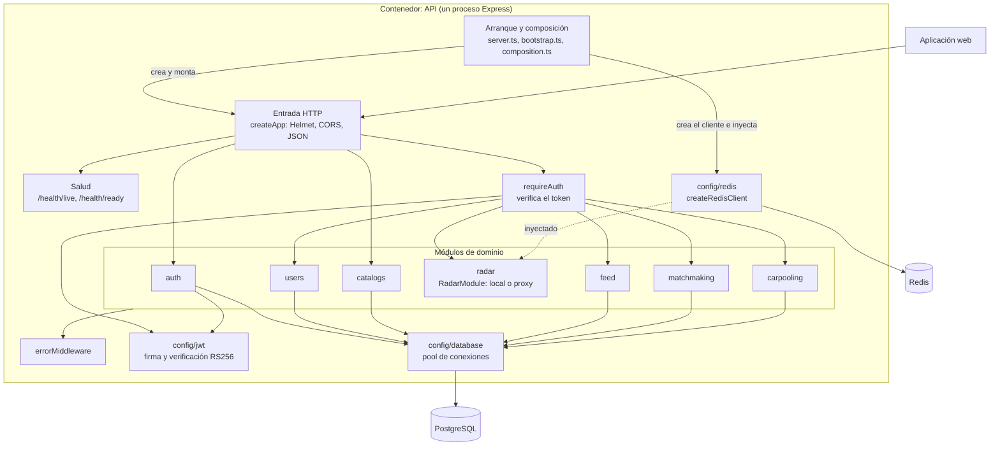
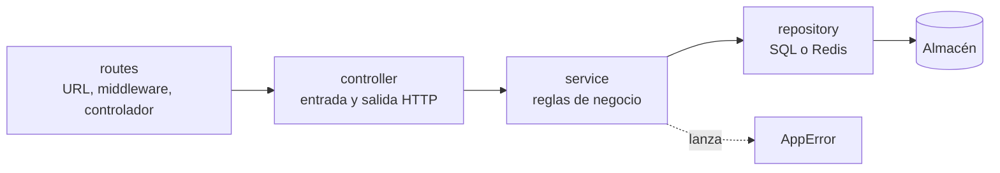
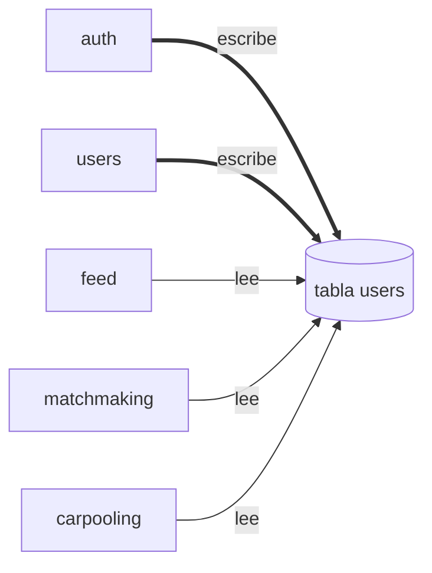

# C3 · Componentes del backend

**Pregunta:** ¿cómo se divide por dentro el contenedor «API»?
**Describe:** el estado actual.

Los componentes son agrupaciones de código dentro de un mismo proceso. Ninguno se despliega por separado.

## Diagrama general

Lectura:

- `auth` y `catalogs` reciben solicitudes sin pasar por `requireAuth`. En `auth`, solo la ruta `profile-me` lo usa.
- No hay flechas entre módulos: ninguno llama a otro.
- `radar` es el único componente conectado a Redis y el único sin conexión a PostgreSQL.

## Componentes

| Componente | Responsabilidad | Rutas | Archivos |
|---|---|---|---|
| Arranque y composición (etapa 3) | Validar configuración, crear conexiones, elegir radar local o proxy, arrancar y cerrar | — | [server.ts](../../apps/api/src/server.ts), [bootstrap.ts](../../apps/api/src/bootstrap.ts), [composition.ts](../../apps/api/src/composition.ts), [env.ts](../../apps/api/src/config/env.ts) |
| Entrada HTTP | `createApp()`: cabeceras de seguridad, CORS, análisis del cuerpo, montaje de enrutadores | — | [app.ts](../../apps/api/src/app.ts) |
| Salud (etapa 3) | Vida y disponibilidad de dependencias | 2, fuera de `/api/v1` | [health.routes.ts](../../apps/api/src/health/health.routes.ts) |
| `requireAuth` | Extraer y verificar el token; adjuntar la identidad a la solicitud | — | [auth.middleware.ts](../../apps/api/src/middlewares/auth.middleware.ts) |
| `auth` | Registro, inicio de sesión, emisión del token | 3 | [src/modules/auth](../../apps/api/src/modules/auth) |
| `users` | Aceptación de términos | 1 | [src/modules/users](../../apps/api/src/modules/users) |
| `catalogs` | Lectura pública de facultades, escuelas y pabellones | 2 | [src/modules/catalogs](../../apps/api/src/modules/catalogs) |
| `radar` | Estado del campus por consenso; desde la etapa 3, unidad montable (`RadarModule`) con Redis inyectado o reenvío a otro servicio | 2 | [src/modules/radar](../../apps/api/src/modules/radar) |
| `feed` | Publicaciones | 2 | [src/modules/feed](../../apps/api/src/modules/feed) |
| `matchmaking` | Descubrimiento, interacción y afinidad | 3 | [src/modules/matchmaking](../../apps/api/src/modules/matchmaking) |
| `carpooling` | Rutas, solicitudes y confirmaciones | 3 | [src/modules/carpooling](../../apps/api/src/modules/carpooling) |
| `errorMiddleware` | Convertir errores en respuestas HTTP | — | [error.middleware.ts](../../apps/api/src/middlewares/error.middleware.ts) |
| `config/jwt` | Firmar y verificar tokens RS256 | — | [jwt.ts](../../apps/api/src/config/jwt.ts) |
| `config/database` | Pool de PostgreSQL | — | [database.ts](../../apps/api/src/config/database.ts) |
| `config/redis` | Fábrica del cliente Redis; no conecta al importarse | — | [redis.ts](../../apps/api/src/config/redis.ts) |
| Compartido | `AppError`, política de roles, constantes | — | [src/shared](../../apps/api/src/shared) |

## Estructura interna de un módulo

Todos los módulos salvo `catalogs` repiten esta estructura.

`catalogs` tiene solo `routes` y `controller`; el controlador consulta el pool directamente.

## Dependencias ocultas entre componentes

El diagrama general muestra importaciones de código. Hay una dependencia que no aparece porque pasa por la base de datos: varios módulos leen la tabla `users`, que escriben `auth` y `users`.

Este acoplamiento por datos es el principal obstáculo para convertir los componentes en servicios. Se analiza en [Componentes y dependencias](../02-arquitectura-de-software/03-componentes-y-dependencias.md).

## Componentes de la aplicación web

No se elabora un C3 completo del frontend. Sus piezas relevantes para la arquitectura son tres:

| Componente | Responsabilidad | Archivo |
|---|---|---|
| Cliente HTTP | Añadir el token y tratar el 401 | [api.ts](../../apps/web/app/lib/api.ts) |
| Guarda de ruta | Aviso de términos | [RouteGuard.tsx](../../apps/web/components/ui/RouteGuard.tsx) |
| Disposición del panel | Redirigir al inicio de sesión si no hay token | [layout.tsx](../../apps/web/app/%28dashboard%29/layout.tsx) |

**Nivel anterior:** [C2 · Contenedores actuales](02-contenedores-actuales.md) · **Siguiente nivel:** [C4 · Código y secuencias](04-codigo-y-secuencias.md)

[← Guía del modelo C4](README.md) · [← Índice](../README.md)
