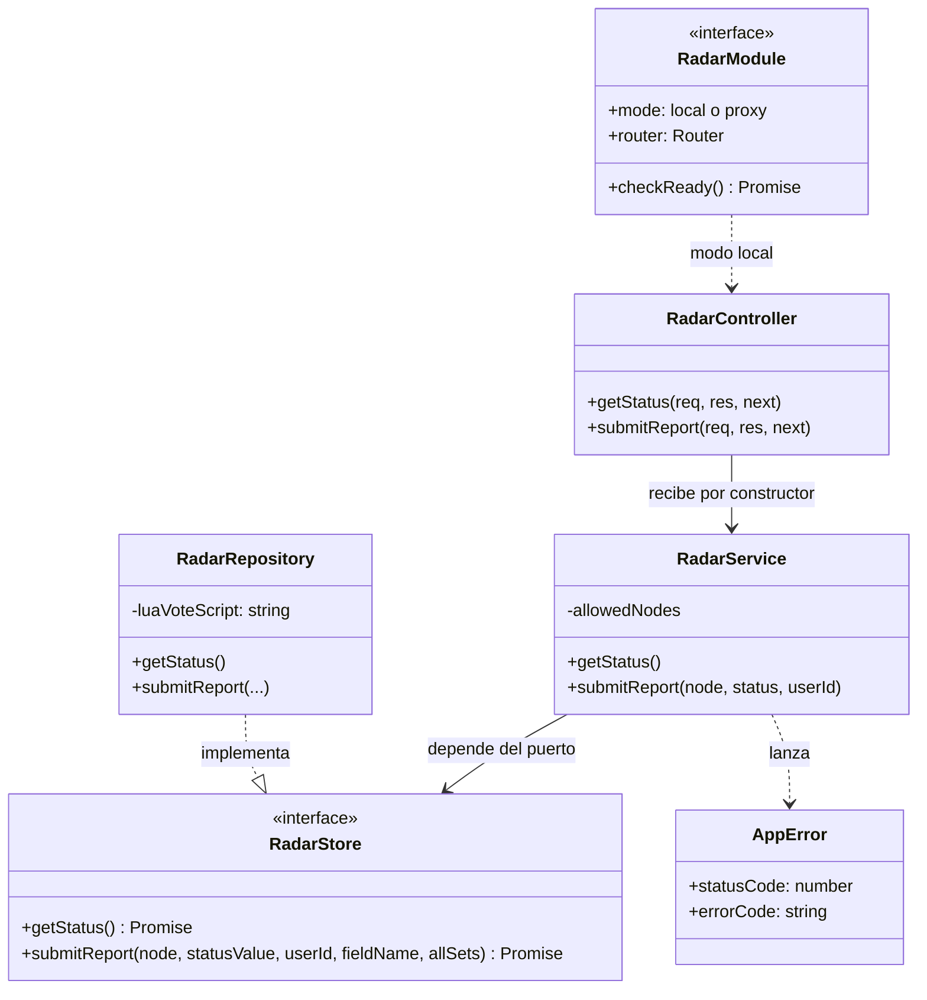
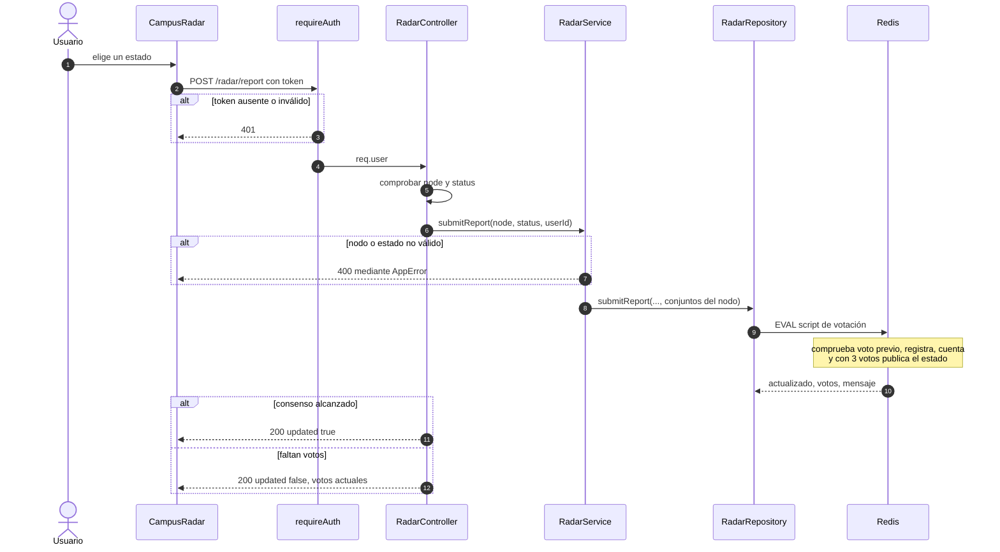
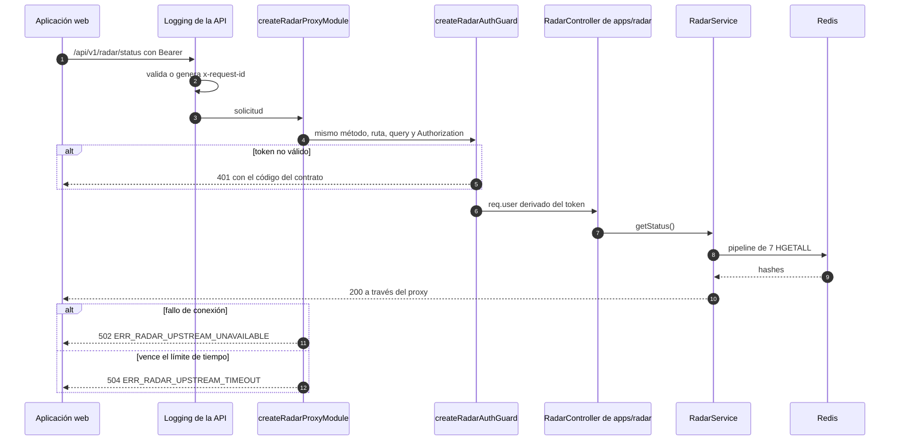
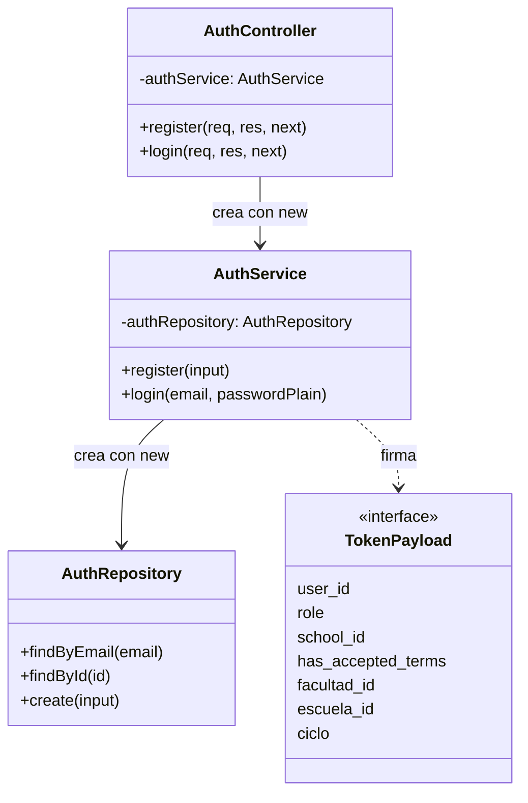
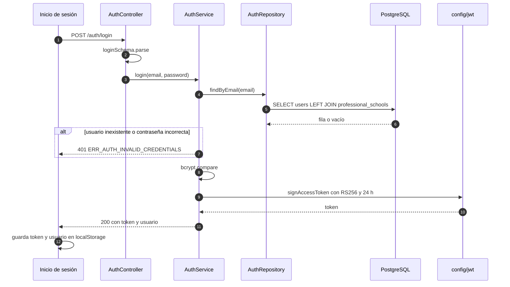
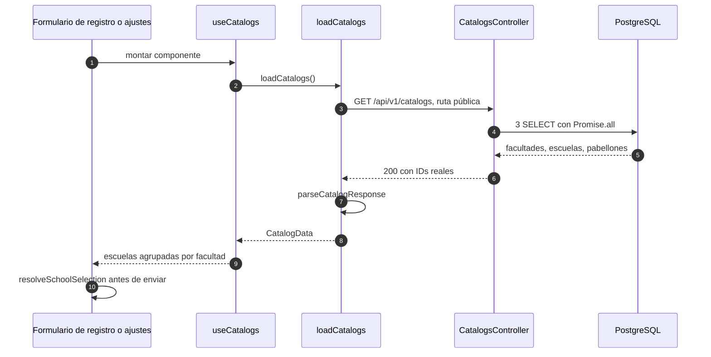
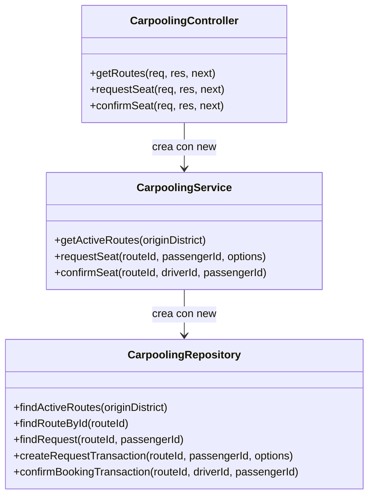
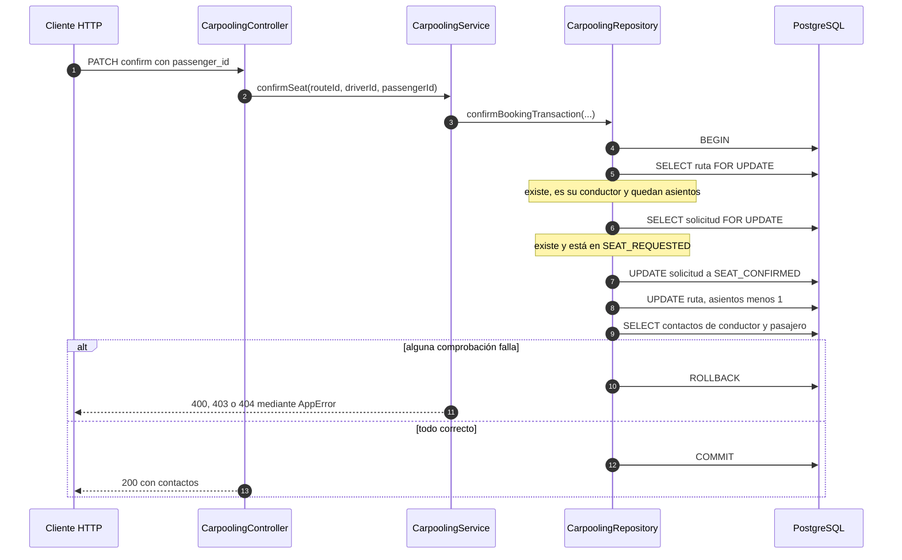
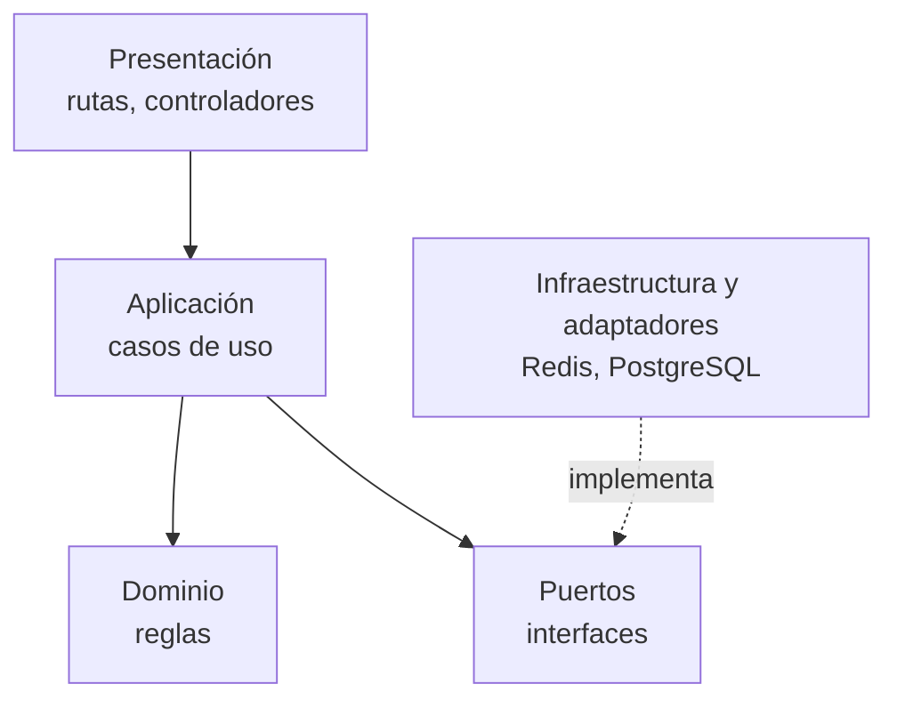

# C4 · Código y secuencias

**Pregunta:** ¿qué clases, funciones e interfaces realizan los flujos arquitectónicamente importantes?
**Describe:** el código de la `main` (`b763885`). Solo se dibujan flujos seleccionados, no todo el repositorio.

| Flujo | Sección |
|---|---|
| Radar: API en modo local | [A1](#a1-radar-en-la-api) |
| Radar: reporte con consenso | [A2](#a2-secuencia-reporte-con-consenso) |
| Radar: servicio y proxy | [A3](#a3-radar-a-través-del-proxy) |
| Autenticación | [B](#b-autenticación) |
| Catálogos | [C](#c-catálogos) |
| Carpooling | [D](#d-carpooling) |
| Dirección hexagonal | [E](#e-nivel-de-código-y-arquitectura-hexagonal) |

## A1. Radar en la API

| Elemento | Archivo |
|---|---|
| `RadarModule`, `createLocalRadarModule` | [radar.module.ts](../../apps/api/src/modules/radar/radar.module.ts) |
| `createRadarProxyModule` | [radar.proxy.ts](../../apps/api/src/modules/radar/radar.proxy.ts) |
| `RadarController` | [radar.controller.ts](../../apps/api/src/modules/radar/radar.controller.ts) |
| `RadarService` | [radar.service.ts](../../apps/api/src/modules/radar/radar.service.ts) |
| `RadarStore`, `RadarRepository` | [radar.repository.ts](../../apps/api/src/modules/radar/radar.repository.ts) |
| Composición | [composition.ts](../../apps/api/src/composition.ts) |

`RadarStore` es el único puerto de comportamiento del backend. `createAppResources` elige la unidad según `RADAR_MODE`, crea el cliente Redis solo en modo local y `createApp` monta el enrutador resultante sin conocer el modo.

## A2. Secuencia: reporte con consenso

`POST /api/v1/radar/report` en modo local.

El consenso es atómico porque vive en el script Lua, no en el servicio.

## A3. Radar a través del proxy

**Estado: IMPLEMENTADO PARCIALMENTE.** Código en `main`; el servicio sin desplegar y el proxy sin activar.

Archivos: [radar.proxy.ts](../../apps/api/src/modules/radar/radar.proxy.ts), [apps/radar/src/app.ts](../../apps/radar/src/app.ts), [auth.middleware.ts de Radar](../../apps/radar/src/middlewares/auth.middleware.ts).

El proxy hace **un solo intento**: repetir un `POST` podría duplicar efectos, y no recurre al Radar local sin que lo decida el operador.

## B. Autenticación

Después, cada ruta protegida pasa por `requireAuth`, que extrae el Bearer y llama a `verifyAccessToken`. No se consulta la base. Los errores son `ERR_AUTH_TOKEN_MISSING`, `ERR_AUTH_INVALID_TOKEN` y `ERR_AUTH_TOKEN_EXPIRED`.

| Elemento | Archivo |
|---|---|
| Rutas y controlador | [auth.routes.ts](../../apps/api/src/modules/auth/auth.routes.ts), [auth.controller.ts](../../apps/api/src/modules/auth/auth.controller.ts) |
| Validadores | [auth.validators.ts](../../apps/api/src/modules/auth/auth.validators.ts) |
| Servicio y repositorio | [auth.service.ts](../../apps/api/src/modules/auth/auth.service.ts), [auth.repository.ts](../../apps/api/src/modules/auth/auth.repository.ts) |
| Tokens y guarda | [jwt.ts](../../apps/api/src/config/jwt.ts), [auth.middleware.ts](../../apps/api/src/middlewares/auth.middleware.ts) |
| Política de roles | [roles.ts](../../apps/api/src/shared/auth/roles.ts) |

Limitaciones observadas: no hay renovación ni revocación, y el campo `jti` declarado en `TokenPayload` no se emite. Además, el registro normaliza el correo a minúsculas pero la búsqueda no: ver DT-47 en [Riesgos y deuda técnica](../07-evaluacion-y-evolucion/02-riesgos-y-deuda-tecnica.md).

## C. Catálogos

| Pregunta | Respuesta | Evidencia |
|---|---|---|
| ¿Cómo se consultan? | El controlador usa el pool directamente, sin servicio ni repositorio | [catalogs.controller.ts](../../apps/api/src/modules/catalogs/catalogs.controller.ts) |
| ¿Cómo se conservan los IDs? | `loadCatalogs` resuelve por clave natural, nunca actualiza claves primarias y aborta ante correspondencias ambiguas | [load_catalogs.ts](../../apps/api/src/database/migrations/load_catalogs.ts) |
| ¿Cómo se serializan cargas simultáneas? | Bloqueo `SHARE ROW EXCLUSIVE` en una transacción | [load_catalogs.ts](../../apps/api/src/database/migrations/load_catalogs.ts) |
| ¿Cómo los usa el frontend? | Solo envía IDs presentes en el catálogo cargado. Si falla, deshabilita la selección; ya no usa constantes locales | [catalogs.ts](../../apps/web/app/lib/catalogs.ts), [useCatalogs.ts](../../apps/web/app/lib/useCatalogs.ts) |

## D. Carpooling

**Estado: IMPLEMENTADO PARCIALMENTE.** La API está completa para listar, solicitar y confirmar; la pantalla usa `localStorage` y no existe ruta para publicar ni rechazar.

| Operación | Transacción | Protección de concurrencia |
|---|---|---|
| Solicitar asiento | `createRequestTransaction`: lee metadatos e inserta en una sesión | Índice único parcial `uq_active_carpooling_request`; el error `23505` se traduce a `ERR_CARPOOLING_DUPLICATE_REQUEST` |
| Confirmar asiento | `confirmBookingTransaction` | `FOR UPDATE` sobre ruta y solicitud |

Persistencia: `carpooling_routes`, `carpooling_requests`; lectura de `users` y `professional_schools`. Código de prueba presente en producción: `injectedFailure` y un cliente alternativo si `pool.connect` no existe (DT-21).

## E. Nivel de código y arquitectura hexagonal

> Las dependencias deben apuntar hacia el dominio y los casos de uso, no hacia la infraestructura.

**Estado: IMPLEMENTACIÓN PARCIAL / DIRECCIÓN ARQUITECTÓNICA PROPUESTA.**

| Condición | Radar | Demás módulos |
|---|---|---|
| Puerto de almacenamiento | Sí: `RadarStore` | No |
| Dependencias inyectadas | Sí, por constructor | No: `new` en campos privados |
| Composición explícita | Sí: `composition.ts`, `apps/radar/src/app.ts` | No |
| Dominio separado de la aplicación | No: `RadarService` reúne ambos y mantiene los valores permitidos | No |
| Puerto ubicado en el centro | No: `RadarStore` se declara en el archivo del adaptador, y el servicio importa de `radar.repository.ts` | No aplica |
| Regla sin dependencia de HTTP | Parcial: `RadarService` lanza errores con estado HTTP | No |

Radar es, por tanto, un primer paso hacia puertos y adaptadores, no una arquitectura hexagonal terminada.

## Qué enseñan estos diagramas

| Observación | Dónde se ve |
|---|---|
| El flujo sigue el camino middleware, controlador, servicio, repositorio | Todas las secuencias |
| Las reglas atómicas viven en el almacén o en el repositorio | Script Lua y transacción de confirmación |
| La identidad llega resuelta desde el token | `req.user` en Radar y carpooling |
| La frontera de Radar es HTTP y clave pública; no comparte código con la API | Secuencia A3 |

**Nivel anterior:** [C3 · Componentes](03-componentes-del-backend.md) · **Trazabilidad:** [Requisito a código](07-trazabilidad-c4.md)

[← Guía del modelo C4](README.md) · [← Índice](../README.md)
