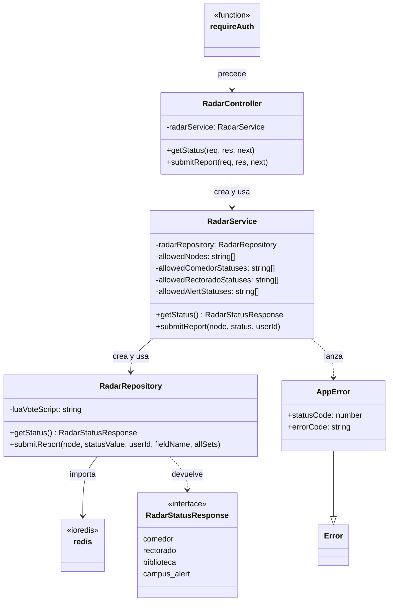
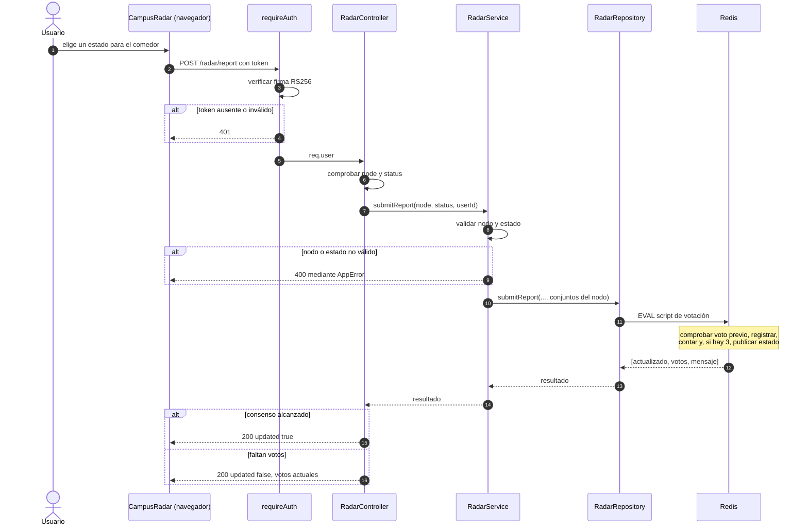
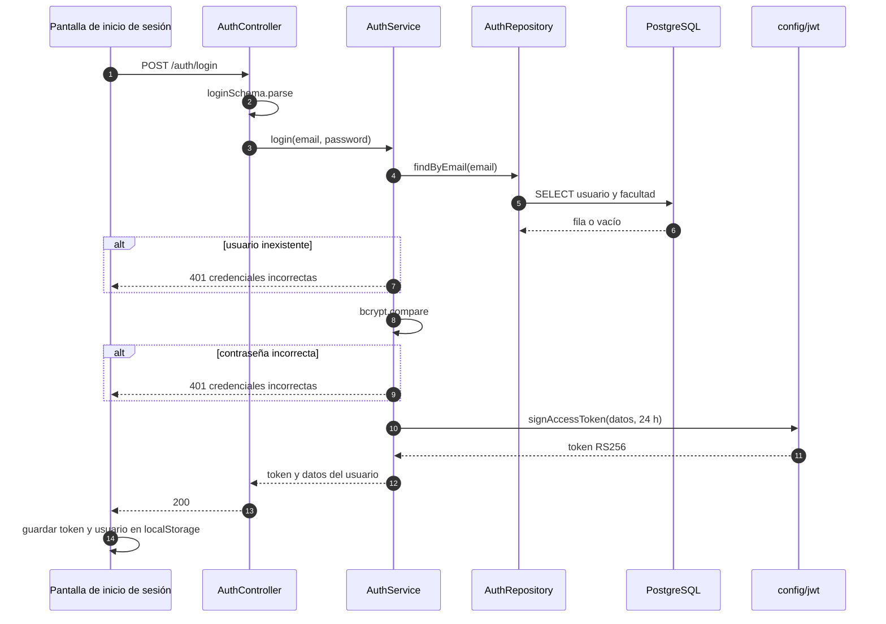

# C4 · Código y secuencias

**Pregunta:** ¿qué clases realizan un flujo concreto y en qué orden colaboran?
**Describe:** el estado actual, con clases y métodos que existen en el commit `8e56bfa`.

Se detalla el flujo del radar por ser el más representativo de la arquitectura y el primer candidato a extracción, y se añaden secuencias de otros dos flujos.

## Clases del flujo de reporte del radar

| Elemento | Archivo |
|---|---|
| `RadarController` | [radar.controller.ts](../../apps/api/src/modules/radar/radar.controller.ts) |
| `RadarService` | [radar.service.ts](../../apps/api/src/modules/radar/radar.service.ts) |
| `RadarRepository`, `RadarStatusResponse` | [radar.repository.ts](../../apps/api/src/modules/radar/radar.repository.ts) |
| `AppError` | [AppError.ts](../../apps/api/src/shared/errors/AppError.ts) |
| `requireAuth` | [auth.middleware.ts](../../apps/api/src/middlewares/auth.middleware.ts) |
| `redis` | [redis.ts](../../apps/api/src/config/redis.ts) |

Observaciones sobre el diagrama:

- Las relaciones «crea y usa» son dependencias hacia clases concretas, creadas con `new`. No hay ninguna interfaz entre `RadarService` y `RadarRepository`.
- La única interfaz, `RadarStatusResponse`, describe datos, no comportamiento.
- La única herencia es `AppError` de `Error`.

## Secuencia: reporte al radar con consenso

`POST /api/v1/radar/report`

## Secuencia: inicio de sesión

`POST /api/v1/auth/login`

Archivos: [auth.controller.ts](../../apps/api/src/modules/auth/auth.controller.ts), [auth.service.ts](../../apps/api/src/modules/auth/auth.service.ts), [auth.repository.ts](../../apps/api/src/modules/auth/auth.repository.ts), [jwt.ts](../../apps/api/src/config/jwt.ts), [login/page.tsx](../../apps/web/app/%28auth%29/login/page.tsx).

## Secuencia: confirmación de asiento

`PATCH /api/v1/carpooling/:route_id/confirm`

```mermaid
sequenceDiagram
    autonumber
    participant X as Cliente HTTP
    participant C as CarpoolingController
    participant S as CarpoolingService
    participant R as CarpoolingRepository
    participant D as PostgreSQL

    X->>C: PATCH confirm con passenger_id
    C->>S: confirmSeat(routeId, driverId, passengerId)
    S->>R: confirmBookingTransaction(...)
    R->>D: BEGIN
    R->>D: SELECT ruta FOR UPDATE
    Note over R: ¿existe? ¿es su conductor? ¿quedan asientos?
    R->>D: SELECT solicitud FOR UPDATE
    Note over R: ¿existe? ¿está en SEAT_REQUESTED?
    R->>D: UPDATE solicitud a SEAT_CONFIRMED
    R->>D: UPDATE ruta, asientos menos 1
    R->>D: SELECT contacto del conductor
    R->>D: SELECT contacto del pasajero
    alt alguna comprobación falla
        R->>D: ROLLBACK
        R-->>S: Error con mensaje clave
        S-->>X: 400, 403 o 404 mediante AppError
    else todo correcto
        R->>D: COMMIT
        R-->>S: contactos
        S-->>C: datos de la conexión
        C-->>X: 200
    end
```

El participante es «cliente HTTP» y no una pantalla porque el frontend no consume esta ruta. Archivos: [carpooling.controller.ts](../../apps/api/src/modules/carpooling/carpooling.controller.ts), [carpooling.service.ts](../../apps/api/src/modules/carpooling/carpooling.service.ts), [carpooling.repository.ts](../../apps/api/src/modules/carpooling/carpooling.repository.ts).

## Qué enseñan estos diagramas sobre el diseño

| Observación | Dónde se ve |
|---|---|
| El flujo sigue siempre el mismo camino: middleware, controlador, servicio, repositorio | Las tres secuencias |
| Las reglas atómicas viven en el almacén o en el repositorio, no en el servicio | El script de Redis y la transacción de confirmación |
| La identidad llega resuelta desde el token; ningún flujo consulta al módulo de autenticación | `req.user` en la primera secuencia |
| El radar no toca PostgreSQL | Primera secuencia |

**Nivel anterior:** [C3 · Componentes del backend](03-componentes-del-backend.md) · **Propuestas:** [C2 de transición](05-contenedores-de-transicion.md)

[← Guía del modelo C4](README.md) · [← Índice](../README.md)
