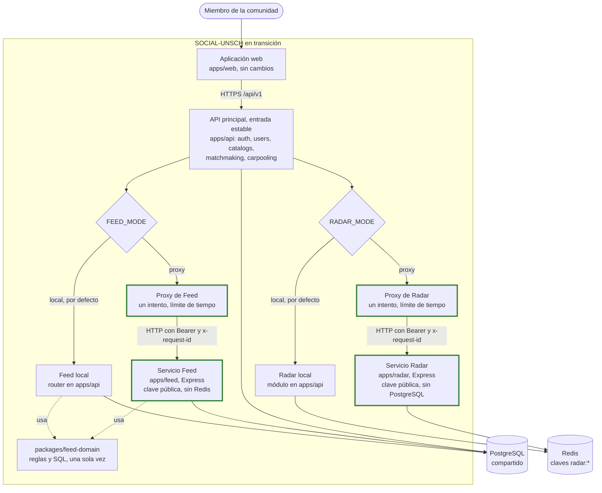

# C2 · Contenedores de transición

> **Estado: IMPLEMENTADO PARCIALMENTE.** El código de los dos proxies y de los dos servicios está en `main` (Radar desde el [PR n.º 5](https://github.com/pillacarodriguezuriel-a11y/social_unsch/pull/5); Feed desde los PR [n.º 10](https://github.com/pillacarodriguezuriel-a11y/social_unsch/pull/10) y [n.º 11](https://github.com/pillacarodriguezuriel-a11y/social_unsch/pull/11)). La API desplegada incluye ambos proxies, **sin activar**: `RADAR_MODE=local` y `FEED_MODE=local`. **Ni `apps/radar` ni `apps/feed` están desplegados.** Detalle en [Cierre de la migración](../migracion/ETAPA_08_CIERRE_MIGRACION.md).

**Pregunta:** ¿cómo conviven el núcleo, Radar y Feed durante la migración?

## Diagrama

**Leyenda:** trazo continuo, en operación. Trazo grueso verde, con código en `main` pero sin desplegar o sin activar. Trazo discontinuo, dependencia de biblioteca compilada, no llamada en ejecución.

Las dos decisiones son **independientes**, así que existen cuatro combinaciones válidas. El orden acordado activa una a la vez: Radar primero, Feed solo cuando Radar lleve su observación en verde ([ADR-011](../06-decisiones-arquitectonicas/ADR-011-cierre-de-la-migracion-y-alcance-final.md)).

## Contenedores

| Contenedor | Tecnología | Responsabilidad | Estado |
|---|---|---|---|
| Aplicación web | Next.js | Sigue llamando a `/api/v1`; no sabe dónde se atienden Radar ni Feed | IMPLEMENTADO |
| API principal | Express | Emite tokens, atiende los demás módulos y monta Radar y Feed como unidades reemplazables | IMPLEMENTADO |
| Proxy de Radar | [radar.proxy.ts](../../apps/api/src/modules/radar/radar.proxy.ts) | Reenvía a `RADAR_PROXY_TARGET`. Sin reintentos ni respaldo local automático. Responde 502 o 504 | IMPLEMENTADO; sin activar |
| Radar local | [radar.module.ts](../../apps/api/src/modules/radar/radar.module.ts) | Respaldo de reversión y modo vigente en producción | IMPLEMENTADO |
| Servicio Radar | [apps/radar](../../apps/radar/package.json) | Proceso independiente con su configuración, salud y registros | IMPLEMENTADO; **sin desplegar** |
| Proxy de Feed | [feed.proxy.ts](../../apps/api/src/modules/feed/feed.proxy.ts) | Reenvía a `FEED_PROXY_TARGET`. Sin reintentos ni respaldo local automático. Responde 502 o 504 | IMPLEMENTADO; sin activar |
| Feed local | [feed.module.ts](../../apps/api/src/modules/feed/feed.module.ts) | Respaldo de reversión y modo vigente en producción | IMPLEMENTADO |
| Servicio Feed | [apps/feed](../../apps/feed/package.json) | Proceso independiente con su configuración, salud y registros | IMPLEMENTADO; **sin desplegar** |
| PostgreSQL | — | **Compartido** por la API y el servicio Feed. 30 conexiones si ambos se despliegan | IMPLEMENTADO |
| Redis | — | Cada proceso usa su propia conexión; las claves `radar:*` son las mismas. Feed no lo usa | IMPLEMENTADO |

## Relaciones nuevas

| De | A | Protocolo | Garantía |
|---|---|---|---|
| Proxy de Radar | Servicio Radar | HTTP(S), JSON | Reenvía método, ruta, query, cuerpo, `Authorization` y `x-request-id`. El destino sale solo de la configuración |
| Proxy de Feed | Servicio Feed | HTTP(S), JSON | Igual: lista blanca de cabeceras, un intento, sin reintentos. No reenvía cookies |
| Servicio Radar | Redis | Protocolo de Redis, TLS con `rediss://` | Sin cola sin conexión y un reintento por comando |
| Servicio Feed | PostgreSQL | SQL mediante `pg`, TLS según la cadena | Pool propio de 10 conexiones, con manejador de error del pool |
| Servicio Radar y Servicio Feed | Token del usuario | Verificación RS256 local | Usan solo la clave pública; no llaman a la API ni aceptan cabeceras de identidad |

## Qué hace reversible esta configuración

| Situación | Acción | Efecto |
|---|---|---|
| El servicio Radar falla o se comporta distinto | `RADAR_MODE=local` en la API y reinicio | La API vuelve a atender Radar. Requiere que `REDIS_URL` siga definida |
| El servicio Feed falla o se comporta distinto | `FEED_MODE=local` en la API y reinicio | La API vuelve a atender Feed. `DATABASE_URL` ya está definida porque el resto de módulos la usan |
| **PostgreSQL cae** | Ninguna reversión ayuda | La causa es compartida: afecta a la API y al servicio Feed por igual. Distinguir caída de proceso de caída de la base |
| La API falla | Ninguna específica | La API sigue siendo el punto único de entrada |

> **Cuidado:** vaciar `RADAR_PROXY_TARGET` o `FEED_PROXY_TARGET` sin cambiar el modo correspondiente **no** revierte: la validación de [env.ts](../../apps/api/src/config/env.ts) rechaza esa configuración y la API no arranca.

La reversión de Radar funciona porque ambas implementaciones comparten formato de claves y contrato HTTP; si cambia alguno durante la convivencia, deja de ser segura. **La de Feed es más sólida:** no hay dos implementaciones, sino una sola en `packages/feed-domain` que ambos modos usan, y dos pruebas de contrato en espejo lo comprueban en cada `verify`.

> **Sobre un 504 en una escritura:** `POST /api/v1/feed` puede haber creado la publicación aunque el proxy responda 504. No hay reintento automático ni respaldo entre procesos, precisamente porque la operación no es idempotente. Comprobar con `GET /api/v1/feed` antes de volver a enviar.

## Qué no cambia

- El contrato que ve el frontend.
- La emisión de tokens, que sigue solo en la API.
- El esquema de PostgreSQL: `apps/api` es su único propietario y `apps/feed` no tiene migraciones.

## Qué falta para que este diagrama sea la realidad

Se detalla en [Pendientes](../07-evaluacion-y-evolucion/08-pendientes.md) y en el [cierre de la migración](../migracion/ETAPA_08_CIERRE_MIGRACION.md): decidir el presupuesto, desplegar Radar, medir en la plataforma real, activar su proxy, cumplir su observación de 14 días y solo después repetirlo con Feed.

**Relacionados:** [C2 actual](Nivel2-DiagramadeContenedores.md) · [C2 objetivo](06-contenedores-objetivo.md) · [Arquitectura de transición](../02-arquitectura-software/04-arquitectura-de-transicion.md) · [ADR-008](../06-decisiones-arquitectonicas/ADR-008-extraccion-radar-servicio-independiente.md) · [ADR-010](../06-decisiones-arquitectonicas/ADR-010-extraccion-feed-servicio-independiente.md) · [ADR-011](../06-decisiones-arquitectonicas/ADR-011-cierre-de-la-migracion-y-alcance-final.md)

[← Guía del modelo C4](README.md) · [← Índice](../README.md)
