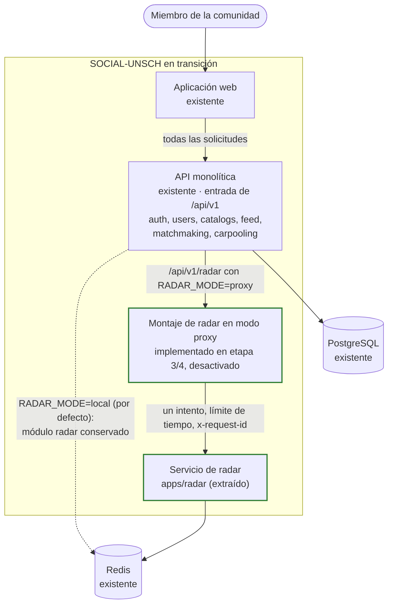

# C2 · Contenedores de transición

> **Estado: Implementado en código y validado en local/CI (Etapa 4).** Representa el sistema con el servicio independiente de Radar extraído en `apps/radar`, con compatibilidad de contratos en `packages/contracts`, verificación RS256 y pruebas de paridad. En producción, la API conserva `RADAR_MODE=local` como valor predeterminado hasta la autorización y ventana de activación formal. Ver detalles en [ETAPA_04_EXTRACCION_RADAR](../migracion/ETAPA_04_EXTRACCION_RADAR.md) y [ADR-008](../06-decisiones-arquitectonicas/ADR-008-extraccion-radar-servicio-independiente.md).

**Pregunta:** ¿cómo conviven lo existente y lo nuevo durante la migración?

## Diagrama

**Leyenda:** trazo continuo, contenedor o relación existente; verde, implementado en código y listo para activación.

## Contenedores

| Contenedor | Estado | Cambio respecto a hoy |
|---|---|---|
| Aplicación web | Existente | Sin cambios: sigue llamando a la API en `/api/v1` |
| Entrada de API | Implementado en etapas 3 y 4 (`RADAR_MODE=local` por defecto) | La propia API: monta el radar como unidad reemplazable y lo reenvía en modo proxy cuando `RADAR_MODE=proxy`. Se propagan cabeceras de correlación `x-request-id` |
| API monolítica | Existente | Conserva todos sus módulos. El módulo local de radar se mantiene para permitir reversión inmediata en caliente |
| Servicio de radar (`apps/radar`) | Implementado en código y validado en local/CI | Proceso independiente Express con Redis propio, límites arquitectónicos estrictos y verificación RS256 sin acceso a PostgreSQL |
| PostgreSQL | Existente | Sin cambios; inaccesible desde Radar |
| Redis | Existente | Administrado por conexiones separadas y resilientes en cada proceso |

## Qué hace reversible esta configuración

| Situación | Acción | Efecto |
|---|---|---|
| El servicio de radar falla o se comporta distinto | `RADAR_MODE=local` en la API | El monolito atiende de nuevo, con el mismo Redis y las mismas claves, sin redesplegar código |
| La API (entrada) falla | Igual que hoy: la API es un único punto de entrada | Sin cambio respecto a la situación actual |

La reversión es posible porque el monolito y el servicio nuevo comparten el mismo formato de claves en Redis y el mismo contrato HTTP. Si alguno de los dos cambia durante la convivencia, la reversión deja de ser segura.

## Condiciones para llegar a este estado

- Repositorio dividido en paquetes y contrato de Radar formalizado (hecho en la etapa 3).
- Verificación de token disponible como código compartido (pendiente).
- Ruta de salud en el monolito (hecho en la etapa 3) y en el servicio nuevo.
- Pruebas reales del radar ejecutándose contra el servicio nuevo sin cambios en sus aserciones.

## Qué no cambia

- El contrato que ve el frontend.
- La emisión de tokens.
- Los datos: Redis ya es un almacén exclusivo del radar.

**Relacionados:** [C2 actual](02-contenedores-actuales.md) · [C2 objetivo](06-contenedores-objetivo.md) · [ADR-004](../06-decisiones-arquitectonicas/ADR-004-extraccion-inicial-de-radar.md)

[← Guía del modelo C4](README.md) · [← Índice](../README.md)
