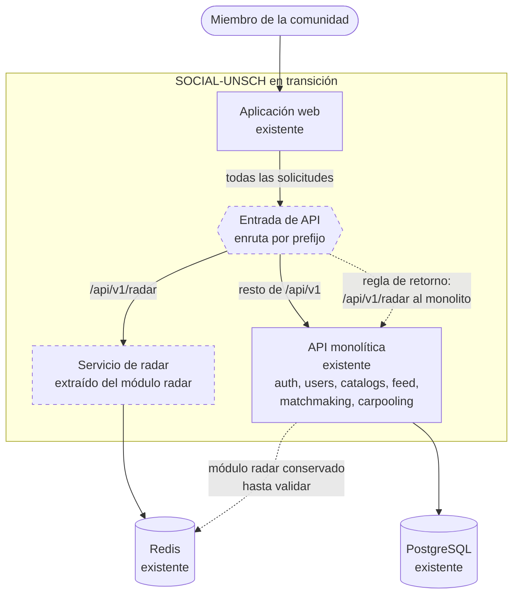

# C2 · Contenedores de transición

> **Estado: Propuesto.** Este diagrama no describe código existente. Representa el sistema después de la etapa 4 del [plan de migración](../07-evaluacion-y-evolucion/03-plan-de-migracion.md): radar extraído y el resto todavía en el monolito.

**Pregunta:** ¿cómo conviven lo existente y lo nuevo durante la migración?

## Diagrama

**Leyenda:** trazo continuo, contenedor o relación existente; trazo discontinuo, propuesto.

## Contenedores

| Contenedor | Estado | Cambio respecto a hoy |
|---|---|---|
| Aplicación web | Existente | Su URL de API apunta a la entrada, no al monolito |
| Entrada de API | Propuesto | Nuevo. Puede ser un servicio dedicado, reescrituras en la plataforma del frontend o el propio monolito reenviando; ver [Arquitectura de transición](../02-arquitectura-de-software/04-arquitectura-de-transicion.md) |
| API monolítica | Existente | Conserva todos sus módulos. El de radar deja de recibir tráfico, pero no se elimina |
| Servicio de radar | Propuesto | Nuevo proceso con el código del módulo actual. Verifica los tokens por sí mismo con la clave pública |
| PostgreSQL | Existente | Sin cambios |
| Redis | Existente | Pasa a ser usado por el servicio de radar |

## Qué hace reversible esta configuración

| Situación | Acción | Efecto |
|---|---|---|
| El servicio de radar falla o se comporta distinto | Cambiar la regla de la entrada para que `/api/v1/radar` vuelva al monolito | El monolito atiende de nuevo, con el mismo Redis y las mismas claves |
| La entrada falla | Apuntar el frontend directamente al monolito | Requiere recompilar el frontend, porque la URL se fija al compilar |

La reversión es posible porque el monolito y el servicio nuevo comparten el mismo formato de claves en Redis y el mismo contrato HTTP. Si alguno de los dos cambia durante la convivencia, la reversión deja de ser segura.

## Condiciones para llegar a este estado

- Repositorio dividido en paquetes y contratos formalizados (etapa 3).
- Verificación de token disponible como código compartido.
- Ruta de salud en el monolito y en el servicio nuevo.
- Pruebas reales del radar ejecutándose contra el servicio nuevo sin cambios en sus aserciones.

## Qué no cambia

- El contrato que ve el frontend.
- La emisión de tokens.
- Los datos: Redis ya es un almacén exclusivo del radar.

**Relacionados:** [C2 actual](02-contenedores-actuales.md) · [C2 objetivo](06-contenedores-objetivo.md) · [ADR-004](../06-decisiones-arquitectonicas/ADR-004-extraccion-inicial-de-radar.md)

[← Guía del modelo C4](README.md) · [← Índice](../README.md)
