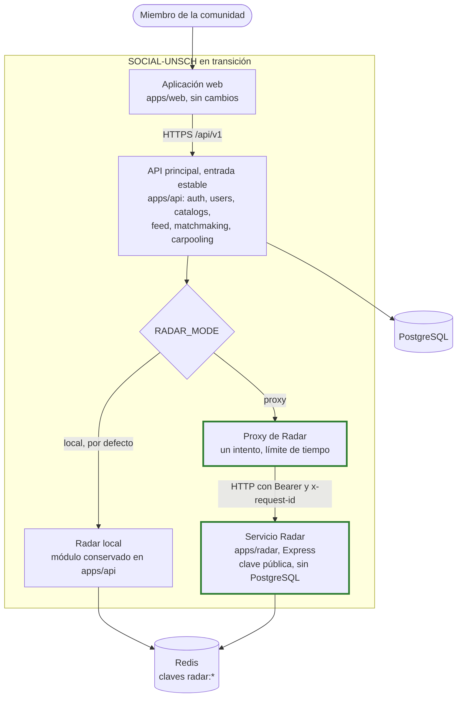

# C2 · Contenedores de transición

> **Estado: IMPLEMENTADO PARCIALMENTE.** El código está en `main` desde el [PR n.º 5](https://github.com/pillacarodriguezuriel-a11y/social_unsch/pull/5). La API desplegada incluye el proxy, sin activar. El servicio Radar **no está desplegado** y la API sigue atendiendo Radar en proceso. En CI, `verify` pasa y `test-real` falla. Detalle en [Extracción de Radar](../migracion/EXTRACCION_RADAR.md).

**Pregunta:** ¿cómo conviven el núcleo y Radar durante la migración?

## Diagrama

**Leyenda:** trazo continuo, en operación. Trazo grueso verde, con código en `main` pero sin desplegar o sin activar.

## Contenedores

| Contenedor | Tecnología | Responsabilidad | Estado |
|---|---|---|---|
| Aplicación web | Next.js | Sigue llamando a `/api/v1`; no sabe dónde se atiende Radar | IMPLEMENTADO |
| API principal | Express | Emite tokens, atiende los demás módulos y monta Radar en `/api/v1/radar` | IMPLEMENTADO |
| Proxy de Radar | [radar.proxy.ts](../../apps/api/src/modules/radar/radar.proxy.ts) | Reenvía a `RADAR_PROXY_TARGET`. Sin reintentos ni respaldo local automático. Responde 502 o 504 | IMPLEMENTADO; sin activar |
| Radar local | [radar.module.ts](../../apps/api/src/modules/radar/radar.module.ts) | Respaldo de reversión y modo vigente en producción | IMPLEMENTADO |
| Servicio Radar | [apps/radar](../../apps/radar/package.json) | Proceso independiente con su propia configuración, salud y registros | IMPLEMENTADO PARCIALMENTE: código en `main`, sin desplegar |
| PostgreSQL | — | Sin cambios; Radar no lo usa | IMPLEMENTADO |
| Redis | — | Cada proceso usa su propia conexión; las claves `radar:*` son las mismas | IMPLEMENTADO |

## Relaciones nuevas

| De | A | Protocolo | Garantía |
|---|---|---|---|
| Proxy | Servicio Radar | HTTP(S), JSON | Reenvía método, ruta, query, cuerpo, `Authorization` y `x-request-id`. El destino sale solo de la configuración |
| Servicio Radar | Redis | Protocolo de Redis, TLS con `rediss://` | Sin cola sin conexión y un reintento por comando |
| Servicio Radar | Token del usuario | Verificación RS256 local | Usa solo la clave pública; no llama a la API |

## Qué hace reversible esta configuración

| Situación | Acción | Efecto |
|---|---|---|
| El servicio Radar falla o se comporta distinto | `RADAR_MODE=local` en la API y reinicio del servicio | La API vuelve a atender Radar. Requiere que `REDIS_URL` siga definida en la API |
| La API falla | Ninguna específica | La API sigue siendo el punto único de entrada |

> **Cuidado:** vaciar `RADAR_PROXY_TARGET` sin cambiar `RADAR_MODE` **no** revierte: la validación de [env.ts](../../apps/api/src/config/env.ts) rechaza esa configuración y la API no arranca.

La reversión funciona porque ambas implementaciones comparten formato de claves y contrato HTTP. Si cambia alguno durante la convivencia, deja de ser segura.

## Qué no cambia

- El contrato que ve el frontend.
- La emisión de tokens, que sigue solo en la API.
- PostgreSQL.

## Qué falta para que este diagrama sea la realidad

Se detalla en [Pendientes](../07-evaluacion-y-evolucion/08-pendientes.md): corregir `test-real` en CI, fusionar el PR, desplegar Radar, medir en la plataforma real, activar el proxy y ensayar la reversión.

**Relacionados:** [C2 actual](02-contenedores-actuales.md) · [C2 objetivo](06-contenedores-objetivo.md) · [Arquitectura de transición](../02-arquitectura-de-software/04-arquitectura-de-transicion.md) · [ADR-008](../06-decisiones-arquitectonicas/ADR-008-extraccion-radar-servicio-independiente.md)

[← Guía del modelo C4](README.md) · [← Índice](../README.md)
