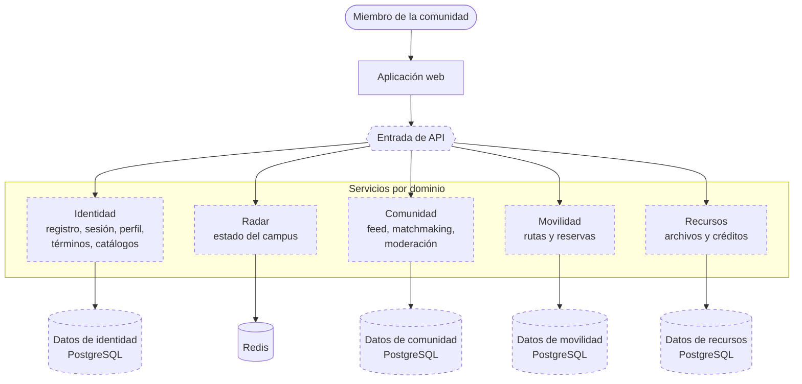
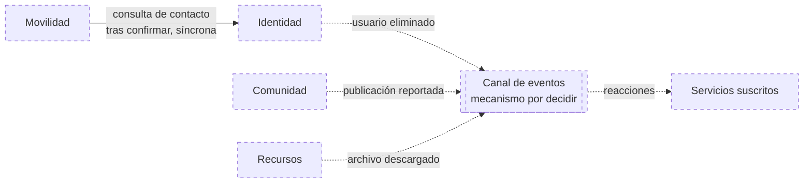

# C2 · Contenedores objetivo

> **Estado: Propuesto.** Este diagrama representa el destino de la migración. De los contenedores de servidor que muestra, hoy solo existen la aplicación web y los almacenes PostgreSQL y Redis; la lógica está en una única API.

**Pregunta:** ¿cuál es el destino de la migración?

## Diagrama

**Leyenda:** trazo discontinuo, propuesto. Trazo continuo, existente (aplicación web y Redis).

### Comunicación entre servicios

El diagrama anterior muestra la estructura. Las relaciones entre servicios se muestran aparte para mantener ambos legibles.

Todo este segundo diagrama es propuesto. Línea continua: llamada síncrona. Línea de puntos: evento asíncrono.

## Contenedores

| Contenedor | Responsabilidad | Dueño de | Origen |
|---|---|---|---|
| Aplicación web | Interfaz | Nada compartido | Existente |
| Entrada de API | Punto único de entrada y enrutamiento | Nada | Nueva |
| Identidad | Cuentas, emisión de tokens, perfil, términos, catálogos | `users`, catálogos | Módulos `auth`, `users`, `catalogs` |
| Radar | Consenso y estado del campus | Claves `radar:*` | Módulo `radar` |
| Comunidad | Publicaciones, matchmaking, moderación | `feed_posts`, `matchmaking_*`, `moderation_*` | Módulos `feed`, `matchmaking`; moderación por construir |
| Movilidad | Rutas y reservas | `carpooling_*` | Módulo `carpooling`; publicación de rutas por construir |
| Recursos | Archivos y créditos | `academic_files`, `file_downloads`, `wiki_credits_log`, saldo | Por construir sobre el esquema existente |
| Canal de eventos | Transporte de hechos entre servicios | — | Nuevo; mecanismo sin decidir |

Los cuatro cilindros de PostgreSQL representan **propiedad separada**, no necesariamente cuatro servidores. Pueden ser esquemas o usuarios distintos de una misma instancia; ver [ADR-005](../06-decisiones-arquitectonicas/ADR-005-propiedad-gradual-de-datos.md).

## Relaciones

| Relación | Tipo | Motivo |
|---|---|---|
| Entrada → servicios | Síncrona, HTTP | Contrato `/api/v1` actual |
| Cada servicio → identidad del usuario | Ninguna llamada: se verifica el token con la clave pública | El token ya lleva identificador y rol |
| Movilidad → Identidad | Síncrona, por contrato | Los datos de contacto se necesitan en el momento de confirmar y deben estar actualizados |
| Comunidad, Recursos, Identidad → canal de eventos | Asíncrona | Reacciones que no deben bloquear la operación |

## Diferencias con el estado actual

| Aspecto | Actual | Objetivo |
|---|---|---|
| Unidades de servidor | 1 | 5 más la entrada |
| Acceso a `users` | 5 módulos con SQL directo | Solo Identidad |
| Reglas en disparadores de la base | Créditos y moderación | En el servicio dueño |
| Comunicación entre dominios | A través de tablas compartidas | Por contrato o por eventos |
| Organización interna | Capas con dependencias concretas | Hexagonal |
| Funciones simuladas | Seis pantallas | Construidas en su servicio |

## Advertencias

- Este diagrama es un objetivo, no un compromiso de fechas ni una descripción del sistema.
- El número de servicios puede reducirse: mantener Identidad y Comunidad juntas es una variante válida si el costo de operación lo aconseja.
- Marketplace y empleo no aparecen: el plan de migración no les asigna servicio.

**Relacionados:** [C2 actual](02-contenedores-actuales.md) · [C2 de transición](05-contenedores-de-transicion.md) · [Arquitectura objetivo](../02-arquitectura-de-software/05-arquitectura-objetivo.md)

[← Guía del modelo C4](README.md) · [← Índice](../README.md)
