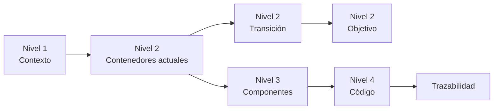

# Modelo C4

El modelo C4 describe un sistema en cuatro niveles de detalle, del más general al más concreto. Cada nivel responde a una pregunta distinta y sirve a un lector distinto.

| Nivel | Nombre | Pregunta | Documento | Describe |
|---|---|---|---|---|
| 1 | Contexto | ¿Qué es SOCIAL-UNSCH, quién lo usa y con qué sistemas interactúa? | [01-contexto.md](01-contexto.md) | Realidad actual |
| 2 | Contenedores actuales | ¿Qué aplicaciones y almacenes de datos lo conforman? | [02-contenedores-actuales.md](02-contenedores-actuales.md) | Realidad actual (`main` y producción) |
| 2 | Contenedores de transición | ¿Cómo conviven el núcleo y Radar? | [05-contenedores-de-transicion.md](05-contenedores-de-transicion.md) | Código en PR n.º 5; **no desplegado** |
| 2 | Contenedores objetivo | ¿Cuál es el destino? | [06-contenedores-objetivo.md](06-contenedores-objetivo.md) | **Propuesto** |
| 3 | Componentes | ¿Cómo se dividen internamente el backend y Radar? | [03-componentes-del-backend.md](03-componentes-del-backend.md) | Código de la rama de la etapa 4 |
| 4 | Código | ¿Qué clases, funciones e interfaces realizan los flujos importantes? | [04-codigo-y-secuencias.md](04-codigo-y-secuencias.md) | Código de la rama de la etapa 4 |
| — | Trazabilidad | ¿Dónde está cada funcionalidad en cada nivel? | [07-trazabilidad-c4.md](07-trazabilidad-c4.md) | Requisito → dominio → contenedor → componente → código |

## Recorrido sugerido

## Dos aclaraciones de vocabulario

- **Contenedor** en C4 es cualquier cosa que se ejecuta o almacena datos de forma independiente: una aplicación web, una API, una base de datos. **No significa contenedor Docker.** La API de SOCIAL-UNSCH es un contenedor C4 aunque no se despliegue con Docker.
- **Componente** es una agrupación de código dentro de un contenedor. No se despliega por separado. Los módulos de `apps/api/src/modules` son componentes, no servicios.

## Convenciones de los diagramas

Los diagramas usan diagramas de flujo de Mermaid en lugar de la sintaxis C4 específica de Mermaid, que es experimental; así se asegura que GitHub los muestre.

| Elemento | Representación |
|---|---|
| Persona | Nodo redondeado |
| Sistema o contenedor de software | Rectángulo |
| Almacén de datos | Cilindro |
| Elemento en operación | Trazo continuo |
| Elemento con código, sin desplegar | Trazo grueso verde |
| Elemento propuesto | Trazo discontinuo |
| Límite del sistema o de un contenedor | Recuadro que agrupa |

Cada diagrama incluye su propia leyenda cuando mezcla estados.

## Línea base

| Vista | Referencia |
|---|---|
| Código de los niveles 3 y 4 | Rama `feat/etapa-4-radar-service`, commit `f480728` |
| Realidad en `main` y producción | Commit `96783ef`; comprobación externa del 2026-10-30 |
| Evidencia completa | [Estado actual y evidencias](../07-evaluacion-y-evolucion/07-estado-actual-y-evidencias.md) |

Ver también: [Arquitectura actual](../02-arquitectura-de-software/01-arquitectura-actual.md) · [Extracción de Radar](../migracion/EXTRACCION_RADAR.md)

[← Índice](../README.md)
