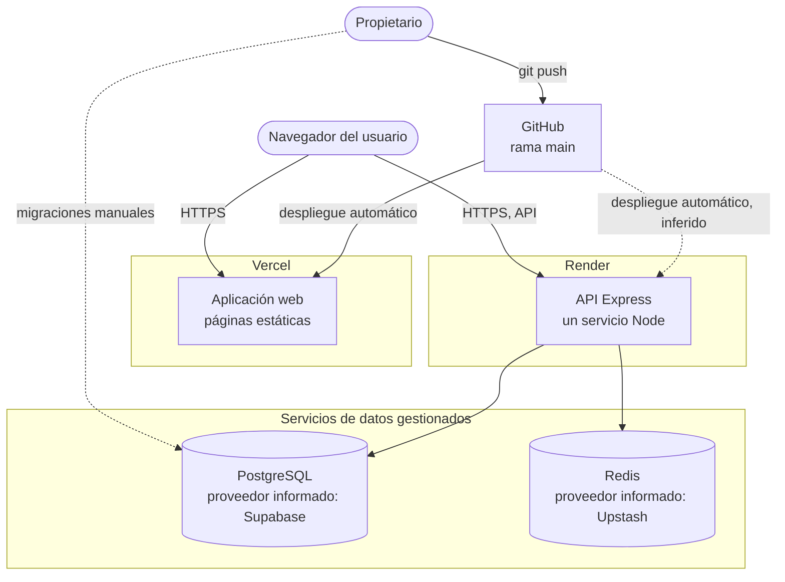

# Mapa de despliegue

Dónde se ejecuta cada pieza del sistema y qué se pudo comprobar. Este documento separa con cuidado tres cosas: lo **verificado** por observación propia, lo **informado** por documentos previos y lo **pendiente de verificación**.

No se tuvo acceso a los paneles de ninguna plataforma. Todo lo verificado se obtuvo desde fuera: API pública de GitHub y solicitudes HTTP de solo lectura hechas el **2026-10-12** y repetidas el **2026-10-30**.

> **Comprobación del 2026-10-30.** API: `/health/live` 200 (32,6 s en frío) y `/health/ready` con `database: up` y `radar: up`, lo que confirma que Redis responde. La respuesta incluye `x-request-id`, añadida por la etapa 4: la API desplegada ya tiene ese código, lo que indica despliegue automático desde `main`. Web: `/login` 200 y último despliegue de producción en `b763885`. Servicio Radar en `social-unsch-radar.onrender.com`: **404, no desplegado**. Donde las tablas siguientes digan otra cosa sobre Redis, prevalece esta nota.

## Mapa

Trazo continuo: relación verificada. Trazo discontinuo: relación prevista o sin verificar.

## Estado por plataforma

### Vercel: aplicación web

| Aspecto | Valor | Estado |
|---|---|---|
| Repositorio de origen | `pillacarodriguezuriel-a11y/social_unsch` | Verificado: GitHub registra despliegues creados por la integración de Vercel |
| Rama de producción | `main` | Verificado: el despliegue de producción más reciente corresponde al commit `b763885` |
| Despliegues de vista previa | Se crean para ramas distintas de `main` | Verificado: GitHub registra despliegues de entorno «Preview» para ramas del repositorio |
| Dirección pública | `https://social-unsch-lemon.vercel.app` | Verificado: `/login` respondió 200 |
| URL de API incrustada | `https://social-unsch.onrender.com/api/v1` | Verificado el 2026-10-10 inspeccionando el código publicado; no se repitió el 2026-10-12 |
| Comando de compilación, directorio raíz, variables | — | Pendiente de verificación |

Consecuencia operativa: **todo cambio que llega a `main` publica el frontend**, y toda rama subida genera un despliegue de vista previa. No hay archivo `vercel.json` en el repositorio; la configuración vive en el panel.

> **Etapa 3:** el frontend pasó a `apps/web`. Para compilar, Vercel debe compilar con Root Directory `apps/web` e incluir archivos fuera de ese directorio. Render puede seguir en la raíz con `npm ci --include=dev && npm run build` y `npm start`, y conviene usar `/health/live` como comprobación de salud. Detalle en [ETAPA_03 §9](../migracion/ETAPA_03_PREPARACION_SEPARACION.md#9-impacto-sobre-vercel-y-render).

### Render: servicio Radar

NO IMPLEMENTADO. El servicio previsto no existe con el nombre documentado. Procedimiento en [Extracción de Radar](../migracion/EXTRACCION_RADAR.md#activación).

### Render: API

| Aspecto | Valor | Estado |
|---|---|---|
| Dirección pública | `https://social-unsch.onrender.com` | Verificado |
| Servicio en ejecución | Una ruta protegida sin token respondió 401 con el formato de error de la aplicación | Verificado |
| Versión desplegada | Incluye el módulo de catálogos, incorporado en la etapa 2 | Verificado: `GET /api/v1/catalogs` respondió 200 con datos. No se pudo determinar el commit exacto |
| Suspensión por inactividad | La primera respuesta tardó unos 32 segundos; las siguientes, alrededor de 1 segundo | Inferencia a partir de la latencia |
| CORS hacia el dominio de Vercel | Permitido | Verificado el 2026-10-10 |
| Mecanismo de despliegue, rama, comandos, región, tipo de instancia, versión de Node | — | Pendiente de verificación |

Un informe previo sin seguimiento en Git menciona la región de Virginia y una versión fijada de Node; no se pudo confirmar.

### PostgreSQL

| Aspecto | Valor | Estado |
|---|---|---|
| La API tiene una base accesible | `GET /catalogs` devolvió facultades y escuelas; un inicio de sesión con un correo inexistente devolvió 401 y no 500 | Verificado |
| Esquema de la etapa 2 aplicado | La consulta de catálogos funciona, lo que exige las tablas de catálogo con datos | Verificado para esas tablas. No se pudo comprobar la tabla `schema_migrations` ni el índice `uq_active_carpooling_request` |
| Proveedor: Supabase | Indicado en los informes de [migracion/](../migracion/ETAPA_01_LINEA_BASE.md) | Pendiente de verificación |
| Modo de conexión, TLS, copias de seguridad | — | Pendiente de verificación |

Cambio respecto al informe de la etapa 1: el 2026-10-10 el inicio de sesión devolvía 500, compatible con una base inaccesible. El 2026-10-12 respondió correctamente. No se sabe qué acción lo resolvió.

### Redis

| Aspecto | Valor | Estado |
|---|---|---|
| Proveedor: Upstash | Indicado en los informes previos, que mostraban el recurso como eliminado | Pendiente de verificación |
| Disponibilidad para la API | `/health/ready` informó `radar: up` el 2026-10-30; en modo local equivale a un `PING` correcto | **Verificado de forma indirecta** |

Falta probar un voto real con una cuenta, lo que escribiría datos en producción. Si `REDIS_URL` falla, las rutas del radar fallan y el resto de la API sigue funcionando.

### GitHub

| Aspecto | Valor | Estado |
|---|---|---|
| Visibilidad | Repositorio público | Verificado |
| Rama por defecto | `main` | Verificado |
| Integración continua | [ci.yml](../../.github/workflows/ci.yml) en `main`: `verify` correcto y `test-real` fallido | Verificado |
| Protección de rama | — | Pendiente de verificación |

## Resumen

| Pieza | ¿Hay evidencia de que opera en producción? |
|---|---|
| Aplicación web | Sí |
| API | Sí |
| PostgreSQL | Sí, de forma indirecta a través de la API |
| Redis | Sí, de forma indirecta a través de `/health/ready` |
| Servicio Radar | **No: no está desplegado** |
| Migraciones aplicadas por completo | Parcial |

## Límites de estas plataformas

Los informes previos indican que se usan planes gratuitos; no se confirmó. Con independencia del plan, conviene no dar por garantizado:

- **Disponibilidad continua.** Un servicio que se suspende por inactividad tarda decenas de segundos en la primera respuesta.
- **Persistencia indefinida.** Los servicios de datos gratuitos suelen pausarse o eliminarse tras un periodo sin uso. El proyecto ya lo experimentó, según el informe de la etapa 1.
- **Copias de seguridad.** No hay ningún procedimiento de respaldo versionado.

Las condiciones exactas dependen de cada proveedor y cambian con el tiempo: deben consultarse en su documentación vigente antes de tomar decisiones.

## Entorno local

Lo único reproducible desde el repositorio es el entorno de desarrollo: [docker-compose.yml](../../docker-compose.yml) levanta PostgreSQL 15 y Redis 7 en los puertos 5432 y 6379; la aplicación se ejecuta con los comandos de [Proceso de entrega](03-proceso-de-entrega.md).

## Comprobaciones que requieren al propietario

| Plataforma | Qué confirmar |
|---|---|
| Vercel | Comando de compilación, directorio raíz (debe ser `apps/web` desde la etapa 3), valor de `NEXT_PUBLIC_API_URL`, comportamiento de las vistas previas |
| Render | Rama, despliegue automático, comandos de compilación y arranque (compatibles con workspaces desde la etapa 3), versión de Node, tipo de instancia, variables definidas, ruta de comprobación de salud |
| Supabase | Que es el proveedor en uso, estado del proyecto, modo de conexión disponible para migraciones, copias de seguridad |
| Upstash | Existencia y estado del recurso, y que `REDIS_URL` en Render apunta a él |

[← Índice](../README.md)
