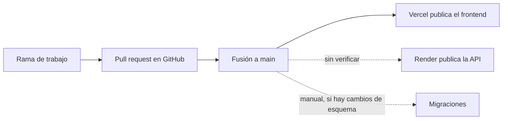

# Proceso de entrega

Cómo llega un cambio desde el código hasta producción. Se separa lo que **existe** (comandos del repositorio) de lo que es **procedimiento propuesto**.

## Lo que existe: comandos

Todos están definidos en el [package.json](../../package.json) de la raíz, que desde la etapa 3 delega en cada workspace (`apps/api`, `apps/web`, `packages/contracts`). La lista completa está en [ETAPA_03 §8](../migracion/ETAPA_03_PREPARACION_SEPARACION.md#8-comandos).

### Desarrollo

| Comando | Qué hace |
|---|---|
| `npm ci` | Instala las dependencias exactas del lockfile |
| `npm run dev:backend` | API en modo desarrollo, puerto 3000 |
| `npm run dev` | Igual que el anterior: solo la API |
| `npm run dev:frontend` | Aplicación web en el puerto 3001 |
| `npm run dev:all` | API y aplicación web a la vez ([dev-all.js](../../scripts/dev-all.js)) |

`npm run dev` no levanta el frontend: para ambos se usa `npm run dev:all`. El [README](../../README.md) se corrigió en este punto junto con esta documentación.

### Construcción

| Comando | Qué hace | Resultado |
|---|---|---|
| `npm run build` | Compila el contrato y la API con TypeScript | `packages/contracts/dist/`, `apps/api/dist/` |
| `npm run build:frontend` | Compila el contrato y la aplicación web, y comprueba sus tipos | `apps/web/.next/` |
| `npm run build:all` | Ambas | — |
| `npm run typecheck` | Tipos de los tres paquetes, incluidas las pruebas | — |
| `npm start` | Ejecuta la API compilada | Proceso Node |

### Pruebas

| Comando | Qué ejecuta | Requiere |
|---|---|---|
| `npm test` | Pruebas unitarias, de rutas y de contrato de la API, y pruebas de `lib/` del frontend | Nada externo |
| `npm run check:boundaries` | Límites entre web, API, contratos y módulos | Nada externo |
| `npm run verify` | Límites, tipos, cobertura, pruebas del frontend y ambas compilaciones | Nada externo |
| `npm run test:coverage` | Lo anterior con umbral de cobertura del 90 % | Nada externo |
| `npm run test:real` | Pruebas contra PostgreSQL y Redis reales | Docker en ejecución; puertos 55432 y 56379 libres |

### Base de datos

| Comando | Qué hace | Modifica datos |
|---|---|---|
| `npm run db:migrate:status` | Lista migraciones aplicadas y pendientes | No |
| `npm run db:migrate` | Aplica las migraciones pendientes de [sql/](../../apps/api/src/database/migrations/sql) | Sí: esquema |
| `npm run db:catalogs` | Sincroniza facultades, escuelas y pabellones sin cambiar identificadores | Sí: catálogos |
| `npm run db:migrate:all` | Los dos anteriores en orden | Sí |
| `npm run db:seed:demo` | Carga usuarios y datos de demostración; exige confirmación, base local y entorno distinto de producción | Sí: solo local |
| `node apps/api/scripts/diagnostico-conexiones.js` | Ejecuta `SELECT 1` y `PING` | No |

Todos los comandos `db:*` actúan sobre la base indicada en `DATABASE_URL`. **Conviene comprobar a qué base apunta esa variable antes de ejecutar cualquiera de ellos.**

### Código heredado que no debe ejecutarse

En [src/database/migrations](../../apps/api/src/database/migrations) permanecen los ejecutores y archivos SQL anteriores a la etapa 2. No tienen comando en `package.json`, pero pueden invocarse a mano.

| Archivo | Riesgo |
|---|---|
| `run_seed.ts` con `seed.sql` | Crea o restablece cuentas de demostración, una de ellas administradora, sin las protecciones del seed nuevo |
| `run_canonical_migration.ts` con `add_canonical_data.sql` | Borra facultades y escuelas antes de recargarlas |
| `fix_accept_terms.ts` | Marca los términos como aceptados para todos los usuarios |
| `run_migration.ts`, `run_credits_migration.ts`, `run_moderation_migration.ts` | Aplican el esquema sin registrarlo en `schema_migrations` |

Su retirada es una tarea pendiente; ver [Riesgos y deuda técnica](../07-evaluacion-y-evolucion/02-riesgos-y-deuda-tecnica.md).

## Lo que existe: flujo observado

| Paso | Evidencia |
|---|---|
| Ramas y *pull requests* | Las etapas 1 y 2 se fusionaron mediante los *pull requests* 1 y 2 |
| Publicación automática del frontend | Despliegues registrados por la integración de Vercel en GitHub |
| Publicación de la API | La API en producción incluye código de la etapa 2; no se sabe si el despliegue fue automático o manual |
| Migraciones | Manuales; ningún proceso las ejecuta al desplegar |

Lo que **no existe**:

- Integración continua: ninguna prueba se ejecuta automáticamente antes de fusionar.
- Entorno de preproducción.
- Coordinación entre el despliegue de la API y las migraciones.
- Procedimiento de reversión documentado.
- Registro de qué versión está desplegada en cada plataforma.

## Riesgo principal del flujo actual

El código y el esquema se despliegan por caminos distintos y sin orden garantizado. Si se fusiona un cambio que depende de una migración antes de aplicarla, la API queda por delante de la base.

Ejemplo concreto: la protección contra solicitudes duplicadas de carpooling depende de un índice creado por la migración 005. Sin esa migración, el código funciona, pero sin la garantía.

## Procedimiento propuesto

> **Estado: Propuesto.** Nada de esta sección está automatizado ni configurado.

### Antes de fusionar

1. `npm ci`
2. `npm run build` y `npm run build:frontend`
3. `npm run test:coverage`
4. `npm run test:real`, si el cambio toca repositorios, migraciones o el radar
5. Revisión del *pull request*

### Integración continua

Un flujo de trabajo que ejecute los pasos 1 a 3 en cada *pull request* y el paso 4 cuando cambien `src/database`, los repositorios o `tests/real`. La suite real necesita un ejecutor con Docker. **No existe configuración**; es la primera pieza recomendada de la etapa 3.

### Cambios de esquema en producción

Toda migración de datos remota debe seguir este orden. Ninguno de estos pasos se ha ejecutado como parte de esta documentación.

| N.º | Paso | Detalle |
|---|---|---|
| 1 | Prerrequisitos | Acceso de propietario a la base; cadena de conexión con sesión continua, no un *pooler* en modo transacción; ventana acordada |
| 2 | Respaldo | Copia completa de la base antes de empezar, guardada fuera del proveedor, y comprobación de que puede restaurarse |
| 3 | Ensayo aislado | Restaurar el respaldo en una base desechable local y ejecutar ahí `npm run db:migrate` y `npm run db:catalogs` |
| 4 | Validación del ensayo | `npm run db:migrate:status`; contar filas de las tablas principales antes y después; comprobar que los identificadores de catálogo no cambiaron; comprobar que el índice `uq_active_carpooling_request` existe |
| 5 | Ejecución | Verificar la variable `DATABASE_URL` y ejecutar los mismos comandos contra producción |
| 6 | Validación en producción | Repetir las comprobaciones del paso 4 y las de [Observabilidad y recuperación](04-observabilidad-y-recuperacion.md) |
| 7 | Despliegue del código | Solo después de validar el esquema |
| 8 | Reversión | Si algo falla tras el paso 5, restaurar el respaldo. Las migraciones no tienen pasos de reversión propios |

Regla de compatibilidad propuesta: toda migración debe ser compatible con la versión anterior del código (añadir antes de exigir, no borrar en el mismo paso), de modo que el orden «primero esquema, después código» sea siempre seguro.

### Reversión de código

| Unidad | Mecanismo propuesto |
|---|---|
| Frontend | Volver a publicar el despliegue anterior desde la plataforma |
| API | Volver a desplegar el commit anterior |
| Esquema | Restaurar el respaldo; por eso las migraciones deben ser compatibles hacia atrás |

Los mecanismos concretos de cada plataforma deben confirmarse en su panel y documentación.

### Entrega durante la migración a servicios

Cuando haya más de una unidad de servidor, cada una necesitará su propia construcción, sus propias variables y su propia ruta de salud, y la entrada de API permitirá revertir una extracción sin redesplegar. Ver [Arquitectura de transición](../02-arquitectura-de-software/04-arquitectura-de-transicion.md).

[← Índice](../README.md)
