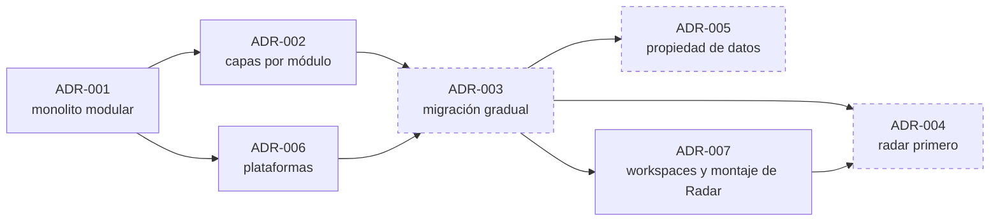

# Decisiones arquitectónicas

Un **registro de decisión arquitectónica** (ADR, por sus siglas en inglés) deja constancia de una decisión con peso en la estructura del sistema: qué se decidió, por qué, qué alternativas había y qué consecuencias tiene.

## Cómo leer estos registros

No existían ADR en el proyecto antes de esta documentación. Por eso los registros son de dos tipos, y la diferencia importa:

| Tipo | Significado |
|---|---|
| **Retrospectivo** | La decisión ya está en el código. El registro la reconstruye a partir de la implementación. No hay constancia de cuándo se tomó, de quién la aprobó ni de qué alternativas se evaluaron entonces; las alternativas y la justificación son un análisis posterior |
| **Propuesto** | La decisión no se ha tomado ni implementado. El registro la plantea para su discusión |

Ningún registro tiene aprobación documentada. La fecha indicada es la de redacción del registro, no la de la decisión.

## Índice

| ADR | Título | Tipo | Estado |
|---|---|---|---|
| [ADR-001](ADR-001-estado-y-organizacion-actual.md) | Monolito modular con PostgreSQL, Redis y JWT propio | Retrospectivo | Vigente en el código |
| [ADR-002](ADR-002-separacion-interna-de-responsabilidades.md) | Separación interna en capas por módulo | Retrospectivo | Vigente en el código |
| [ADR-003](ADR-003-migracion-gradual-por-dominios.md) | Migración gradual hacia servicios por dominio | Propuesto | En discusión; etapas 1 a 3 ejecutadas |
| [ADR-004](ADR-004-extraccion-inicial-de-radar.md) | Radar como primer servicio extraído | Propuesto | En discusión |
| [ADR-005](ADR-005-propiedad-gradual-de-datos.md) | Propiedad gradual de los datos por dominio | Propuesto | En discusión |
| [ADR-006](ADR-006-plataformas-de-despliegue.md) | Plataformas gestionadas para el despliegue | Retrospectivo | Vigente; configuración pendiente de verificación |
| [ADR-007](ADR-007-workspaces-y-montaje-de-radar.md) | Separación en npm workspaces y montaje reemplazable de Radar | Decisión de la etapa 3 | Implementada en rama; pendiente de fusión |

## Relación entre decisiones

Trazo continuo: decisión presente en el código. Trazo discontinuo: propuesta.

## Estructura de cada registro

Identificador y título · Estado · Fecha de documentación · Contexto · Decisión · Alternativas · Justificación · Consecuencias · Evidencias · Condiciones para reconsiderarla.

## Cómo añadir un registro

1. Crear `ADR-NNN-titulo-breve.md` con el número siguiente.
2. Usar la misma estructura.
3. Indicar con claridad si la decisión está tomada, y por quién, o si es una propuesta.
4. No modificar un registro aceptado: si la decisión cambia, crear uno nuevo que lo sustituya y enlazarlos.

[← Índice](../README.md)
