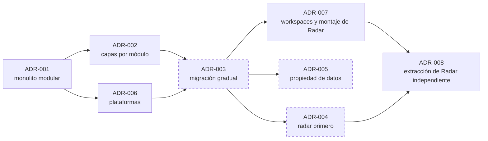

# Decisiones arquitectónicas

Un **registro de decisión arquitectónica** (ADR, por sus siglas en inglés) deja constancia de una decisión con peso en la estructura del sistema: qué se decidió, por qué, qué alternativas había y qué consecuencias tiene.

## Cómo leer estos registros

No existían ADR en el proyecto antes de esta documentación. Por eso los registros son de dos tipos, y la diferencia importa:

| Tipo | Significado |
|---|---|
| **Retrospectivo** | La decisión ya está en el código. El registro la reconstruye a partir de la implementación. No hay constancia de cuándo se tomó, de quién la aprobó ni de qué alternativas se evaluaron entonces; las alternativas y la justificación son un análisis posterior |
| **Propuesto** | La decisión no se ha tomado ni implementado. El registro la plantea para su discusión |

Ningún registro tiene aprobación documentada. La fecha indicada es la de redacción del registro, no la de la decisión.

## Índice

| ADR | Título | Tipo | Estado |
|---|---|---|---|
| [ADR-001](ADR-001-estado-y-organizacion-actual.md) | Monolito modular con PostgreSQL, Redis y JWT propio | Retrospectivo | Vigente en el código |
| [ADR-002](ADR-002-separacion-interna-de-responsabilidades.md) | Separación interna en capas por módulo | Retrospectivo | Vigente en el código |
| [ADR-003](ADR-003-migracion-gradual-por-dominios.md) | Migración gradual hacia servicios por dominio | Propuesto | En ejecución sin aprobación registrada; etapas 1 a 3 hechas, etapa 4 parcial |
| [ADR-004](ADR-004-extraccion-inicial-de-radar.md) | Radar como primer servicio extraído | Propuesto | En ejecución mediante ADR-008; sin desplegar |
| [ADR-005](ADR-005-propiedad-gradual-de-datos.md) | Propiedad gradual de los datos por dominio | Propuesto | En discusión |
| [ADR-006](ADR-006-plataformas-de-despliegue.md) | Plataformas gestionadas para el despliegue | Retrospectivo | Vigente; configuración pendiente de verificación |
| [ADR-007](ADR-007-workspaces-y-montaje-de-radar.md) | Separación en npm workspaces y montaje reemplazable de Radar | Decisión de la etapa 3 | Implementada en `main` (PR n.º 4) |
| [ADR-008](ADR-008-extraccion-radar-servicio-independiente.md) | Extracción de Radar como servicio independiente y enrutamiento reversible | Decisión de la etapa 4 | Implementada parcialmente: PR n.º 5 abierto, `test-real` fallido, sin desplegar. Tiene [nota de corrección](ADR-008-extraccion-radar-servicio-independiente.md) |

## Síntesis por decisión

Cada registro detalla contexto, decisión, alternativas y consecuencias. Esta tabla resume cada decisión y su evidencia actual.

| Decisión | Problema que resuelve | Consecuencia positiva | Contrapartida | Registro | Estado | Evidencia en código |
|---|---|---|---|---|---|---|
| Monolito modular | Un operador necesita un sistema simple | Despliegue y transacciones simples | Un fallo afecta a todo | ADR-001 | IMPLEMENTADO | [app.ts](../../apps/api/src/app.ts) |
| Capas por módulo | Separar HTTP, reglas y datos | Pruebas por capa | Dependencias concretas | ADR-002 | IMPLEMENTADO en seis de siete módulos | [feed.service.ts](../../apps/api/src/modules/feed/feed.service.ts) |
| Arquitectura hexagonal | Aislar el negocio de la infraestructura | Almacén sustituible | Más estructura | Sin registro propio; dirección en [Arquitectura objetivo](../02-arquitectura-de-software/05-arquitectura-objetivo.md) | IMPLEMENTADO PARCIALMENTE: solo Radar | [radar.repository.ts](../../apps/api/src/modules/radar/radar.repository.ts) |
| Strangler Fig | Migrar sin detener ni reescribir | Reversible por partes | Dos implementaciones temporales | ADR-003, ADR-008 | IMPLEMENTADO PARCIALMENTE | [composition.ts](../../apps/api/src/composition.ts) |
| Monorepo con workspaces | Construir cada parte por separado | Contrato común y un lockfile | Coordinación de versiones | ADR-007 | IMPLEMENTADO | [package.json](../../package.json) |
| PostgreSQL inicialmente compartido | Evitar transacciones distribuidas prematuras | Integridad simple | Sin propiedad real de datos | ADR-005 | IMPLEMENTADO como punto de partida; separación PROPUESTA | [database.ts](../../apps/api/src/config/database.ts) |
| Redis para Radar | Datos efímeros y voto atómico | Vigencia automática | Datos no duraderos | ADR-001 | IMPLEMENTADO | [radar.repository.ts](../../apps/api/src/modules/radar/radar.repository.ts) |
| APIs `/api/v1` | Dar un prefijo estable al cliente | Permite mover rutas sin cambiar el frontend | Una sola versión hasta hoy | Sin registro propio | IMPLEMENTADO | [app.ts](../../apps/api/src/app.ts) |
| Contratos entre dominios | Detectar cambios incompatibles | Una sola definición | Solo cubre Radar | ADR-007, ADR-008 | IMPLEMENTADO PARCIALMENTE | [radar.ts](../../packages/contracts/src/radar.ts) |
| Extracción de Radar | Validar el mecanismo con el caso menos acoplado | Aislamiento de fallos, por validar | Un servicio más y un salto de red | ADR-004, ADR-008 | IMPLEMENTADO PARCIALMENTE | [apps/radar](../../apps/radar/src/app.ts) |
| Eventos selectivos | Reacciones que no deben bloquear | Menor acoplamiento | Consistencia eventual | Sin registro propio; criterio en el [plan](../07-evaluacion-y-evolucion/03-plan-de-migracion.md#etapa-7--recursos-créditos-e-integración-asíncrona) | PROPUESTO: no hay código | Ninguna |

Las decisiones marcadas «sin registro propio» se dejan así a propósito: no hay evidencia suficiente de cuándo o cómo se tomaron como para redactar un ADR completo.

## Relación entre decisiones

Trazo continuo: decisión presente en el código. Trazo discontinuo: propuesta.

## Estructura de cada registro

Identificador y título · Estado · Fecha de documentación · Contexto · Decisión · Alternativas · Justificación · Consecuencias · Evidencias · Condiciones para reconsiderarla.

## Cómo añadir un registro

1. Crear `ADR-NNN-titulo-breve.md` con el número siguiente.
2. Usar la misma estructura.
3. Indicar con claridad si la decisión está tomada, y por quién, o si es una propuesta.
4. No modificar un registro aceptado: si la decisión cambia, crear uno nuevo que lo sustituya y enlazarlos.

[← Índice](../README.md)
