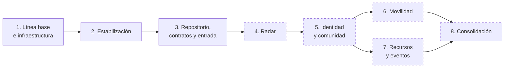

# Plan de migración

Propuesta de evolución desde el monolito modular actual hacia servicios por dominio, en ocho etapas.

> **Qué es propuesta y qué no.** Las etapas 1 a 3 tienen evidencia de ejecución (la 3, en una rama pendiente de fusión). Las etapas 4 a 8 son **propuestas**: no hay código, fechas ni aprobación. Este documento no fija plazos.

## Vista general

Trazo continuo: etapa con evidencia de ejecución. Trazo discontinuo: propuesta.

| Etapa | Estado | Cambia el estilo arquitectónico |
|---|---|---|
| 1 | Ejecutada; recuperación de Redis sin verificar | No |
| 2 | Ejecutada en el código; aplicación remota parcialmente verificada | No |
| 3 | Implementada en rama, pendiente de fusión | No: sigue siendo un monolito, ahora en un monorepo |
| 4 | Propuesta | Sí: primer servicio fuera del monolito |
| 5 a 7 | Propuestas | Sí |
| 8 | Propuesta | No: consolida |

## Dependencias entre etapas

| Etapa | Depende de | Motivo |
|---|---|---|
| 3 | 1, 2 | Hace falta un sistema estable y una línea base conocida |
| 4 | 3 | Sin entrada reversible ni contrato formal, extraer no se puede deshacer |
| 5 | 4 | El mecanismo de extracción debe estar probado con el caso simple |
| 6 | 5 | Movilidad necesita el contrato de datos de contacto con Identidad |
| 7 | 5 | Recursos necesita que el saldo de créditos salga de `users` |
| 8 | 6, 7 | Consolida el conjunto |

Las etapas 6 y 7 no dependen entre sí y pueden intercambiarse.

---

## Etapa 1 · Línea base y recuperación de infraestructura

**Estado: ejecutada, con un pendiente.**

| Aspecto | Detalle |
|---|---|
| Objetivo | Conocer y preservar el estado real del código y de la infraestructura |
| Resultado | Inventario, plantilla de variables, script de diagnóstico, pruebas versionadas |
| Evidencia | [ETAPA_01_LINEA_BASE.md](../migracion/ETAPA_01_LINEA_BASE.md); *pull request* 1 fusionado en `main` |
| Pendiente | Verificar Redis en producción |

## Etapa 2 · Estabilización

**Estado: ejecutada en el código.**

| Aspecto | Detalle |
|---|---|
| Objetivo | Corregir riesgos de datos y de autorización antes de mover nada |
| Resultado | Migrador versionado, carga de catálogos no destructiva, seed restringido, registro sin rol administrador, transacciones en carpooling, módulo de catálogos, pruebas contra servicios reales |
| Evidencia | [ETAPA_02_ESTABILIZACION.md](../migracion/ETAPA_02_ESTABILIZACION.md); *pull request* 2 fusionado en `main` |
| Pendiente | Confirmar en la base de producción el registro de migraciones y el índice único de carpooling |

---

## Etapa 3 · Repositorio, límites, contratos y entrada reversible

**Estado: implementada en la rama `refactor/etapa-3-preparacion-separacion`, pendiente de fusión.** Informe: [ETAPA_03](../migracion/ETAPA_03_PREPARACION_SEPARACION.md).

Qué se hizo y qué no, respecto a la propuesta original:

| Trabajo propuesto | Resultado |
|---|---|
| Dividir el repositorio en paquetes | Hecho: `apps/web`, `apps/api`, `packages/contracts` |
| Formalizar el contrato | Hecho para Radar y el formato de error (Zod); las demás rutas siguen sin contrato formal |
| Entrada de API | Hecho dentro de la API: montaje reemplazable y modo proxy desactivado |
| Observabilidad mínima | Salud y validación de configuración hechas; registro de solicitudes pendiente |
| Integración continua | Pendiente: `npm run verify` existe, sin flujo configurado |
| Código compartido de autenticación | Pendiente: no hizo falta mientras Radar siga en la API |
| Saneamiento | Catálogos corregidos; ejecutores heredados y respaldo, pendientes |
| Configuración de despliegue versionada | Pendiente: los ajustes están documentados, no versionados |

Propuesta original:

**Objetivo:** dejar el sistema preparado para extraer servicios sin cambiar todavía su comportamiento.

| Trabajo | Resultado esperado |
|---|---|
| Dividir el repositorio en paquetes | Aplicación web, API y contratos se construyen por separado |
| Formalizar el contrato | Especificación de las 16 rutas; tipos compartidos; errores unificados |
| Entrada de API | El frontend llama a una entrada que hoy enruta todo al monolito |
| Observabilidad mínima | Ruta de salud, registro de solicitudes, validación de configuración al arrancar |
| Integración continua | Compilación y pruebas en cada *pull request* |
| Código compartido de autenticación | `requireAuth` y el tipo del token disponibles como paquete |
| Saneamiento | Retirar ejecutores heredados; asegurar el índice único; respaldo de la base |
| Configuración de despliegue versionada | Archivos de despliegue en el repositorio |

| Criterio | Detalle |
|---|---|
| Entrada | Etapas 1 y 2 completas; Redis verificado; respaldo de la base disponible |
| Salida | Todas las pruebas existentes pasan sin cambios en sus aserciones; el frontend funciona a través de la entrada; cada paquete se construye de forma independiente; la integración continua bloquea un cambio que rompa una prueba |
| Reversión | Apuntar el frontend de nuevo al monolito. La división en paquetes se revierte con Git: no toca datos |

## Etapa 4 · Extracción de Radar

**Estado: implementada en código y validada en local/CI.** Fundamento en [ADR-004](../06-decisiones-arquitectonicas/ADR-004-extraccion-inicial-de-radar.md) y [ADR-008](../06-decisiones-arquitectonicas/ADR-008-extraccion-radar-servicio-independiente.md). Documento de etapa: [ETAPA_04_EXTRACCION_RADAR](../migracion/ETAPA_04_EXTRACCION_RADAR.md).

**Objetivo:** primer servicio independiente (`apps/radar`), con el dominio menos acoplado, compatibilidad de contratos estricta y activación reversible.

| Trabajo propuesto | Resultado obtenido |
|---|---|
| Crear el servicio de radar independiente | Hecho: `apps/radar` con configuración validada (Zod), Redis resiliente, Express decoupled y graceful shutdown |
| Conservar compatibilidad de contratos e idioma | Hecho: contratos formalizados en `packages/contracts`, estados bilingües preservados (ES/EN) para evitar divergencia de consenso |
| Autenticación asimétrica verificada | Hecho: RS256 con clave pública en Radar; rechazo de suplantación de cabeceras (`x-user-id`); tokens opacos al exterior |
| Proxy con observabilidad y correlación | Hecho: `RADAR_MODE=proxy` en la API con propagación de `x-request-id`, timeouts configurables y sin reintentos automáticos |
| Resiliencia de Redis | Hecho: `enableOfflineQueue: false`, `maxRetriesPerRequest: 1`, reconexión exponencial acotada a 3s sin bloqueos indefinidos |
| Límites arquitectónicos | Hecho: verificado con `npm run verify` (`radar-sin-api`, `radar-sin-web`, `radar-sin-pg`, `api-sin-radar-interno`) |
| Integración continua | Hecho: GitHub Actions (`.github/workflows/ci.yml`) con `verify` y pruebas de integración con PostgreSQL 16 y Redis 7 desechables |
| Pruebas y mediciones reproducibles | Hecho: 59 pruebas en Radar (cobertura >90%), 521 pruebas totales en el monorepo; benchmark reproducible de latencia documentado |
| Conservar reversibilidad inmediata | Hecho: `RADAR_MODE=local` por defecto en la API; conmutación en caliente sin migración de datos ni cambios en frontend |

| Criterio | Detalle |
|---|---|
| Entrada | Etapa 3 completa; Redis verificado; contratos compartidos en `packages/contracts` |
| Salida alcanzada | Servicio independiente compilable y ejecutable; 100% pruebas de contrato, paridad y E2E verdes; CI configurado; documentación y procedimientos de despliegue listos |
| Activación productiva | Pendiente de autorización formal y despliegue del servicio en Render (Web Service Node.js) |
| Reversión | Variable de entorno `RADAR_MODE=local` en la API para devolver el tráfico al módulo local en segundos |
| Punto de decisión | Observar métricas reales en Render antes de autorizar el desmantelamiento del módulo local en la API |

## Etapa 5 · Identidad y Comunidad

**Estado: propuesta.**

**Objetivo:** separar la identidad del resto y resolver el acceso compartido a `users`. Es la etapa de mayor riesgo.

El orden interno depende de las dependencias y debe decidirse al llegar. Una secuencia posible:

1. Declarar la propiedad de cada tabla (nivel 1 de [ADR-005](../06-decisiones-arquitectonicas/ADR-005-propiedad-gradual-de-datos.md)).
2. Definir el contrato de datos públicos de usuario y el de datos de contacto.
3. Sustituir en `feed` y `matchmaking` los `JOIN` con `users`.
4. Extraer Comunidad (`feed`, `matchmaking`) o mantenerla junto a Identidad, según el costo observado en la etapa 4.
5. Extraer Identidad (`auth`, `users`, `catalogs`).
6. Construir lo que falta en estos dominios: perfil de matchmaking, actualización de perfil, moderación.

| Criterio | Detalle |
|---|---|
| Entrada | Etapa 4 validada y decisión de continuar; contratos de usuario definidos |
| Salida | Ningún módulo fuera de Identidad consulta `users` con SQL; permisos de base por servicio; pruebas reales de autenticación, feed y matchmaking pasan; el inicio de sesión no cambia para el usuario |
| Reversión | Por ruta, mediante la entrada. Los cambios de datos deben ser aditivos: no se elimina una columna ni una clave foránea hasta validar el nivel siguiente |
| Riesgo específico | La emisión de tokens no puede interrumpirse; la clave privada debe existir en un solo lugar en cada momento |

## Etapa 6 · Movilidad

**Estado: propuesta.**

**Objetivo:** extraer carpooling y completar su flujo.

| Trabajo | Resultado esperado |
|---|---|
| Conectar la pantalla a la API existente | Fin de la simulación en `localStorage` |
| Construir la publicación y el rechazo de rutas y solicitudes | Flujo completo |
| Resolver la lectura de contacto en la confirmación | Sin `JOIN` con `users` dentro de la transacción |
| Retirar el código de prueba del código de producción | Sin `injectedFailure` |
| Extraer el servicio | Movilidad independiente |

| Criterio | Detalle |
|---|---|
| Entrada | Contrato de datos de contacto disponible (etapa 5) |
| Salida | Las pruebas reales de concurrencia siguen pasando; la confirmación conserva sus garantías; la pantalla usa datos compartidos |
| Reversión | Por ruta, mediante la entrada |

La conexión de la pantalla a la API no depende de la extracción y puede adelantarse.

## Etapa 7 · Recursos, créditos e integración asíncrona

**Estado: propuesta.**

**Objetivo:** construir el dominio de recursos como servicio e introducir eventos solo donde estén justificados.

| Trabajo | Resultado esperado |
|---|---|
| Construir la API de archivos y descargas | Fin de la simulación |
| Mover el saldo de créditos fuera de `users` | Recursos es dueño del saldo |
| Sustituir el disparador de descargas por lógica del servicio | Regla en el código, con sus pruebas |
| Elegir y aplicar el mecanismo de eventos | Publicación fiable y consumo que tolera repeticiones |
| Decidir el almacenamiento de archivos | Hoy solo existe un campo de URL |

| Criterio | Detalle |
|---|---|
| Entrada | Identidad separada (etapa 5); decisión sobre el almacenamiento de archivos |
| Salida | El saldo nunca queda inconsistente en pruebas de concurrencia; cada evento se procesa al menos una vez sin efectos duplicados |
| Reversión | Al ser funcionalidad nueva, desactivar la ruta. El traslado del saldo requiere respaldo previo y migración reversible |

Criterio para usar un evento: la reacción puede retrasarse, no debe revertir la operación original y quien la origina no necesita su resultado. Si no se cumplen las tres condiciones, la integración es síncrona.

## Etapa 8 · Consolidación

**Estado: propuesta.**

**Objetivo:** que el conjunto sea operable de forma sostenida.

| Trabajo | Resultado esperado |
|---|---|
| Métricas y alertas por servicio | Los fallos se detectan sin esperar al usuario |
| Respaldo programado y restauración ensayada | Recuperación comprobada |
| Entorno de preproducción | Los cambios de esquema se ensayan antes de producción |
| Objetivos de servicio medidos | Sustituyen a los objetivos sin validar |
| Retirada del monolito | Solo cuando no reciba tráfico |
| Revisión de plataformas | Confirmar o cambiar [ADR-006](../06-decisiones-arquitectonicas/ADR-006-plataformas-de-despliegue.md) |

| Criterio | Detalle |
|---|---|
| Entrada | Etapas 6 y 7 completas |
| Salida | Los escenarios de calidad tienen mediciones reales; el procedimiento de recuperación se ha ejecutado al menos una vez |
| Reversión | No aplica: no introduce cambios funcionales |

---

## Lo que el plan no cubre

| Tema | Situación |
|---|---|
| Marketplace y empleo | Sin etapa asignada; requieren decidir si forman parte del producto |
| Verificación de correo | Deuda señalada (DT-01); encaja en la etapa 5 sin estar detallada |
| Cumplimiento de protección de datos personales | Fuera del alcance de esta documentación |
| Plazos y esfuerzo | No estimados |

## Alternativa de alcance reducido

El plan completo no es la única salida válida. Si tras la etapa 4 el costo de operación resulta alto, una variante razonable es:

- Mantener un monolito modular con Radar como único servicio aparte.
- Aplicar dentro del monolito la organización hexagonal y la propiedad de datos hasta el nivel 3.
- Dedicar el esfuerzo a completar las funciones simuladas.

Esta variante conserva la mayor parte del beneficio de modificabilidad con una fracción del costo de operación.

Los criterios para decidir entre continuar y detenerse están en [Criterios de validación](04-criterios-de-validacion.md).

[← Índice](../README.md)
