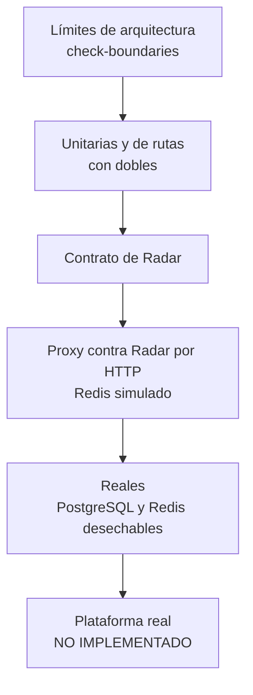

# Estrategia de pruebas

Qué se prueba, con qué y dónde se ejecuta. Los resultados están en [Estado actual y evidencias](07-estado-actual-y-evidencias.md).

## Niveles

| Nivel | Alcance | Ubicación | Comando | En CI |
|---|---|---|---|---|
| Límites | Importaciones prohibidas entre unidades | [check-boundaries.js](../../scripts/check-boundaries.js) | `npm run check:boundaries` | Sí, en `verify` |
| Unitarias | Servicios, repositorios, validadores, configuración | [apps/api/tests/unit](../../apps/api/tests/unit/auth.service.test.ts), [apps/radar/tests/unit](../../apps/radar/tests/unit/radar.service.test.ts) | `npm test` | Sí, en `verify` |
| De rutas | HTTP con base, Redis y JWT sustituidos. El directorio se llama `integration`, pero no integra con servicios reales | [apps/api/tests/integration](../../apps/api/tests/integration/auth.routes.test.ts) | `npm test` | Sí, en `verify` |
| Contrato | Respuestas contra los esquemas Zod | [API](../../apps/api/tests/contract/radar.contract.test.ts), [Radar](../../apps/radar/tests/contract/radar.contract.test.ts), [web](../../apps/web/tests/radar-contract.test.ts) | `npm test` | Sí, en `verify` |
| Proxy | Servidores reales en el equipo, con Redis simulado | [proxy.e2e.test.ts](../../apps/radar/tests/integration/proxy.e2e.test.ts) | `npm run test:radar` | Sí, en `verify` |
| Reales | 36 pruebas de la API en contenedores desechables | [apps/api/tests/real](../../apps/api/tests/real/radar.real.test.ts) | `npm run test:real` | Previsto; **fallido** |
| Frontend | Lógica de `app/lib` y tipos del contrato; sin componentes | [apps/web/tests](../../apps/web/tests/catalogs.test.ts) | `npm run test:web` | Sí, en `verify` |

## Reglas

- `npm run verify` es la puerta local: límites, tipos, cobertura, pruebas de la web y compilación.
- La cobertura exige un mínimo del 90 % en API y Radar. En la API se mide sobre una lista explícita de archivos en [jest.config.ts](../../apps/api/jest.config.ts), de modo que no representa todo el código.
- Las pruebas reales rechazan cualquier conexión que no sea local: `assertSafeTestDatabase` en [test-environment.ts](../../apps/api/tests/real/helpers/test-environment.ts). Requieren Docker.

## Vacíos conocidos

| Vacío | Riesgo | Pendiente |
|---|---|---|
| `test-real` falla en CI | Las garantías de concurrencia y migración no protegen la fusión | [P-01](08-pendientes.md#críticos) |
| `apps/radar` nunca corre contra Redis real | El script Lua no se ejercita desde el servicio | [P-07](08-pendientes.md#calidad) |
| La paridad no ejecuta la implementación de la API | La divergencia entre ambas puede pasar inadvertida | [P-08](08-pendientes.md#calidad) |
| Sin pruebas de componentes ni de extremo a extremo con navegador | Regresiones de pantalla sin detectar | [P-16](08-pendientes.md#frontend) |
| Sin pruebas de carga | Sin datos de rendimiento | [P-09](08-pendientes.md#calidad) |

Ver también: [Métricas](06-metricas.md) · [Escenarios de calidad](../01-analisis-del-sistema/08-escenarios-de-calidad.md) · [Criterios de validación](04-criterios-de-validacion.md)

[← Índice](../README.md)
