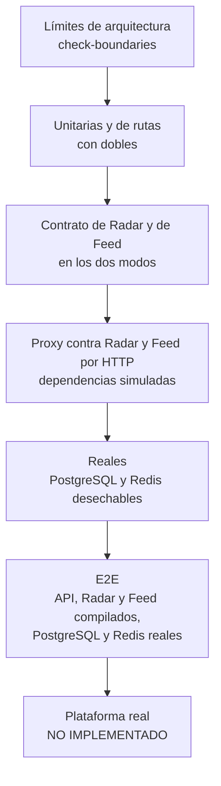

# Estrategia de pruebas

Qué se prueba, con qué y dónde se ejecuta. Los resultados están en [Estado actual y evidencias](07-estado-actual-y-evidencias.md).

## Niveles

| Nivel | Alcance | Ubicación | Comando | En CI |
|---|---|---|---|---|
| Límites | Importaciones prohibidas entre unidades, incluida la pureza de `feed-domain` | [check-boundaries.js](../../scripts/check-boundaries.js) | `npm run check:boundaries` | Sí, en `verify` |
| Dominio compartido | Reglas, SQL y manejadores HTTP de Feed, usados por los dos modos | [packages/feed-domain/tests](../../packages/feed-domain/tests/http.test.ts) | `npm run test:feed-domain` | Sí, en `verify` |
| Unitarias | Servicios, repositorios, validadores, configuración | [apps/api/tests/unit](../../apps/api/tests/unit/auth.service.test.ts), [apps/radar/tests/unit](../../apps/radar/tests/unit/radar.service.test.ts), [apps/feed/tests/unit](../../apps/feed/tests/unit/auth.middleware.test.ts) | `npm test` | Sí, en `verify` |
| De rutas | HTTP con base, Redis y JWT sustituidos. El directorio se llama `integration`, pero no integra con servicios reales | [apps/api/tests/integration](../../apps/api/tests/integration/auth.routes.test.ts), [apps/feed/tests/integration](../../apps/feed/tests/integration/feed.app.test.ts) | `npm test` | Sí, en `verify` |
| Contrato | Respuestas contra los esquemas Zod. Feed se valida **en espejo**: el modo local y el servicio independiente contra los mismos esquemas | Radar: [API](../../apps/api/tests/contract/radar.contract.test.ts), [servicio](../../apps/radar/tests/contract/radar.contract.test.ts), [web](../../apps/web/tests/radar-contract.test.ts). Feed: [API](../../apps/api/tests/contract/feed.contract.test.ts), [servicio](../../apps/feed/tests/contract/feed.contract.test.ts) | `npm test` | Sí, en `verify` |
| Proxy | Servidores reales en el equipo, con las dependencias simuladas | [Radar](../../apps/radar/tests/integration/proxy.e2e.test.ts), [Feed](../../apps/api/tests/integration/feed.proxy.test.ts) | `npm test` | Sí, en `verify` |
| Reales | Pruebas de la API en contenedores desechables | [apps/api/tests/real](../../apps/api/tests/real/radar.real.test.ts) | `npm run test:real` | Sí, job `test-real` |
| E2E Radar | 14 escenarios con API y Radar compilados en procesos separados, PostgreSQL y Redis reales, incluidas caídas de Radar, Redis y PostgreSQL | [radar.e2e.test.js](../../tests/e2e/radar.e2e.test.js) | `npm run test:e2e` | Sí, job `e2e-radar` |
| E2E Feed | API y Feed compilados en procesos separados con PostgreSQL real, en **modo proxy y modo local**, con comprobación de paridad entre ambos | [feed.e2e.test.js](../../tests/e2e/feed.e2e.test.js) | `npm run test:e2e:feed` | Sí, job `e2e-feed` |
| Rendimiento | Local frente a proxy con las aplicaciones reales | [benchmark-radar.js](../../scripts/benchmark-radar.js), [benchmark-feed.js](../../scripts/benchmark-feed.js) | `npm run bench:radar`, `npm run bench:feed` | No: solo local |
| Frontend | Lógica de `app/lib` y tipos del contrato; sin componentes | [apps/web/tests](../../apps/web/tests/catalogs.test.ts) | `npm run test:web` | Sí, en `verify` |

## Reglas

- `npm run verify` es la puerta local: límites, tipos, cobertura, pruebas de la web y compilación.
- La cobertura exige un mínimo del 90 % en los cuatro ejes para `feed-domain`, API, Radar y Feed. En la API se mide sobre una lista explícita de archivos en [jest.config.ts](../../apps/api/jest.config.ts), de modo que no representa todo el código.
- Las pruebas reales rechazan cualquier conexión que no sea local: `assertSafeTestDatabase` en [test-environment.ts](../../apps/api/tests/real/helpers/test-environment.ts). Requieren Docker.
- **La lógica de Feed no se prueba dos veces:** vive una sola vez en `packages/feed-domain` y se prueba allí. `apps/api` y `apps/feed` solo prueban su cableado, su autenticación y el contrato. Duplicar las pruebas daría una falsa sensación de cobertura sobre código que ya no existe por duplicado.
- Los umbrales de rendimiento de Feed **no están aprobados**: `benchmark-feed.js` emite sus veredictos como `EXPLORATORIO` y no deben citarse como criterios cumplidos.

## Vacíos conocidos

| Vacío | Riesgo | Pendiente |
|---|---|---|
| Benchmark solo en un equipo local | Sin datos de la plataforma real | [P-10](08-pendientes.md#infraestructura) |
| Umbrales de rendimiento de Feed sin aprobar | Las mediciones no habilitan la activación del proxy | [P-26](08-pendientes.md#arquitectónicos) |
| `apps/feed` sin pruebas contra PostgreSQL real propias | Su SQL se cubre vía `feed-domain` (dobles) y E2E, no con un pool real dedicado | [P-27](08-pendientes.md#calidad) |
| Cierre ordenado solo comprobable en Linux | En Windows, `SIGTERM` termina sin cierre ordenado | — |
| La paridad cubre errores y contrato, no toda la lógica | Divergencias en caminos no ejercitados | [P-08](08-pendientes.md#calidad) |
| Sin pruebas de componentes ni de extremo a extremo con navegador | Regresiones de pantalla sin detectar | [P-16](08-pendientes.md#frontend) |
| Arnés E2E y benchmark requieren Docker | No se ejecutan sin Docker | — |

Ver también: [Métricas](06-metricas.md) · [Escenarios de calidad](../01-analisis-de-sistema/08-escenarios-atributos-calidad.md) · [Criterios de validación](04-criterios-de-validacion.md)

[← Índice](../README.md)
