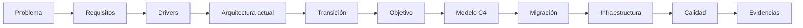

# SOCIAL-UNSCH — Documentación técnica

| Dato | Valor |
|---|---|
| Autor | Uriel Carlos Pillaca Rodríguez |
| Código de estudiante | 27222120 |
| Universidad | Universidad Nacional de San Cristóbal de Huamanga |
| Escuela | Escuela Profesional de Ingeniería de Sistemas |
| Curso | Arquitectura de Software |
| Estado verificado | 2026-10-30 sobre `f480728`, rama `feat/etapa-4-radar-service` |

## 1. Introducción

SOCIAL-UNSCH es una plataforma web para la comunidad de la Universidad Nacional de San Cristóbal de Huamanga. Reúne, con acceso limitado a correos `@unsch.edu.pe`, el estado del campus en tiempo casi real, publicaciones, búsqueda de compañeros de proyecto y movilidad compartida.

Esta documentación explica qué hace el sistema, cómo está construido hoy, qué decisiones contiene y cómo evoluciona. Está escrita para quien evalúa el proyecto en el curso y para quien se incorpora a desarrollarlo.

**Recorrido recomendado:**

| Paso | Documento |
|---|---|
| Problema | [Contexto y alcance](01-analisis-del-sistema/01-contexto-y-alcance.md) |
| Requisitos | [Requisitos funcionales](01-analisis-del-sistema/04-requisitos-funcionales.md) |
| Drivers | [Drivers arquitectónicos](01-analisis-del-sistema/07-drivers-arquitectonicos.md) |
| Arquitectura | [Actual](02-arquitectura-de-software/01-arquitectura-actual.md), [transición](02-arquitectura-de-software/04-arquitectura-de-transicion.md), [objetivo](02-arquitectura-de-software/05-arquitectura-objetivo.md) |
| Modelo C4 | [Guía y cuatro niveles](04-modelo-c4/README.md) |
| Migración | [Estrategia](migracion/README.md), [plan](07-evaluacion-y-evolucion/03-plan-de-migracion.md), [Radar](migracion/EXTRACCION_RADAR.md) |
| Infraestructura | [Mapa de despliegue](05-despliegue-y-operacion/01-mapa-de-despliegue.md) |
| Calidad | [Escenarios](01-analisis-del-sistema/08-escenarios-de-calidad.md), [métricas](07-evaluacion-y-evolucion/06-metricas.md) |
| Evidencias | [Estado actual](07-evaluacion-y-evolucion/07-estado-actual-y-evidencias.md), [pendientes](07-evaluacion-y-evolucion/08-pendientes.md) |

## 2. Estado del sistema

SOCIAL-UNSCH se encuentra evolucionando desde un monolito modular hacia una arquitectura con servicios extraídos progresivamente por dominio.

- **En operación:** una aplicación web Next.js (`apps/web`) y una API Express (`apps/api`) que atiende también Radar, sobre PostgreSQL y Redis.
- **Con código, sin desplegar:** el servicio `apps/radar` y su activación por proxy, en el [PR n.º 5](https://github.com/pillacarodriguezuriel-a11y/social_unsch/pull/5), abierto. En CI, `verify` pasó y `test-real` falló.
- **Propuesto:** los demás servicios por dominio.
- **Autenticación:** JWT RS256 propio. La clave privada queda en la API; Radar verifica con la pública.
- **Frontend:** cinco áreas consumen la API; seis pantallas siguen simuladas en el navegador.

### Cómo leer los estados

| Estado | Significado |
|---|---|
| **Implementado** | Existe código que lo realiza y se cita el archivo |
| **Implementado parcialmente** o **Parcial** | Existe una parte, pero el flujo completo no se cierra |
| **Simulado** | La pantalla existe, pero usa datos fijos o `localStorage` |
| **Propuesto** | Forma parte del diseño futuro |
| **Pendiente de validación** o **Pendiente de verificación** | No pudo comprobarse con el acceso disponible |
| **No implementado** | No existe, y se dice para evitar suposiciones |

Se separan siempre **realidad actual** (lo que opera), **dirección arquitectónica** (lo que ya se construye, como el PR de Radar) y **arquitectura objetivo** (adónde se quiere llegar).

## 3. Arquitectura

| Vista | Documento | Estado |
|---|---|---|
| Actual | [Arquitectura actual](02-arquitectura-de-software/01-arquitectura-actual.md) | Implementado |
| Transición | [Arquitectura de transición](02-arquitectura-de-software/04-arquitectura-de-transicion.md) | Implementado parcialmente |
| Objetivo | [Arquitectura objetivo](02-arquitectura-de-software/05-arquitectura-objetivo.md) | Propuesto |

| Complemento | Contenido |
|---|---|
| [Estilos y enfoques](02-arquitectura-de-software/02-estilos-y-enfoques.md) | Monolito modular, capas, hexagonal, servicios, Strangler Fig |
| [Dominios del sistema](02-arquitectura-de-software/08-dominios-del-sistema.md) | Dominios y límites reales |
| [Componentes y dependencias](02-arquitectura-de-software/03-componentes-y-dependencias.md) | Dónde está el acoplamiento |
| [Datos y propiedad por dominio](02-arquitectura-de-software/06-datos-y-propiedad-por-dominio.md) | Tablas, claves de Redis y dueño propuesto |
| [Contratos e integraciones](02-arquitectura-de-software/07-contratos-e-integraciones.md) | API REST, contratos e integraciones externas |
| [Decisiones arquitectónicas](06-decisiones-arquitectonicas/README.md) | ADR-001 a ADR-008 |

## 4. Modelo C4

- [Guía del modelo](04-modelo-c4/README.md)
- [Nivel 1 — Contexto](04-modelo-c4/01-contexto.md)
- [Nivel 2 — Contenedores](04-modelo-c4/02-contenedores-actuales.md), con vistas de [transición](04-modelo-c4/05-contenedores-de-transicion.md) y [objetivo](04-modelo-c4/06-contenedores-objetivo.md)
- [Nivel 3 — Componentes](04-modelo-c4/03-componentes-del-backend.md)
- [Nivel 4 — Código](04-modelo-c4/04-codigo-y-secuencias.md)
- [Trazabilidad C4](04-modelo-c4/07-trazabilidad-c4.md)

## 5. Migración arquitectónica

| Documento | Contenido |
|---|---|
| [Estrategia de migración](migracion/README.md) | Criterios para distribuir, Strangler Fig e índice de informes |
| [Plan de migración](07-evaluacion-y-evolucion/03-plan-de-migracion.md) | Ocho etapas, criterios, riesgos y reversión |
| [Extracción de Radar](migracion/EXTRACCION_RADAR.md) | Estado vigente, rollback, riesgos y pruebas |
| [Criterios de validación](07-evaluacion-y-evolucion/04-criterios-de-validacion.md) | Qué comprobar antes de extraer un servicio |

Informes históricos: [etapa 1](migracion/ETAPA_01_LINEA_BASE.md), [etapa 2](migracion/ETAPA_02_ESTABILIZACION.md), [etapa 3](migracion/ETAPA_03_PREPARACION_SEPARACION.md), [etapa 4](migracion/ETAPA_04_EXTRACCION_RADAR.md), [inventario de configuración](migracion/INVENTARIO_CONFIGURACION.md) y [resultados de verificación](migracion/RESULTADOS_VERIFICACION.md). Son registros de su momento: donde difieren del código, prevalece el código.

## 6. Infraestructura

| Documento | Contenido |
|---|---|
| [Mapa de despliegue](05-despliegue-y-operacion/01-mapa-de-despliegue.md) | Vercel, Render, PostgreSQL y Redis: verificado y pendiente |
| [Configuración y entornos](05-despliegue-y-operacion/02-configuracion-y-entornos.md) | Variables por nombre y propósito |
| [Proceso de entrega](05-despliegue-y-operacion/03-proceso-de-entrega.md) | Comandos existentes y procedimiento |
| [Observabilidad y recuperación](05-despliegue-y-operacion/04-observabilidad-y-recuperacion.md) | Qué se puede observar y cómo recuperar |

## 7. Calidad

| Documento | Contenido |
|---|---|
| [Atributos de calidad](01-analisis-del-sistema/05-atributos-de-calidad.md) | Prioridades y mecanismos |
| [Escenarios de calidad](01-analisis-del-sistema/08-escenarios-de-calidad.md) | Fuente, estímulo, entorno, artefacto, respuesta y métrica |
| [Estrategia de pruebas](07-evaluacion-y-evolucion/05-estrategia-de-pruebas.md) | Niveles, ejecución y vacíos |
| [Métricas](07-evaluacion-y-evolucion/06-metricas.md) | Metas propuestas y resultados medidos |

## 8. Evidencias

| Documento | Contenido |
|---|---|
| [Estado actual y evidencias](07-evaluacion-y-evolucion/07-estado-actual-y-evidencias.md) | Rama, commit, rutas, pruebas, migraciones y salud |
| [Pendientes](07-evaluacion-y-evolucion/08-pendientes.md) | Acciones abiertas por categoría |
| [Inventario de implementación](07-evaluacion-y-evolucion/01-inventario-de-implementacion.md) | Estado de cada funcionalidad |
| [Riesgos y deuda técnica](07-evaluacion-y-evolucion/02-riesgos-y-deuda-tecnica.md) | Deuda con evidencia y diferencias entre documentos y código |
| [Informe de la documentación](INFORME_DOCUMENTACION.md) | Método y limitaciones |

## 9. Estado de implementación

| Elemento | Estado |
|---|---|
| Arquitectura actual (monolito modular) | Implementado, en producción |
| Línea base | Implementado |
| Estabilización | Implementado; aplicación remota parcialmente verificada |
| Monorepo con npm workspaces | Implementado, en producción |
| Contratos por dominio | Implementado parcialmente: solo Radar y formato de error |
| Límites comprobados por script | Implementado |
| Integración continua | Implementado parcialmente: en PR, `test-real` fallido |
| Radar independiente | Implementado parcialmente: código en PR, sin desplegar |
| Arquitectura hexagonal | Implementado parcialmente: puerto e inyección solo en Radar |
| Propiedad de datos por dominio | Propuesto |
| Eventos selectivos | Propuesto |
| Arquitectura distribuida | No implementado: una sola API en operación |

## Mapa de la documentación

La estructura numerada ya existía y se conservó para no crear duplicados. Equivalencia por tema:

| Tema | Ubicación |
|---|---|
| Visión general y funcionalidades | [Contexto](01-analisis-del-sistema/01-contexto-y-alcance.md), [actores](01-analisis-del-sistema/02-actores.md), [historias](01-analisis-del-sistema/03-historias-de-usuario.md), [inventario](07-evaluacion-y-evolucion/01-inventario-de-implementacion.md) |
| Análisis | [`01-analisis-del-sistema`](01-analisis-del-sistema/04-requisitos-funcionales.md): requisitos, [restricciones](01-analisis-del-sistema/06-restricciones.md) y [trazabilidad](01-analisis-del-sistema/09-matriz-de-trazabilidad.md) |
| Arquitectura | `02-arquitectura-de-software` |
| Diseño interno | [Organización](03-diseno-de-software/01-organizacion-interna.md), [SOLID](03-diseno-de-software/02-principios-solid.md), [patrones](03-diseno-de-software/03-patrones-de-diseno.md), [flujos](03-diseno-de-software/04-flujos-principales.md), [reglas](03-diseno-de-software/05-reglas-de-negocio.md), [errores](03-diseno-de-software/06-errores-y-consistencia.md) |
| Modelo C4 | `04-modelo-c4` |
| Migración | `migracion` y [plan](07-evaluacion-y-evolucion/03-plan-de-migracion.md) |
| Infraestructura | `05-despliegue-y-operacion`; base de datos y Redis en [Datos](02-arquitectura-de-software/06-datos-y-propiedad-por-dominio.md) |
| Decisiones | `06-decisiones-arquitectonicas` |
| Calidad y evidencias | `07-evaluacion-y-evolucion` |

## Diagramas

Todos los diagramas son bloques Mermaid dentro de los archivos Markdown y se muestran directamente en GitHub.

[← README del proyecto](../README.md)
