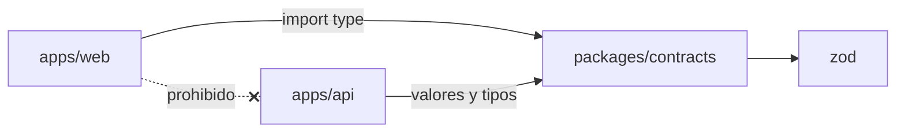
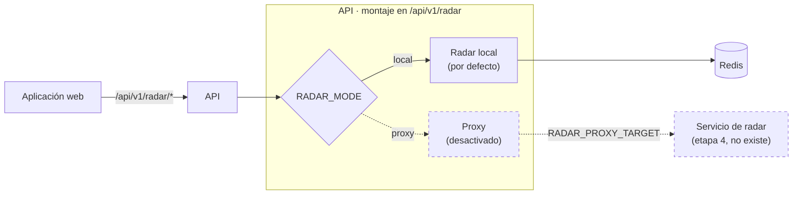

# Etapa 3 · Separación de unidades, límites, contratos y enrutamiento reversible

| Dato | Valor |
|---|---|
| Fecha | 2026-10-23 |
| Commit de referencia (línea base) | `60db1eb` de `main` (fusión del PR n.º 3) |
| Rama | `refactor/etapa-3-preparacion-separacion` |
| Decisión | [ADR-007](../06-decisiones-arquitectonicas/ADR-007-workspaces-y-montaje-de-radar.md) |
| Resultado | **Completa en el repositorio.** Antes de fusionar hay ajustes obligatorios en Vercel y comprobaciones en Render (sección 9) |

Esta etapa prepara la extracción de Radar; **no la inicia**. El backend sigue siendo una única aplicación desplegable.

## 1. Estado inicial

Contrastado con el código de `60db1eb`, no con informes previos:

| Aspecto | Estado en `60db1eb` |
|---|---|
| Etapas 1 y 2 | Integradas en `main` (PR n.º 1 y 2); documentación arquitectónica integrada (PR n.º 3) |
| Empaquetado | Un `package.json` para frontend y backend; `tsconfig.json` del frontend incluía `src/**`; `next build` leía el `.env` del backend |
| Arranque | `app.ts` construía la aplicación al importarse; `config/redis.ts` abría la conexión a Redis al importarse |
| Radar | Valores permitidos escritos solo en `RadarService`; el servicio creaba su repositorio con `new` |
| Configuración | Sin validación; la API arrancaba aunque faltaran variables obligatorias |
| Salud | Sin rutas de salud |
| Línea base de pruebas | 380 pruebas con dobles (19 suites), cobertura: sentencias 95,46 %, ramas 91,35 %, funciones 97,1 %, líneas 95,59 %. `npm run build` y `npm run build:frontend` correctos |

## 2. Pendientes de estabilización

| Pendiente informado | ¿Seguía presente? | Resolución | Prueba de regresión |
|---|---|---|---|
| `npm ci` fallaba con npm 11.9 por `@emnapi` ausente | **Sí** (reproducido con npm 11.9.0; npm 11.6.2 pasaba) | Se añaden cuatro entradas al lockfile sin cambiar ninguna versión; se declaran `engines` | `npm ci` con npm 10.8.2, 11.6.2 y 11.9.0 |
| El frontend combinaba IDs reales con constantes | **Sí**, y peor de lo informado: el registro leía la respuesta de `/catalogs` con una forma incorrecta y **nunca** aplicaba el catálogo real | `app/lib/catalogs.ts` y `useCatalogs`: solo se ofrecen y envían IDs del catálogo persistido | `apps/web/tests/catalogs.test.ts` |
| El registro enviaba IDs locales si fallaba el catálogo | **Sí** | Sin catálogo válido, la selección se deshabilita y se ofrece reintentar | Ídem |
| `PostPublisher` y otros consumidores con asociaciones estáticas | **Sí**: `PostPublisher` inventaba la escuela 1; `FeedList` tenía un mapa fijo de nombres; ajustes usaba la escuela 1 por defecto | Usan el catálogo real; la facultad se deriva de la escuela real | Ídem |
| La carga de catálogos reconocía una facultad por abreviatura y luego la resolvía solo por nombre | **Sí**: caía al ID canónico, que podía ser de otra facultad | Mapa explícito canónico → real (`facultyIdMap`, `schoolIdMap`); si no se resuelve, se aborta | Unitaria con cliente simulado; real, escenario 15 |
| `MAX(id) + 1` sin protección ante cargas concurrentes | **Sí**: con el código original, dos cargas simultáneas fallan con `duplicate key value violates unique constraint "faculties_pkey"` | `LOCK TABLE ... IN SHARE ROW EXCLUSIVE MODE` y IDs alternativos desde la secuencia, sincronizada bajo el bloqueo | Real, escenario 16 |

Fuera de alcance y sin cambios: las pantallas simuladas de matchmaking y del banco de archivos siguen usando constantes, porque no envían esos IDs a la API.

Estrategia de concurrencia: el modo `SHARE ROW EXCLUSIVE` es incompatible consigo mismo y con las escrituras, de modo que dos cargas se ejecutan una tras otra y nadie inserta catálogos mientras se calculan IDs. No bloquea lecturas ni las comprobaciones de claves foráneas, así que el registro de usuarios sigue funcionando. Ninguna de estas operaciones se ejecutó contra Supabase.

## 3. Estructura final

```text
apps/
  api/        @social-unsch/api  Express. src/, tests/, scripts/diagnostico-conexiones.js,
              tsconfig.json (salida dist/), tsconfig.jest.json, jest.config.ts, jest.real.config.ts, .env.example
  web/        @social-unsch/web  Next.js. app/, components/, public/, tests/ (lógica de app/lib),
              tsconfig.json, tsconfig.jest.json, jest.config.ts, .env.example
packages/
  contracts/  @social-unsch/contracts  Esquemas Zod de Radar y del formato de error (salida dist/)
scripts/      dev-all.js, check-boundaries.js (+ prueba)
docs/  docker-compose.yml  package.json (workspaces)  package-lock.json (único)
```



- Cada aplicación declara sus dependencias directas. `cookie-parser` se retira porque estaba declarado y no se usaba; ninguna otra versión cambia.
- Sin Nx, Turborepo ni otra herramienta: npm workspaces basta para tres paquetes.
- El contrato se compila a `dist/` como parte de `build`, `dev` y `typecheck` de cada aplicación. Jest lo resuelve desde su código fuente.

## 4. Límites de módulos

| Módulo | Responsabilidad | Datos que escribe | Datos que lee | Interfaz expuesta | Dependencias por eliminar antes de extraerlo |
|---|---|---|---|---|---|
| `auth` | Registro, inicio de sesión, emisión de tokens | `users` | `users`, `professional_schools` | 3 rutas | Ninguna: es la fuente de `users` |
| `users` | Aceptación de términos | `users` | — | 1 ruta | Comparte la tabla `users` con `auth` |
| `catalogs` | Lectura de catálogos | — | `faculties`, `professional_schools`, `campus_pavilions` | 2 rutas públicas | Consulta el pool desde el controlador |
| `feed` | Publicaciones | `feed_posts` | `users` (`JOIN`) | 2 rutas | `JOIN` con `users` |
| `matchmaking` | Descubrimiento e interacción | `matchmaking_profiles`, `matchmaking_interactions` | `matchmaking_projects`, `users` | 3 rutas | `JOIN` con `users` |
| `carpooling` | Rutas y reservas | `carpooling_requests`, `carpooling_routes` | `users`, `professional_schools` | 3 rutas | Datos de contacto leídos dentro de la transacción |
| `radar` | Estado del campus por consenso | Claves `radar:*` en Redis | — | 2 rutas; unidad montable `RadarModule` | **Ninguna** (ver abajo) |

Dependencias permitidas para cualquier módulo: `middlewares`, `shared`, `config/jwt` (vía `requireAuth`) y su propio almacén. Están prohibidas las importaciones entre módulos; lo comprueba `npm run check:boundaries`.

### Radar en detalle

| Aspecto | Hallazgo en el código |
|---|---|
| Rutas | `GET /api/v1/radar/status`, `POST /api/v1/radar/report` |
| Identidad | Solo el `user_id` del token verificado por `requireAuth`; no consulta usuarios |
| Catálogos y PostgreSQL | No los usa (comprobado por la regla `radar-sin-conexiones`) |
| Redis | Conjuntos `radar:<nodo>:reports:<estado>` (votantes) y hashes `radar:<nodo>:status` o `radar:biblioteca:floor:<n>:occupancy` (estado publicado); voto atómico con un script Lua |
| Persistencia | Ninguna: todos los datos son temporales |
| Expiración | 900 s desde el último voto, tanto en votos como en estados; sin estado vigente el nodo es `indefinido` |
| Umbral | 3 votos de usuarios distintos; al alcanzarse se borran los contadores del nodo |
| Fallos | Redis caído: las rutas del radar responden 500 y el resto de la API sigue atendiendo; `/health/ready` informa `radar: down` |

Cambios para preparar la extracción:

- `RadarRepository` recibe el cliente Redis por constructor (`RadarRedisClient`); `RadarService` recibe un `RadarStore`; `RadarController` recibe el servicio.
- `createLocalRadarModule({ redis })` compone el radar y expone `router` y `checkReady()`.
- `config/redis.ts` ya no crea una conexión al importarse: exporta `createRedisClient(url)`, que solo invoca `composition.ts`.
- Los demás módulos no se convirtieron a arquitectura hexagonal.

## 5. Contratos

Mecanismo: **esquemas Zod en `packages/contracts`**, como única definición. La API importa de ahí los nodos y valores aceptados; las pruebas validan las respuestas con los mismos esquemas; el frontend importa solo los tipos derivados. No se añadió OpenAPI para no mantener una segunda definición.

| Método y ruta | Autenticación | Entrada | Respuesta correcta | Errores |
|---|---|---|---|---|
| `GET /api/v1/radar/status` | `Authorization: Bearer <JWT RS256>` | — | 200 `RadarStatusResponse`: `comedor`, `rectorado`, `campus_alert` con `{ status, is_definite }`; `biblioteca.floor_1..4` con `{ occupancy: número 0-100 \| "indefinido", is_definite }` | 401 `ERR_AUTH_TOKEN_MISSING`, `ERR_AUTH_INVALID_TOKEN`, `ERR_AUTH_TOKEN_EXPIRED`; 500 `ERR_SERVER_INTERNAL_ERROR` |
| `POST /api/v1/radar/report` | Ídem | `{ node, status }`; `status` como texto (aforo: `"0"`..`"100"`) | 200 `{ message, updated: true, current_status }` o `{ message, updated: false, votes_current, votes_required: 3 }` | 400 `ERR_VALIDATION_INVALID_FIELDS`, `ERR_RADAR_INVALID_NODE`, `ERR_RADAR_INVALID_STATUS`; 401 y 500 como arriba |

Formato de error común: `{ "error": true, "message": "...", "code": "ERR_..." }` (`ErrorResponseSchema`).

Comportamientos existentes que el contrato documenta sin cambiarlos:

- Los estados se aceptan en inglés y en español y cuentan como votos distintos.
- Un voto repetido responde 200 con `updated: false` y `votes_current: 0`.
- Un `status` numérico en lugar de texto produce hoy un 500.
- La vigencia de 900 s no aparece en la respuesta: el contrato la declara como `RADAR_TTL_SECONDS`.

No se cambió ningún nombre de campo ni código de error.

## 6. Enrutamiento reversible



- `createApp()` monta en `/api/v1/radar` la unidad `RadarModule` que recibe. El resto de rutas no cambia.
- **Modo local (por defecto):** el radar se atiende en el proceso, como antes.
- **Modo proxy (implementado, desactivado):** justificación: permite que en la etapa 4 la propia API haga de entrada reversible, sin desplegar una puerta de enlace adicional ni cambiar el frontend. Garantías:
  - destino fijado solo por la configuración del servidor (`RADAR_PROXY_TARGET`), validado: `http(s)`, sin credenciales, query ni fragmento;
  - la solicitud no puede cambiar el host de destino;
  - se conservan método, ruta, query, cuerpo JSON y las cabeceras `Authorization`, `Content-Type`, `Accept`, `Accept-Language` y `X-Request-Id`; no se reenvían cookies;
  - un único intento, sin reintentos ni respaldo local;
  - límite de tiempo `RADAR_PROXY_TIMEOUT_MS` (5000 ms por defecto): 504 `ERR_RADAR_UPSTREAM_TIMEOUT`; sin conexión, 502 `ERR_RADAR_UPSTREAM_UNAVAILABLE`;
  - el proxy no verifica el token: lo reenvía y lo verifica el servicio de destino.

Probado contra un servidor HTTP local desechable; nunca contra producción.

**Cómo cambiará en la etapa 4:** se desplegará el servicio de radar con el mismo contrato y las mismas claves de Redis; en la API se configurará `RADAR_MODE=proxy` y `RADAR_PROXY_TARGET`. Para revertir basta volver a `RADAR_MODE=local`, sin redesplegar código. Condición para que la reversión sea segura: el servicio nuevo y el módulo local deben seguir usando el mismo formato de claves y el mismo contrato.

## 7. Configuración y salud

| Variable | Dónde | Obligatoria | Nota |
|---|---|---|---|
| `DATABASE_URL` | API | Sí | Validada: `postgres://` o `postgresql://` |
| `JWT_PRIVATE_KEY`, `JWT_PUBLIC_KEY` | API | Sí | Validadas: deben parecer PEM |
| `ALLOWED_ORIGINS` | API | En producción | Fuera de producción, valores por defecto anteriores |
| `REDIS_URL` | API | Recomendada | Si falta en producción: aviso, el radar queda no disponible y el resto de la API funciona (mismo destino por defecto que antes) |
| `PORT`, `APP_PORT`, `NODE_ENV` | API | No | Sin cambios |
| `RADAR_MODE` | API | No | `local` (por defecto) o `proxy` |
| `RADAR_PROXY_TARGET`, `RADAR_PROXY_TIMEOUT_MS` | API | Solo en modo proxy | — |
| `ALLOW_DEMO_SEED` | Seed local | No | Sin cambios |
| `NEXT_PUBLIC_API_URL` | Web | Sí al compilar | Única variable del frontend |

- Plantillas: `apps/api/.env.example` y `apps/web/.env.example`, con valores ficticios.
- La API lee `apps/api/.env` y, por compatibilidad, el `.env` de la raíz. El frontend solo lee sus propios archivos: los secretos del backend dejan de estar al alcance de `next build`.
- Ante configuración inválida, la API termina con código 1 y enumera las variables afectadas sin mostrar sus valores.
- Ciclo de vida: importar la aplicación o el contrato no abre conexiones. `composition.ts` crea el cliente Redis; el pool de PostgreSQL conecta en la primera consulta. Al recibir `SIGTERM` o `SIGINT`, la API deja de aceptar conexiones y cierra Redis y PostgreSQL, con un límite de 10 s.

| Ruta | Respuesta |
|---|---|
| `GET /health/live` | 200 `{ "status": "ok" }`. No consulta dependencias |
| `GET /health/ready` | 200 `ready`; 200 `degraded` si cae solo el radar; 503 `unavailable` si cae PostgreSQL. Cuerpo: `{ status, checks: { database, radar } }` con `up`/`down`, sin detalles |

Política: Redis no bloquea la readiness de toda la API porque solo lo usa el radar; PostgreSQL sí, porque lo necesitan casi todas las rutas.

## 8. Comandos

Se conservan los comandos de la raíz; delegan en cada workspace.

| Comando (raíz) | Ejecuta |
|---|---|
| `npm ci` | Instalación de los tres paquetes desde el lockfile único |
| `npm run dev:backend` / `npm run dev` | API en modo desarrollo |
| `npm run dev:frontend` | Web en el puerto 3001 |
| `npm run dev:all` | Ambos |
| `npm run build` / `npm run build:api` | Contrato y API (`apps/api/dist`) |
| `npm run build:frontend` | Contrato y web (`apps/web/.next`) |
| `npm run build:all` | Ambos |
| `npm start` | `node dist/server.js` en `apps/api` |
| `npm run typecheck` | Tipos de los tres paquetes, incluidas las pruebas |
| `npm test` | Pruebas de la API y de la web |
| `npm run test:coverage` | API con umbral del 90 % |
| `npm run test:real` | API contra PostgreSQL y Redis en contenedores desechables |
| `npm run check:boundaries` / `npm run test:boundaries` | Límites y su prueba |
| `npm run verify` | Todo lo anterior salvo las pruebas reales |
| `npm run db:*` | Sin cambios de uso |

## 9. Impacto sobre Vercel y Render

No se tuvo acceso a los paneles: no se sabe con certeza qué tienen configurado. En el repositorio no hay `vercel.json` ni `render.yaml`.

### Vercel · ajuste obligatorio antes de fusionar

| Ajuste | Valor |
|---|---|
| Root Directory | `apps/web` |
| Incluir archivos fuera del Root Directory | Activado (necesario para `packages/contracts` y el lockfile de la raíz) |
| Install Command | El predeterminado, si Vercel detecta los workspaces; si no, `cd ../.. && npm ci` |
| Build Command | `npm run build` (compila el contrato y después `next build`) |
| Output Directory | Predeterminado (`.next`) |
| Variables | `NEXT_PUBLIC_API_URL` |

Sin este cambio, la compilación de producción desde la raíz falla: en la raíz ya no hay aplicación Next.js. Vercel conservaría el despliegue anterior, pero `main` dejaría de publicarse. Lo mismo ocurre con las vistas previas de esta rama mientras el panel apunte a la raíz.

### Render · comprobaciones antes de fusionar

| Ajuste | Valor compatible |
|---|---|
| Root Directory | Vacío (raíz del repositorio) |
| Build Command | `npm ci --include=dev && npm run build` (TypeScript es dependencia de desarrollo) |
| Start Command | `npm start` |
| Artefactos | `apps/api/dist/` y `packages/contracts/dist/` |
| Health Check Path | `/health/live` (recomendado; `/health/ready` para monitoreo) |
| Variables | Las actuales; `RADAR_MODE` sin definir equivale a `local` |
| Node | Cualquier versión que cumpla `^20.14.0 \|\| ^22.11.0 \|\| ^24.0.0` |

Si el Start Command actual es `node dist/server.js`, debe cambiarse a `npm start` o a `node apps/api/dist/server.js`.

Los archivos SQL se leen desde `apps/api/src/database/migrations/sql/` al ejecutar `npm run db:migrate` con `ts-node`; no forman parte del artefacto desplegado, como antes. No se ejecutaron migraciones remotas.

## 10. Resultados de pruebas (2026-10-23)

| Comprobación | Línea base `60db1eb` | Final |
|---|---|---|
| `npm ci` | Falla con npm 11.9.0 | Correcto con npm 11.9.0 (instalación real), 11.6.2 y 10.8.2 (simulación) |
| Compilación del backend | Correcta | Correcta (`npm run build`) |
| Compilación del frontend | Correcta, 14 páginas | Correcta, 14 páginas (`npm run build:frontend`) |
| Tipos | Correctos sin pruebas | `npm run typecheck` correcto, incluidas las pruebas |
| Pruebas de la API con dobles | 19 suites, 380 pruebas | 26 suites, 447 pruebas |
| Cobertura de la API | 95,46 / 91,35 / 97,1 / 95,59 % | 96,7 / 92,91 / 98,31 / 96,81 % (sentencias / ramas / funciones / líneas), con los archivos nuevos incluidos |
| Pruebas del frontend | No existían | 2 suites, 14 pruebas |
| Contrato de Radar | No existía | 16 pruebas contra la aplicación |
| Límites | No existía | Sin infracciones; 3 pruebas del verificador |
| Pruebas reales (Docker) | 33 informadas en la etapa 2 | **36/36** ejecutadas: escenarios 15 y 16 de catálogos y escenario 6 del radar vía HTTP |
| Escenarios 15 y 16 contra el código original | — | Fallan, el 16 con `duplicate key value violates unique constraint "faculties_pkey"` |
| Node 20.14.0 | — | Tipos, 447 pruebas, `next build` y límites correctos |
| Servidor compilado | — | `/health/live` 200; `/health/ready` 503 sin PostgreSQL; radar sin token 401; configuración inválida termina con código 1 sin mostrar secretos |

Todas las pruebas reales usaron contenedores desechables en los puertos 55432 y 56379. No se usaron servicios de producción ni se tocaron otros contenedores.

## 11. Reversión

| Alcance | Cómo |
|---|---|
| Toda la etapa, antes de fusionar | No fusionar la rama |
| Toda la etapa, después de fusionar | `git revert` de los commits de la etapa, en orden inverso; devolver Vercel a la raíz |
| Solo el enrutamiento del radar | `RADAR_MODE=local` (valor por defecto) |
| Solo las correcciones de catálogos | Revertir los commits `fix(catalogs)` y `fix(web)`; no hay cambios de esquema ni de datos |

## 12. Pendientes

- Ajustar Vercel y verificar Render antes de fusionar (sección 9).
- Integración continua: `npm run verify` está listo, pero no hay flujo de trabajo configurado.
- Cliente Redis sin reconexión tras 5 fallos (deuda existente, sin cambios).
- Unificar los valores del radar en un solo idioma: es un cambio de contrato y se decide en la etapa 4.
- Retirar los ejecutores de migración heredados (deuda de la etapa 2, fuera de alcance).
- El aforo `0 %` se muestra en el frontend como «Vacío» (comportamiento existente).

## 13. Condiciones para iniciar la etapa 4

1. Esta rama fusionada y desplegada, con Vercel y Render ajustados y `/health/ready` respondiendo en producción.
2. Redis de producción verificado (sigue pendiente desde la etapa 1).
3. Integración continua ejecutando `npm run verify`.
4. Decisión sobre el idioma de los valores del radar antes de duplicar el contrato en otro servicio.
5. Medición de latencia actual del radar, incluido el arranque en frío, como punto de comparación.
6. Ensayo local del modo proxy contra un servicio de radar real (no un servidor de prueba).

[← Índice](../README.md)
