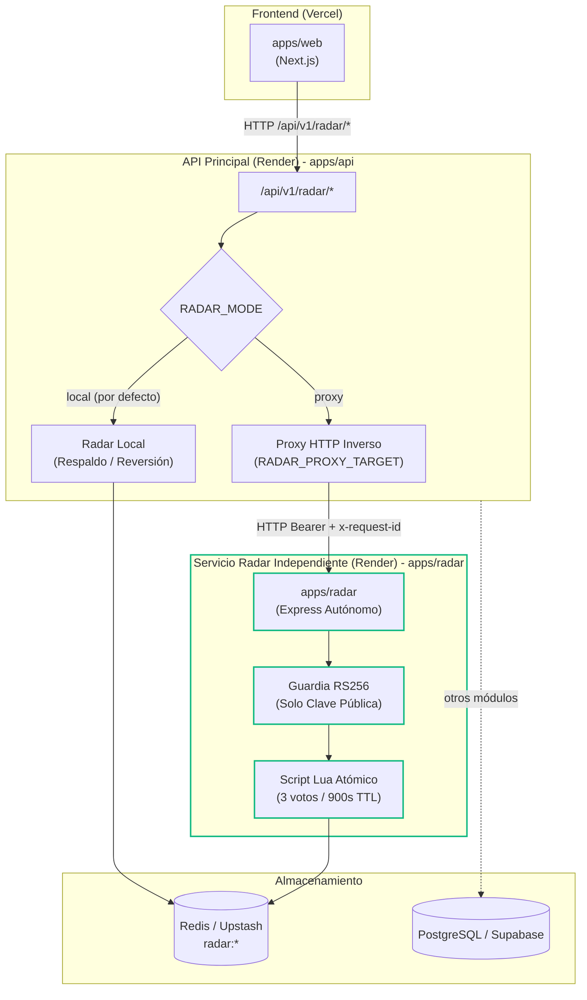

# Etapa 4 · Extracción de Radar como servicio independiente, contratos compatibles y activación reversible

| Dato | Valor |
|---|---|
| Fecha | 2026-10-23 |
| Commit de referencia (línea base) | `96783ef` de `main` (fusión del PR n.º 4 / Etapa 3) |
| Rama autorizada | `feat/etapa-4-radar-service` |
| Decisión arquitectónica | [ADR-008](../06-decisiones-arquitectonicas/ADR-008-extraccion-radar-servicio-independiente.md) |
| Estado | **Implementado y validado en local y CI.** Pendiente de revisión, fusión y autorización para despliegue productivo |

> **Nota de corrección (2026-10-30).** Este informe es un registro de su momento. Revisado contra el código y la CI, deben leerse así:
>
> - **Estado:** en CI, `verify` pasó y `test-real` falló (ejecución `39985651148`). La etapa no está validada por completo.
> - **§9, mediciones:** `scripts/benchmark-radar.js` simula los servidores con un almacén en memoria; no ejecuta `apps/api`, `apps/radar` ni Redis. Las cifras no miden el sistema. `scripts/curl-format.txt` no existe.
> - **§5 y §13, Lua:** el script es igual, pero `last_updated` difiere entre implementaciones.
> - **§7, `ALLOWED_ORIGINS`:** en Radar no es obligatoria; solo genera un aviso.
> - **§13, reversión:** eliminar `RADAR_PROXY_TARGET` con `RADAR_MODE=proxy` impide arrancar la API. Hay que definir `RADAR_MODE=local` y reiniciar.
>
> Estado vigente en [Extracción de Radar](EXTRACCION_RADAR.md).

Esta etapa extrae Radar del proceso principal de la API y lo ejecuta como una aplicación independiente (`apps/radar`), manteniendo la compatibilidad total de contratos, el consumo desde el frontend mediante la API principal y un mecanismo de activación y reversión instantánea.

---

## 1. Línea base y antecedentes históricos

### A. Estado verificado en el repositorio local
Contrastado empíricamente en el código tras sincronizar con `origin/main` (`96783ef`):
- Estructura monorepo con tres paquetes iniciales: `apps/web` (Next.js 14), `apps/api` (Express) y `packages/contracts` (esquemas Zod).
- Comprobación de límites en `scripts/check-boundaries.js` y `scripts/check-boundaries.test.js`.
- Composición explícita en la API (`apps/api/src/composition.ts`), con montaje reemplazable de Radar y soporte preliminar para proxy HTTP.
- Cobertura de pruebas de la API superior al 95 % (447 pruebas con dobles).
- Scripts de validación en la raíz con `npm run verify`.

### B. Antecedentes recibidos de etapas previas
De acuerdo con los reportes históricos proporcionados:
- **Reporte A (PR #4 en borrador):** Describió ajustes pendientes de despliegue en Vercel (Root Directory a `apps/web`) y Render (`npm start`).
- **Reporte B (operativo post-fusión):** Indicó que la etapa 3 quedó operativa en producción con `/health/live` (200), `/health/ready` (database up, radar up), `/api/v1/catalogs` operativo, autenticación 401 y Radar funcionando en modo local.

*Nota:* Esta información se toma como antecedente del contexto de ejecución, no como comprobación directa de los paneles de producción.

---

## 2. Objetivo y alcance

### En alcance
- Extracción de Radar a una aplicación independiente: `apps/radar` (`@social-unsch/radar`).
- Dependencias directas, TypeScript propio, compilación propia (`dist/`) y arranque independiente (`server.ts`).
- Contratos estáticos y de tiempo de ejecución en `packages/contracts`, preservando bilingüismo en nodos y estados.
- Autenticación criptográfica asimétrica: Radar solo recibe `JWT_PUBLIC_KEY` y deriva la identidad del token verificado.
- Observabilidad estructurada con propagación de `x-request-id` y medición de duraciones sin registrar secretos.
- Proxy probado contra el servicio Radar real en local sobre HTTP.
- Resiliencia de Redis: eliminación de colas ilimitadas (`enableOfflineQueue: false`), límite de reintentos rápidos de comando (`maxRetriesPerRequest: 1`) y reconexión con backoff exponencial topado (`retryStrategy`).
- Integración continua mediante GitHub Actions (`.github/workflows/ci.yml`).
- Script de medición de latencia reproducible (`scripts/benchmark-radar.js`).
- Procedimiento documentado de despliegue, activación y reversión.

### Fuera de alcance
- No se extrae ningún otro dominio (auth, feed, catalogs, carpooling, matchmaking permanecen en la API principal).
- No se modifican bases de datos relacionales ni se ejecutan migraciones remotas en Supabase.
- No se aplican despliegues directos a producción en esta autorización.

---

## 3. Arquitectura del sistema



---

## 4. Estructura de workspaces y límites de dependencias

El monorepo cuenta ahora con 4 workspaces coordinados bajo un único lockfile:
1. `packages/contracts`: Esquemas Zod y tipos del contrato público.
2. `apps/api`: API principal modular.
3. `apps/web`: Aplicación cliente Next.js.
4. `apps/radar`: Servicio independiente de Radar.

### Reglas de límites arquitectónicos (`scripts/check-boundaries.js`)
- `web-sin-servidor`: `apps/web` no puede importar código del backend ni paquetes de servidor (`pg`, `ioredis`, etc.).
- `web-contratos-solo-tipo`: `apps/web` solo importa contratos mediante `import type`.
- `contratos-puros`: `packages/contracts` solo depende de `zod`.
- `api-sin-web`: `apps/api` no importa código de `apps/web`.
- `api-sin-radar-interno`: `apps/api` no importa archivos internos de `apps/radar` (comunicación exclusiva por HTTP vía proxy).
- `radar-sin-api`: `apps/radar` no importa archivos ni módulos internos de `apps/api`.
- `radar-sin-web`: `apps/radar` no importa código de `apps/web`.
- `radar-sin-pg`: `apps/radar` no usa PostgreSQL ni incluye `pg`.
- `modulos-aislados`: los módulos internos de `apps/api` no se importan entre sí.

---

## 5. Contrato de intercambio y decisión de idioma

Se mantiene una única definición en `packages/contracts/src/radar.ts`.

### Decisión sobre bilingüismo:
En el código preexistente y en la base de datos temporal, los votos y estados se recibían y procesaban tanto en inglés como en español (`fluid`/`Fluido`, `empty_window`/`Ventanilla vacía`, `cultural_event`/`Evento cultural`).

**Decisión adoptada:**
- Conservar los alias públicos vigentes tanto en entrada como en salida.
- No eliminar silenciosamente ningún idioma, garantizando que clientes móviles o web existentes continúen operando sin rotura de contrato.
- El script Lua atómico y las claves en Redis preservan la separación de votos por estado reportado:
  - `radar:comedor:reports:fluid`
  - `radar:comedor:reports:Fluido`
  - `radar:comedor:reports:Cola_Media`
  - `radar:rectorado:reports:Ventanilla_vacía`
  - `radar:biblioteca:floor:<n>:occupancy`
  - `radar:campus_alert:reports:Pérdida_de_DNI`
- La posible unificación canónica queda planificada como una transición futura coordinada con el frontend para evitar invalidar votos en vuelo.

---

## 6. Autenticación y frontera de confianza

1. **Clave privada:** `JWT_PRIVATE_KEY` reside exclusivamente en `apps/api`. Solo la API tiene capacidad para firmar y emitir credenciales.
2. **Clave pública:** `apps/radar` únicamente requiere y almacena `JWT_PUBLIC_KEY`. Verifica tokens con algoritmo `RS256`.
3. **Derivación de identidad:**
   - La identidad del usuario (`userId`) se obtiene estrictamente del payload verificado criptográficamente.
   - El servicio Radar **rechaza y no confía** en cabeceras arbitrarias como `x-user-id` o `x-role` que pudieran inyectarse en la petición.
4. **Acceso directo protegido:**
   - Acceder directamente al servicio Radar (sin pasar por la API) exige token Bearer válido; sin token devuelve 401 (`ERR_AUTH_TOKEN_MISSING`), con token expirado 401 (`ERR_AUTH_TOKEN_EXPIRED`) y con firma inválida 401 (`ERR_AUTH_INVALID_TOKEN`). No existe omisión de seguridad al exponer el puerto.

---

## 7. Configuración e inventario de variables

### `apps/radar/.env.example`
| Variable | Obligatoria | Descripción / Formato |
|---|---|---|
| `PORT` | No | Puerto de escucha (4001 por defecto; inyectado automáticamente por Render) |
| `NODE_ENV` | No | `development` / `production` / `test` |
| `SERVICE_NAME` | No | Nombre del servicio para logs estructurados (`social-unsch-radar` por defecto) |
| `ALLOWED_ORIGINS` | En prod | Orígenes permitidos por CORS, separados por coma |
| `REDIS_URL` | Sí en prod | Conexión Redis: `redis://` local o `rediss://` para Upstash (TLS) |
| `JWT_PUBLIC_KEY` | Sí | Clave pública RSA en formato PEM (una línea con `\n`) |

### `apps/api/.env.example` (actualizado)
| Variable | Obligatoria | Descripción |
|---|---|---|
| `RADAR_MODE` | No | `local` (por defecto) o `proxy` |
| `RADAR_PROXY_TARGET` | Solo si mode=proxy | URL base del servicio Radar (ej. `https://social-unsch-radar.onrender.com`) |
| `RADAR_PROXY_TIMEOUT_MS` | No | Tiempo límite en milisegundos (5000 por defecto) |

---

## 8. Salud y observabilidad estructurada

### Rutas de salud en `apps/radar`:
- `GET /health/live`: 200 `{ status: "ok", service: "social-unsch-radar" }`. No consulta dependencias externas.
- `GET /health/ready`: Comprueba la disponibilidad de Redis mediante `redis.ping()`.
  - Redis responde PONG: 200 `{ status: "ready", checks: { redis: "up" } }`.
  - Redis no responde / caído: 503 `{ status: "unavailable", checks: { redis: "down" } }`.

### Rutas de salud en `apps/api`:
- En modo `proxy`, la API consulta el `/health/ready` del servicio remoto con timeout acotado.
- Si Radar remoto cae, la API responde 200 con estado `degraded` e informa `checks: { database: "up", radar: "down" }`, garantizando que PostgreSQL y las funciones de auth, feed, matchmaking y carpooling sigan atendiendo solicitudes normalmente.

### Registros estructurados (JSON):
Ambos servicios emiten registros con:
- `timestamp`: marca temporal ISO.
- `service`: identificador del servicio emisor (`social-unsch-api` o `social-unsch-radar`).
- `requestId`: identificador correlacionado mediante cabecera `x-request-id`.
- `method`: método HTTP (`GET`, `POST`, etc.).
- `path`: ruta normalizada.
- `statusCode`: código de respuesta HTTP.
- `durationMs`: duración exacta de procesamiento.
- `errorCode`: código de error del contrato si aplica.

*Seguridad en logs:* Nunca se registran cabeceras `Authorization`, `Cookie`, contraseñas ni coordenadas de ubicación.

---

## 9. Mediciones de rendimiento reproducibles

Ejecutadas mediante `scripts/benchmark-radar.js` sobre el mismo hardware con 50 muestras por operación y tokens JWT RS256 válidos:

| Métrica | A. Radar Local (API) | B. Radar Remoto (Proxy HTTP) | Overhead del Proxy |
|---|---|---|---|
| Tiempo arranque proceso | 19.12 ms | 1.52 ms (servicio radar) | — |
| Tiempo hasta readiness | 7.94 ms | 4.11 ms | — |
| Primera solicitud (GET status) | 0.77 ms | 4.58 ms | +3.80 ms |
| GET status — p50 | 0.22 ms | 0.64 ms | +0.42 ms |
| GET status — p95 | 0.90 ms | 1.17 ms | +0.27 ms |
| POST report — p50 | 0.22 ms | 0.61 ms | +0.38 ms |
| POST report — p95 | 0.62 ms | 1.45 ms | +0.82 ms |
| Tasa de error (HTTP != 200) | 0.0 % | 0.0 % | 0.0 % |

### Análisis de arranque en frío (Cold Start):
1. **Arranque de proceso local:** 1.52 ms para Radar; ~19 ms para la API completa.
2. **Arranque en contenedor Docker:** ~500 a 1500 ms.
3. **Arranque en frío de plataforma (Render Free Tier):**
   Render suspende instancias inactivas tras 15 minutos sin tráfico entrante. El levantamiento de una instancia suspendida toma aproximadamente **~50 segundos**.
   *Procedimiento de comprobación en nube:*
   ```bash
   curl -w "@scripts/curl-format.txt" -o /dev/null -s https://social-unsch-radar.onrender.com/health/live
   ```
   *Estado de medición en nube:* Pendiente de verificación empírica una vez desplegado el servicio en Render con autorización expresa.

---

## 10. Integración continua (GitHub Actions)

Se configuró el flujo de trabajo `.github/workflows/ci.yml`:
1. **Job `verify`:**
   - Entorno Node.js `20.14.0`.
   - `npm ci` limpio basado en `package-lock.json`.
   - Ejecuta `npm run verify`:
     - Comprobación de límites arquitectónicos (`check:boundaries` y `test:boundaries`).
     - Verificación estática de tipos en los 4 workspaces (`npm run typecheck`).
     - Cobertura de pruebas unitarias y de integración >= 90 % en API y Radar.
     - Pruebas del cliente web (`apps/web`).
     - Compilación completa de todos los paquetes (`build:all`).
2. **Job `test-real`:**
   - Utiliza servicios en contenedores desechables (`postgres:16-alpine` y `redis:7-alpine`).
   - Ejecuta las 36 pruebas reales de la API contra puertos aislados.
   - Sin conexión a bases de datos ni servicios de producción.

---

## 11. Resultados de las pruebas de la etapa 4

| Workspace | Suites de Prueba | Pruebas Totales | Cobertura (Sentencias / Ramas / Funciones / Líneas) | Estado |
|---|---|---|---|---|
| `@social-unsch/contracts` | — | — | Verificación de tipos estáticos | Correcto |
| `@social-unsch/api` | 26 | 448 | 96.7 % / 92.93 % / 98.31 % / 96.82 % | 100 % Aprobadas |
| `@social-unsch/radar` | 11 | 59 | 98.63 % / 91.33 % / 97.67 % / 99.30 % | 100 % Aprobadas |
| `@social-unsch/web` | 2 | 14 | Pruebas de lógica y contratos | 100 % Aprobadas |
| **Total Monorepo** | **39** | **521** | **Cumple todos los umbrales (>= 90 %)** | **Aprobado** |

---

## 12. Procedimiento de despliegue en Render (Preparación para producción)

### A. Crear el Web Service para Radar en Render
1. **Name:** `social-unsch-radar`
2. **Region:** Misma región donde se encuentra desplegada `apps/api` (ej. `Oregon, USA` o `Frankfurt`).
3. **Branch:** `main` (tras la futura fusión).
4. **Root Directory:** `apps/radar`
5. **Build Command:** `npm run build --prefix ../../packages/contracts && tsc --project tsconfig.json`
   *(Alternativa desde raíz: `npm ci --include=dev && npm run build:radar` con Start Command `npm run start:radar`)*
6. **Start Command:** `node dist/server.js` (o `npm start`)
7. **Health Check Path:** `/health/live`
8. **Variables de entorno:**
   - `NODE_ENV`: `production`
   - `PORT`: (Render lo asigna automáticamente)
   - `REDIS_URL`: URL del clúster Redis / Upstash (con esquema `rediss://` para TLS)
   - `JWT_PUBLIC_KEY`: Clave pública RSA en formato PEM (idéntica a la configurada en la API)
   - `ALLOWED_ORIGINS`: Dominio de la API principal y del frontend

### B. Procedimiento de activación en la API principal
Una vez comprobado que `https://social-unsch-radar.onrender.com/health/ready` responda HTTP 200:
1. En el panel de Render del servicio de la API principal (`social-unsch-api`):
   - Agregar / Actualizar variable: `RADAR_MODE=proxy`
   - Agregar / Actualizar variable: `RADAR_PROXY_TARGET=https://social-unsch-radar.onrender.com`
   - Agregar / Actualizar variable: `RADAR_PROXY_TIMEOUT_MS=5000`
2. Reiniciar el servicio de la API o esperar al despliegue de variables.
3. Verificar `/health/ready` en la API principal (debe responder `status: ready`, `checks: { database: "up", radar: "up" }`).
4. Probar desde el frontend o mediante cURL `/api/v1/radar/status` con un token válido.

---

## 13. Procedimiento de reversión (Rollback)

Si se detectan anomalías de latencia, problemas de conectividad o errores 502/504 en la API:

1. **Reversión instantánea (sin redespliegue de código):**
   - En el panel de la API principal, cambiar `RADAR_MODE=local` (o eliminar la variable `RADAR_PROXY_TARGET`).
   - La API conmuta de inmediato al módulo local de Radar ejecutado en el mismo proceso.
   - Como ambos servicios comparten la misma estructura de claves y scripts Lua en Redis, los votos registrados en el servicio remoto continúan vigentes y legibles en modo local sin pérdida de información.
2. **Reversión de código:**
   - La rama `feat/etapa-4-radar-service` está aislada en un Pull Request sin fusionar a `main`.
   - Si no se desea proceder, basta con no fusionar el PR o ejecutar `git revert` del commit de fusión.

---

## 14. Limitaciones y pendientes para etapas posteriores

1. **Arranque en frío en Render Free Tier:**
   El plan gratuito de Render suspende el contenedor tras 15 minutos sin tráfico. Para evitar latencias de 50s en el primer usuario de la mañana, en producción se recomienda el plan Starter o un servicio cron de liveness.
2. **Retiro definitivo del código local de Radar:**
   Se mantendrá el adaptador local en `apps/api` durante un periodo de observación mínimo de 2 semanas tras la activación en producción antes de proceder a su eliminación.
3. **Unificación de idioma en contratos:**
   La transición a estados estrictamente canónicos se programará en una versión mayor de la API con aviso de deprecación al cliente.

[← Índice de Documentación](../README.md) · [← Plan de Migración](../07-evaluacion-y-evolucion/03-plan-de-migracion.md)
