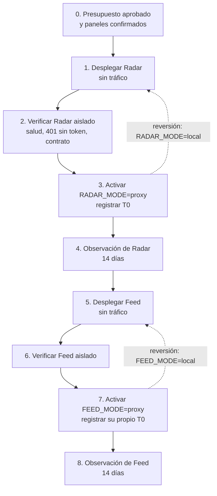

# Etapa 8 · Integración, despliegue y cierre verificable de la migración

| Dato | Valor |
|---|---|
| Fecha | **2026-11-25** |
| Rama de trabajo | `codex/etapa-8-cierre-migracion` |
| Base | `main` `452f9d6` (fusión del PR n.º 11, etapa 7) |
| Estado de la fase | **ABIERTA.** Código, pruebas y documentación completos. **Despliegue, activación y validación operativa pendientes de autorización y presupuesto** |
| Alcance | Auditar el estado real, completar los pendientes técnicos dentro de lo autorizado, consolidar la integración, preparar el despliegue y cerrar la migración de forma verificable. **No se extrae ningún dominio nuevo** |

> **Resultado global: PARCIAL.** Se cumplen los tres primeros criterios de cierre (código completo, CI, cambios integrados) y faltan los tres últimos (servicios desplegados, modos remotos activos, validación operativa). La migración **no está completada en producción**.

Este documento es **vivo**: refleja el estado vigente. Los informes `ETAPA_01`–`ETAPA_07` son registros de su momento.

---

## 1. Auditoría del estado real (sin asumir el informe anterior)

No existe `AGENTS.md` ni `CLAUDE.md` en el repositorio. Se conservaron todos los archivos sin seguimiento ajenos al alcance.

**La información de partida estaba desactualizada.** Se nos indicó que la etapa 6 estaba en la rama `codex/etapa-6-desacoplamiento-feed` (commit `3e4768c`) y la etapa 5 seguía abierta. Lo comprobado el 2026-11-25:

| Comprobación | Resultado real |
|---|---|
| `origin/main` | `452f9d6`, **23 commits por delante** de la copia local |
| Etapa 5 | **Fusionada** en `main` (PR n.º 8 y n.º 9) |
| Etapa 6 | **Fusionada** en `main` (PR n.º 10) |
| Etapa 7 | **Fusionada** en `main` (PR n.º 11), incluido el commit `a821bef` |
| Rama `codex/etapa-7-extraccion-feed` | Ancestro de `origin/main`: nada pendiente de integrar |
| `apps/radar` y `apps/feed` desplegados | **No.** Ronda GET del 2026-11-25 ([etapa8-production-2026-11-25.json](evidencias/etapa8-production-2026-11-25.json)): API `/health/live` 200 (32,67 s en frío), `/health/ready` 200 `ready` (`database: up`, `radar: up`, sin `feed`), `/api/v1/catalogs` 200, `/api/v1/radar/status` 401, `/api/v1/feed` 401; `social-unsch-radar.onrender.com` y `social-unsch-feed.onrender.com` devuelven **404**; Vercel `/login` 200 (1,06 s) |
| Modos activos en producción | `RADAR_MODE=local` y `FEED_MODE=local` (valores por defecto, confirmados indirectamente por ausencia de `feed` en `/health/ready` y 404 en ambos dominios previstos) |
| Observación de 14 días | **No iniciada**, ni para Radar ni para Feed |

### Matriz por etapa

| Etapa | Implementación | CI | Merge | Producción | Pendientes |
|---|---|---|---|---|---|
| 1. Línea base | Completa | Verde | En `main` (PR n.º 1) | Aplicada | Recuperación de Redis sin verificar |
| 2. Estabilización | Completa | Verde | En `main` (PR n.º 2) | Aplicada parcialmente verificada | Confirmar `schema_migrations` e índice carpooling |
| 3. Monorepo, contratos, límites | Completa | Verde | En `main` (PR n.º 4) | **Desplegada** | — |
| 4. Extracción de Radar | Completa | Falló `test-real` al fusionarse; corregido en etapa 5 | En `main` (PR n.º 5) | API con el proxy **sin activar** | Servicio sin desplegar |
| 5. Operación de Radar | Completa | Verde en `main` `f27083f` ([45296802875](https://github.com/pillacarodriguezuriel-a11y/social_unsch/actions/runs/45296802875)) | En `main` (PR n.º 7, 8, 9) | Sin cambios (`RADAR_MODE=local`) | Paneles/SHA, presupuesto, activación, observación |
| 6. Desacoplamiento de Feed | Completa | Verde en `main` `c0f6638` ([45485858388](https://github.com/pillacarodriguezuriel-a11y/social_unsch/actions/runs/45485858388)) | En `main` (PR n.º 10) | Sin cambios funcionales | — |
| 7. Extracción de Feed | Completa (con defectos en `test-real` y `e2e-feed`) | **FALLIDO** en PR #11 y `main` `452f9d6` ([45492869658](https://github.com/pillacarodriguezuriel-a11y/social_unsch/actions/runs/45492869658): fallaron `test-real` y `e2e-feed`) | En `main` (PR n.º 11) | API con el proxy **sin activar** | Servicio sin desplegar; defectos corregidos en etapa 8 |
| 8. Cierre | Completa en código (`f93847c`) | Local 100 % verde (`verify`, `test:real` 36/36, `test:e2e` 14/14, `test:e2e:feed` 16/16); CI remota en rama al publicar | PR en borrador | **Sin cambios** | Merge autorizado, despliegue, activación, observación |

### Contradicción de alcance detectada y resuelta

El [plan de migración](../07-evaluacion-y-evolucion/03-plan-de-migracion.md) numera sus etapas 6, 7 y 8 como *Movilidad*, *Recursos* y *Consolidación*. Las etapas realmente ejecutadas con esos números fueron otras: desacoplamiento de Feed, extracción de Feed y este cierre. Feed pertenece al dominio *Comunidad*, que el plan había marcado como propuesta **diferida**.

No es una desviación del equipo: fue una decisión del propietario de adelantar Feed. Queda registrada en el [ADR-011](../06-decisiones-arquitectonicas/ADR-011-cierre-de-la-migracion-y-alcance-final.md) y anotada en el propio plan. **Movilidad y Recursos no se ejecutaron y quedan fuera de este cierre.** No se ha introducido ninguna extracción nueva.

---

## 2. Arquitectura realmente desplegada

| Pieza | Estado real | Dónde |
|---|---|---|
| `apps/web` | **DESPLEGADA** | Vercel |
| `apps/api` | **DESPLEGADA**, atendiendo Radar y Feed en proceso | Render |
| `apps/radar` | Implementado y probado, **SIN DESPLEGAR** | — |
| `apps/feed` | Implementado y probado, **SIN DESPLEGAR** | — |
| PostgreSQL | **DESPLEGADO**, compartido entre API y Feed | Supabase |
| Redis | **DESPLEGADO**, exclusivo del radar | Upstash |

**El sistema en producción es un monolito modular.** Los dos servicios extraídos existen en el código y son activables por configuración, pero no operan. No procede llamar al resultado «microservicios»: además de no estar desplegados, `apps/feed` comparte base de datos con la API y lee `users`.

---

## 3. Pendientes técnicos completados en esta etapa

### 3.1 Lógica de Feed duplicada entre los dos modos · **CORREGIDO**

**Problema encontrado:** `apps/api` y `apps/feed` tenían copias casi idénticas del repositorio, del controlador y del adaptador de autor: unas 260 líneas, **incluido el SQL**. Diferían ya en nombres de consultas preparadas y comentarios. Un cambio de filtro, orden o mensaje en un lado habría separado el comportamiento de los modos local y proxy en silencio, lo que rompe la garantía de reversión del Strangler Fig. Además había unas 770 líneas de pruebas duplicadas, dos de cuyos archivos probaban exactamente el mismo `FeedService`.

**Solución:** la implementación vive ahora una sola vez en [`packages/feed-domain`](../../packages/feed-domain/src/index.ts):

| Archivo nuevo | Contenido |
|---|---|
| [`sql.ts`](../../packages/feed-domain/src/sql.ts) | `SqlQueryable`: puerto estructural de acceso SQL que `pg.Pool` satisface sin que el paquete importe `pg` |
| [`pg-feed.repository.ts`](../../packages/feed-domain/src/pg-feed.repository.ts) | `PgFeedRepository` y `PgAuthorMetaAdapter`: el SQL del Feed, una sola vez |
| [`http.ts`](../../packages/feed-domain/src/http.ts) | `FeedHttpHandlers`: validación, códigos de error y cuerpos, sin framework; devuelve `{ status, body }` |

`apps/api` y `apps/feed` conservan solo el cableado y un adaptador de Express de unas quince líneas. Lo único que difiere entre ambos es de dónde sale el identificador del usuario (`req.user.user_id` frente a `req.user.userId`), porque cada proceso verifica el token con su propio middleware.

El paquete sigue **sin dependencias de ejecución**, verificado por la regla `feed-domain-puro` de [check-boundaries.js](../../scripts/check-boundaries.js).

**Comportamiento preservado a propósito.** La deduplicación no cambió ninguna respuesta pública, incluidas dos rarezas que ahora quedan registradas en el contrato en lugar de «arregladas» por sorpresa: un parámetro de consulta vacío se trata como ausente, y un `content` no textual produce 500 en lugar de 400.

### 3.2 Feed sin contrato compartido · **CORREGIDO**

Radar tenía `packages/contracts/src/radar.ts`; Feed no tenía equivalente. Sin contrato no había forma mecánica de comprobar que el modo local y el servicio independiente respondieran igual.

Se añadió [`packages/contracts/src/feed.ts`](../../packages/contracts/src/feed.ts) con las rutas, los esquemas y los códigos de error, y **dos pruebas de contrato en espejo** que validan las respuestas reales contra los mismos esquemas:

- [`apps/api/tests/contract/feed.contract.test.ts`](../../apps/api/tests/contract/feed.contract.test.ts) — modo local
- [`apps/feed/tests/contract/feed.contract.test.ts`](../../apps/feed/tests/contract/feed.contract.test.ts) — servicio independiente

Si una de las dos implementaciones dejara de cumplir el contrato, falla `verify`.

### 3.3 Caída de `apps/feed` invisible en modo proxy · **CORREGIDO**

`/health/ready` de la API reportaba `radar` pero no `feed`: con `FEED_MODE=proxy`, una caída del servicio no habría aparecido en la salud. Se añadió la comprobación en [composition.ts](../../apps/api/src/composition.ts), **solo en modo proxy** (en modo local el Feed vive en el proceso y su dependencia real ya se reporta como `database`), y no crítica, para que la API se degrade en lugar de fallar.

### 3.4 Pool de `apps/feed` sin manejador de errores · **CORREGIDO**

El pool de la API tenía un manejador del evento `error`; el de `apps/feed`, no. Un error en un cliente inactivo habría terminado el proceso. Añadido en [database.ts](../../apps/feed/src/config/database.ts), con registro estructurado que no imprime la cadena de conexión.

### 3.5 Feed sin medición de rendimiento · **CORREGIDO**

No existía equivalente a `bench:radar`. Se añadió [`scripts/benchmark-feed.js`](../../scripts/benchmark-feed.js) (ver §6).

### 3.6 `ops:probe` no cubría Feed · **CORREGIDO**

La sonda no conocía el servicio Feed ni la ruta `/api/v1/feed`. Ahora acepta `PROBE_FEED`, sondea `/api/v1/feed` en la API validando la respuesta contra `FeedListResponseSchema`, y admite `feed` entre las comprobaciones de salud. Las rutas de los servicios se sondean **sin token a propósito**: un 401 confirma que cada servicio verifica la firma por sí mismo; un 200 sería un fallo de seguridad.

### 3.7 Scripts incompletos · **CORREGIDO**

`packages/feed-domain` no se ejecutaba en `test` ni en `test:coverage`, y faltaba `dev:feed`. Añadidos, junto con `test:feed-domain` y `bench:feed`.

### 3.8 Los jobs `test-real` y `e2e-feed` de CI estaban rotos en `main` (`452f9d6`) · **CORREGIDO**

Hallazgo verificado contra la API de GitHub Actions ([run 45492869658](https://github.com/pillacarodriguezuriel-a11y/social_unsch/actions/runs/45492869658)): tras fusionar el PR n.º 11, **cuatro de los ocho jobs de `main` fallaron**:

1. **`test-real` (Node 20 y 24):** [`apps/api/jest.real.config.ts`](../../apps/api/jest.real.config.ts) no mapeaba `@social-unsch/feed-domain` y el job `test-real` de [`.github/workflows/ci.yml`](../../.github/workflows/ci.yml) solo compilaba `@social-unsch/contracts` sin compilar `@social-unsch/feed-domain`. **Corregido** añadiendo el mapeo en `jest.real.config.ts` y `npm run build:feed-domain` en `ci.yml`.
2. **`e2e-feed` (Node 20 y 24):** [`tests/e2e/feed.e2e.test.js`](../../tests/e2e/feed.e2e.test.js) nunca se había ejecutado con éxito: registraba un `full_name` con dígito (`'Estudiante Feed E2E'`, rechazado 400), leía `login.body.token` en lugar de `login.body.access_token`, esperaba un array raíz en `GET /api/v1/feed` en lugar de `{ data: [...] }`, enviaba `facultyId` en lugar de `faculty_id` y esperaba `{ id, content }` en `POST` en lugar de `{ success, message, post_id }`. **Corregido y ampliado** para validar contratos Zod, `x-request-id`, concurrencia (10 escrituras simultáneas), timeout 504, caída de proceso 502 frente a caída de PostgreSQL compartido 503/500, **permisos mínimos en PostgreSQL desechable** (`feed_min_priv`), matriz `RADAR_MODE=proxy` + `FEED_MODE=proxy` y cierre ordenado (`SIGTERM`).

### 3.9 Pendientes de Radar que **NO** se resolvieron

| Pendiente | Por qué sigue abierto |
|---|---|
| [P-06](../07-evaluacion-y-evolucion/08-pendientes.md#p-06--dos-implementaciones-de-radar): dos implementaciones de Radar | Unificarlas como se hizo con Feed es el siguiente paso natural, pero toca el dominio que lleva más camino recorrido y cuya activación es la primera de la cola. Hacerlo ahora añadiría riesgo a la activación inmediata sin beneficio para ella |
| [P-24](../07-evaluacion-y-evolucion/08-pendientes.md): umbral de sobrecarga del proxy de Radar | **No se cambió ningún umbral.** La ronda optimizada de la etapa 5 cumple en local (−14,8 %), las anteriores no; falta medir en la plataforma real. Decidir cómo se evalúa el criterio con latencias de pocos milisegundos es una **decisión del propietario**, no del equipo |
| Despliegue y activación de Radar | Requiere presupuesto y autorización (ver §7) |

---

## 4. Datos y permisos

Documentado en detalle en [Datos y propiedad por dominio](../02-arquitectura-software/06-datos-y-propiedad-por-dominio.md#acceso-a-datos-de-los-servicios-extraídos). Resumen de lo que esta etapa declara expresamente:

| Cuestión | Respuesta |
|---|---|
| ¿Feed tiene datos propios? | **No.** Comparte PostgreSQL con la API |
| ¿Quién escribe `feed_posts`? | La API en modo local, o `apps/feed` en modo proxy. Solo uno atiende tráfico a la vez |
| ¿Quién escribe `users`? | **Solo la API.** `apps/feed` únicamente lee `full_name` y `role` |
| ¿Dónde toca Feed datos ajenos? | En dos puntos: el `INNER JOIN users` de `PgFeedRepository.findFiltered` y `PgAuthorMetaAdapter` |
| ¿Se eliminó alguna clave foránea? | **No.** `feed_posts.user_id → users.id` sigue vigente; la integridad la garantiza PostgreSQL |
| ¿Hay transacciones compartidas entre Feed e Identidad? | **Ninguna.** Feed inserta y después lee el autor en consulta aparte |
| ¿Quién es responsable de las migraciones? | **`apps/api`, en exclusiva.** `apps/feed` no tiene migraciones ni altera el esquema |
| Presupuesto de conexiones | API `max: 20` + Feed `max: 10` = **30** si ambos se despliegan. **Debe validarse contra el límite del plan de Supabase antes de activar** |

**No se ejecutó ninguna migración ni `seed` sobre Supabase.** No se requiere ninguna migración remota para esta etapa: el esquema no cambió.

**Permisos mínimos verificados en PostgreSQL desechable (`tests/e2e/feed.e2e.test.js`, commit `f93847c`):** se creó el rol `feed_min_priv` sin permisos sobre el resto del esquema y con acceso exclusivamente a `USAGE ON SCHEMA public`, `SELECT, INSERT ON TABLE feed_posts` y `SELECT (id, full_name, role) ON TABLE users`. Se comprobó con `apps/feed` compilado que `/health/ready`, `GET /api/v1/feed` y `POST /api/v1/feed` funcionan cumpliendo contrato, mientras PostgreSQL rechaza con `permission denied` (`42501`) cualquier lectura de `users.email`, modificación de `users` o lectura de `carpooling_routes`.

Dos avisos que condicionan el despliegue: el pooler en *Transaction mode* (puerto 6543) es incompatible con las consultas preparadas con nombre que usa el repositorio, y cada proceso usa su propio prefijo (`feed-api-*`, `feed-svc-*`) para que un mismo nombre no quede asociado a dos textos distintos.

---

## 5. Validación integral

Ejecutada el 2026-11-25 en Windows 11, Node v24.11.1, sobre la rama `codex/etapa-8-cierre-migracion`.

### 5.1 `npm run verify` — salida 0

| Workspace | Sentencias | Ramas | Funciones | Líneas | Pruebas |
|---|---|---|---|---|---|
| `@social-unsch/feed-domain` | 100 % | 100 % | 100 % | 100 % | 66 de 66, 4 suites |
| `@social-unsch/api` | 96,05 % | 90,32 % | 95,54 % | 97,47 % | 435 de 435, 27 suites |
| `@social-unsch/radar` | 98,65 % | 91,47 % | 97,72 % | 99,31 % | 61 de 61, 11 suites |
| `@social-unsch/feed` | 98,85 % | 92,95 % | 95,83 % | 99,40 % | 54 de 54, 4 suites |
| `@social-unsch/web` | Sin instrumentar | — | — | — | 14 de 14, 2 suites |

**630 pruebas, 0 fallos. Umbral de 90 % superado en los cuatro ejes de los cuatro workspaces instrumentados.** El eje más ajustado es el de ramas de la API (90,32 %).

La cobertura de la API bajó respecto a la medición previa porque las pruebas del servicio y del repositorio de Feed se trasladaron a `feed-domain`, donde ahora vive la única implementación. El mismo código se mide en otro workspace, al 100 %. **No se excluyó ningún archivo para aprobar** ni se redujo ningún umbral.

También en verde: `test:operations` (2/2), `check:boundaries` (sin infracciones en web, contratos, api, módulos, radar y feed, incluida `feed-domain-puro`), `test:boundaries`, `typecheck` de los seis workspaces y `build:all`.

### 5.2 Pruebas con infraestructura real y E2E (commit `f93847c`, 2026-11-25)

| Suite | Comando | Infraestructura real desechable | Resultado | Cobertura demostrada |
|---|---|---|---|---|
| Pruebas reales API | `npm run test:real` | PostgreSQL 15 + Redis 7 (Docker) | **36 de 36**, 5 suites, 0 fallos | Migraciones idempotentes, catálogos, auth, carpooling concurrencia, matchmaking, Feed SQL real y Radar Redis real |
| E2E Radar | `npm run test:e2e` | PostgreSQL 16 + Redis 7 + API y Radar compilados | **14 de 14**, 0 fallos | Contrato, `x-request-id`, 30/30 rechazos 401, spoofing, duplicados, concurrencia, timeout 504, Radar detenido 502, Redis detenido/pausado 500, PG detenido 503, aislamiento de flujos y `SIGTERM` |
| E2E Feed y matriz de modos | `npm run test:e2e:feed` | PostgreSQL 16 + Redis 7 + API, Feed y Radar compilados | **16 de 16**, 9 suites, 0 fallos | Salud, `x-request-id`, auth RS256/spoofing, contratos Zod, filtros/XSS, 10 escrituras concurrentes sin pérdida, paridad proxy↔local, timeout 504, caída de proceso Feed (502, `200 degraded`, flujos ajenos intactos) vs caída de PostgreSQL compartido (`503 unavailable`/500), **permisos mínimos PostgreSQL (`feed_min_priv`)**, **matriz `proxy/proxy`** con caída independiente de cada servicio y `SIGTERM` |

### 5.3 Matriz de modos soportados

Las dos decisiones son independientes, así que hay cuatro combinaciones. Todas arrancan, se validan y han sido probadas con procesos compilados reales:

| `RADAR_MODE` | `FEED_MODE` | Soportada | Comprobada por |
|---|---|---|---|
| `local` | `local` | Sí — **es la configuración de producción** | Todas las suites; es el valor por defecto |
| `proxy` | `local` | Sí | `tests/e2e/radar.e2e.test.js`; es el siguiente paso de activación |
| `local` | `proxy` | Sí | `tests/e2e/feed.e2e.test.js`; paso posterior |
| `proxy` | `proxy` | Sí (probada en E2E, pero **no se activa en un solo paso**) | `tests/e2e/feed.e2e.test.js` (con `apps/radar` y `apps/feed` separados y caída independiente); el ADR-011 prohíbe cambiar ambos modos a la vez en producción |

Configuraciones **impedidas por la validación de arranque**, no solo documentadas: modo `proxy` sin destino, destino que no sea `http(s)`, destino con credenciales, con query o con fragmento, y timeout fuera del rango 100–30000 ms. La API no arranca en ninguno de esos casos ([env.ts](../../apps/api/src/config/env.ts), [env.test.ts](../../apps/api/tests/unit/env.test.ts)).

---

## 6. Rendimiento y costos

Todas las mediciones ejecutan las aplicaciones compiladas reales contra contenedores desechables reales (sin servidores simulados), con calentamiento explícito (10 s), 3 repeticiones alternadas (A-B-A-B-A-B), datos equivalentes sembrados en cada repetición y validación de contrato e integridad real en almacén. **Limitación común:** equipo local compartido con 6 contenedores ajenos y red *loopback* (sin RTT real de Render/Supabase/Upstash).

### 6.0 Resumen de Radar (umbrales acordados, etapa 5)

- Ronda optimizada con transporte nativo `http/https` ([`d616f9b`](evidencias/benchmark-radar-etapa5-proxy-http-2026-11-23.json), 2026-11-23): mediana S1 p95 **157,45 ms** local vs **134,19 ms** proxy (**-14,8 %**, pares -30,1 %, -14,8 %, +2,2 %; 0 errores), S2 p95 **18,86 ms** vs **13,59 ms** (0 errores, 33/33+1 integridad), RSS `api-proxy` ~121 MB. Cumple en local; las rondas previas (`723e283` +156 %, `577cca6` +49,5 %) permanecen declaradas como **NO CUMPLE** y falta medir con red real en staging/Render.

### 6.1 Benchmark de Feed — Resultados **EXPLORATORIOS** (umbrales aún sin aprobar)

**Propuesta de umbrales de Feed (pendiente de aprobación del propietario):** S1 lecturas p95 < 500 ms con 50 usuarios simultáneos; sobrecarga p95 del proxy ≤ 20 % frente a modo local en lecturas (S1) y escrituras (S2); S2 100 publicaciones/min con 0 errores y 100 % de integridad de filas en PostgreSQL. Mientras no se aprueben, **todos los veredictos se declaran EXPLORATORIOS**.

Se registran íntegramente las dos corridas completas realizadas el 2026-11-25 (sin descartar repeticiones desfavorables):

1. **Corrida con telemetría JSON completa** (`2026-11-26T03:03Z`, código de etapa 8 sobre `452f9d6` *dirty*, [benchmark-feed-etapa8-2026-11-25.json](evidencias/benchmark-feed-etapa8-2026-11-25.json)):
   - **S1 (50 usuarios, 30 s, 200 posts sembrados):** mediana p95 local **116,69 ms** (742 rps, p50 60,4 ms, p99 167,0 ms) vs proxy **109,02 ms** (770 rps, p50 57,1 ms, p99 142,7 ms) → mediana **-6,6 %** (-7,66 ms), 0 errores. **Por par:** rep 1 **+64,3 %** (152,7 → 250,8 ms), rep 2 **+48,4 %** (64,3 → 95,5 ms), rep 3 **-6,6 %** (116,7 → 109,0 ms) — alta dispersión por competencia del equipo.
   - **S2 (100 POST/min, 60 s):** mediana p95 local **15,92 ms** vs proxy **13,86 ms** (-12,9 %), 0 errores, **+100/100 filas exactas** en PostgreSQL en las 6 ejecuciones.
   - **S3 diagnóstico (20 GET/s, 30 s):** mediana p50 **3,47 → 4,55 ms** (+1,08 ms en *loopback*), p95 **10,68 → 10,17 ms** (-4,7 %), 0 errores.
   - **Arranque en frío (mediana proceso local):** API 580 ms (local) / 531 ms (proxy); Feed **402 ms**.

2. **Corrida de confirmación sobre commit limpio `f93847c`** (`2026-11-26T03:29Z–03:44Z`, [etapa8-benchmark-feed-f93847c.log](evidencias/etapa8-benchmark-feed-f93847c.log)):

| Rep | Modo | S1 p95 | S1 rps | Sobrecarga par S1 | S2 p95 (filas PG) | S3 p95 (20 rps) | Errores / TO |
|---|---|---|---|---|---|---|---|
| 1 | Local | 59,26 ms | 1 233 | — | 11,60 ms (+100/100) | 28,96 ms | 0 / 0 |
| 1 | Proxy | 69,27 ms | 982 | **+16,9 %** (+10,01 ms) | 10,71 ms (+100/100) | 5,73 ms | 0 / 0 |
| 2 | Local | 67,98 ms | 1 120 | — | 8,85 ms (+100/100) | 4,34 ms | 0 / 0 |
| 2 | Proxy | 64,51 ms | 1 026 | **-5,1 %** (-3,47 ms) | 11,86 ms (+100/100) | 4,92 ms | 0 / 0 |
| 3 | Local | 66,39 ms | 1 153 | — | 12,21 ms (+100/100) | 4,12 ms | 0 / 0 |
| 3 | Proxy | 59,60 ms | 1 135 | **-10,2 %** (-6,79 ms) | 12,31 ms (+100/100) | 6,42 ms | 0 / 0 |
| **Mediana** | **Local / Proxy** | **66,39 / 64,51 ms** | **1 153 / 1 026** | **-2,8 %** (-1,88 ms) | **11,60 / 11,86 ms (+2,2 %)** | **4,34 / 5,73 ms (+1,39 ms)** | **0 / 0** |

*Veredicto global de Feed:* **EXPLORATORIO.** En equipo local sin saturación de red el transporte nativo del proxy añade ~1–2 ms por salto en S3 y cumple con holgura los umbrales propuestos en la corrida limpia (todos los pares ≤ +16,9 %), pero la dispersión de la corrida 1 (+64,3 % / +48,4 % en pares) y la ausencia de RTT real entre Render y Supabase impiden extrapolar a producción sin pruebas en staging.

### 6.2 Costos y restricciones

No se contrató nada ni se modificó ningún plan. Condiciones verificadas en documentación oficial (2026-11-23, sin cambios conocidos):

| Opción | Costo público | Qué resuelve | Qué queda pendiente |
|---|---|---|---|
| **A. Mantener todo local (actual)** | **+$0** | No añade costo ni riesgo; el sistema opera | Ningún servicio extraído en operación; `apps/radar` y `apps/feed` quedan listos para cuando haya presupuesto |
| **B. Radar en plan sin suspensión** | **+$7/mes** | Permite activar `RADAR_MODE=proxy` sin 504 por arranque en frío | Si la API sigue en plan gratuito, su propio despertar seguirá tardando decenas de segundos |
| **C. Radar y Feed en plan sin suspensión** | **+$14/mes** | Permite el alcance completo de esta fase | No incluye eventuales costos de Redis de pago, PostgreSQL sin pausa (~$25/mes), impuestos ni ancho de banda |

**Incompatibilidad demostrada:** un plan con suspensión por inactividad tiene arranque en frío de 27–60 s, superior al máximo configurable de los proxies (30 s). Activar un proxy contra un servicio así produce 504 sistemáticos. **Queda prohibido usar cron o latidos artificiales** para evitar la suspensión: elude el límite del proveedor y falsea la medición.

*Si el presupuesto no permite al menos la Opción B, la recomendación arquitectónica formal es mantener ambos modos en `local` y reevaluar cuando haya presupuesto y mediciones en la plataforma real.* El sistema sigue íntegro y operativo en esa configuración; no es un fracaso de la migración, es su alternativa de alcance reducido.

---

## 7. Despliegue: preparado, no ejecutado

**No se desplegó nada. No se modificó ninguna variable en Render, Vercel, Supabase o Upstash. No se contrató ningún servicio.**

La configuración exacta propuesta para cada plataforma está en [Configuración y entornos](../05-despliegue-y-operacion/02-configuracion-y-entornos.md), incluidas las variables de `apps/feed`, las de la API para el modo proxy y la configuración candidata del servicio en Render. **No se suponen valores, planes ni regiones:** los que faltan están marcados como pendientes de confirmar en los paneles.

### Orden de activación (estricto)

**Nunca se cambian los dos modos a la vez.** Cada activación exige autorización explícita y deja al otro servicio como estaba. El procedimiento detallado A–G de Radar, con sus puertas de aborto, está en [Operación de Radar §6](ETAPA_05_OPERACION_RADAR.md); el de Feed es el mismo sustituyendo Redis por PostgreSQL y añadiendo la confirmación del presupuesto de conexiones.

### Reversión

| Servicio | Acción | Comprobación posterior |
|---|---|---|
| Radar | `RADAR_MODE=local` y reinicio; `REDIS_URL` debe seguir definida | `/health/ready` = 200 `ready`, lectura autenticada de `/api/v1/radar/status` |
| Feed | `FEED_MODE=local` y reinicio; `DATABASE_URL` ya está definida | `/health/ready` = 200 `ready`, lectura autenticada de `/api/v1/feed` |
| PostgreSQL caído | **Ninguna reversión ayuda:** la causa es compartida | Diagnóstico de [Operación de Radar §2](ETAPA_05_OPERACION_RADAR.md) |

> **Cuidado:** vaciar `RADAR_PROXY_TARGET` o `FEED_PROXY_TARGET` sin cambiar el modo **no** revierte: la API rechaza esa configuración y no arranca.
>
> **Escrituras:** un 504 en `POST /api/v1/feed` puede haber creado la publicación. No hay reintento automático ni respaldo entre procesos, porque la operación no es idempotente. Comprobar con `GET /api/v1/feed` antes de reenviar.

---

## 8. Observación y recuperación

**Estado: PREPARADA · NO INICIADA, para los dos servicios.**

La recolección está lista: `ops:probe` (una ronda GET, sin bucle, con validación de contrato y sin tokens en la evidencia) y `ops:summary` (agregación offline de logs JSONL en ventanas de 5 minutos, que descarta cuerpos y credenciales e informa las líneas ignoradas). El detalle de señales, fuentes, ventanas y privacidad está en [Observabilidad y recuperación](../05-despliegue-y-operacion/04-observabilidad-y-recuperacion.md) y en [Operación de Radar §7](ETAPA_05_OPERACION_RADAR.md).

| Elemento | Estado |
|---|---|
| Disponibilidad, latencias, errores, timeouts | Scripts listos; **sin datos**: nada desplegado que observar |
| Reinicios y arranques en frío | Se leen de los eventos de la plataforma; sin acceso al panel |
| Estado de dependencias | `/health/ready` reporta `database`, `radar` y, en modo proxy, `feed` |
| Consumo de conexiones y recursos | Requiere los paneles; el retraso del *event loop* no está instrumentado en producción |
| Diagnóstico por identificador de solicitud | **Implementado:** los proxies propagan `x-request-id` y los dos servicios lo reutilizan o generan un UUID |
| Registros sin datos sensibles | Verificado: los registros no contienen tokens; una prueba comprueba que el `Authorization` no aparece |

**Los 14 días de observación no han transcurrido porque no han empezado.** No hay T0 para ninguno de los dos servicios. No se declara disponibilidad ni resultado operativo alguno. Cuando se active el primer servicio, el operador registrará T0 en UTC y revisiones con hitos D1, D3, D7 y D14, sin reiniciar el contador ni borrar ventanas anómalas. Cada servicio tiene su propio periodo: activar Feed no aprovecha el de Radar.

---

## 9. Documentación actualizada

| Documento | Cambio |
|---|---|
| [README principal](../../README.md) | Describe el sistema resultante y distingue desplegado de implementado |
| [Índice de documentación](../README.md) | Fase vigente, servicios y paquetes |
| [Estrategia de migración](README.md) | Estado vigente, alcance final y aclaración de la numeración |
| [Plan de migración](../07-evaluacion-y-evolucion/03-plan-de-migracion.md) | Marcado como superado en parte; Movilidad y Recursos como no ejecutadas |
| [Datos y propiedad](../02-arquitectura-software/06-datos-y-propiedad-por-dominio.md) | PostgreSQL compartido, lectores/escritores, claves foráneas, responsable de migraciones, presupuesto de conexiones |
| [Estilo](../02-arquitectura-software/estilo-arquitectonico.md) y [enfoque](../02-arquitectura-software/enfoque-arquitectonico.md) arquitectónicos | Dos dominios extraídos; Feed cumple puertos y adaptadores |
| [Contratos e integraciones](../02-arquitectura-software/07-contratos-e-integraciones.md) | Contratos implementados de Radar y Feed; excepción declarada del `JOIN` a `users` |
| [Escenarios de calidad](../01-analisis-de-sistema/08-escenarios-atributos-calidad.md) | EC-16 a EC-20 |
| C4: [contenedores](../04-modelo-c4/Nivel2-DiagramadeContenedores.md), [transición](../04-modelo-c4/05-contenedores-de-transicion.md), [componentes](../04-modelo-c4/Nivel3-Diagrama-de-Componentes.md), [código](../04-modelo-c4/Nivel4-DiagramadeCodigo.md) y [trazabilidad](../04-modelo-c4/07-trazabilidad-c4.md) | Feed en contenedores, componentes y código; las cuatro combinaciones de modos |
| [Arquitectura de transición](../02-arquitectura-software/04-arquitectura-de-transicion.md) y [dominios](../02-arquitectura-software/08-dominios-del-sistema.md) | Dos dominios extraídos, alcance cerrado, diferencia de separación de datos entre Radar y Feed |
| [Estrategia de pruebas](../07-evaluacion-y-evolucion/05-estrategia-de-pruebas.md) | Niveles nuevos y regla de no duplicar pruebas |
| [Métricas](../07-evaluacion-y-evolucion/06-metricas.md) | Cobertura y CI actualizados |
| [Observabilidad](../05-despliegue-y-operacion/04-observabilidad-y-recuperacion.md) | Sondas, modos de fallo y diagnóstico por `x-request-id` |
| [Configuración y entornos](../05-despliegue-y-operacion/02-configuracion-y-entornos.md) | Variables de `apps/feed` y configuración candidata de despliegue |
| [Pendientes](../07-evaluacion-y-evolucion/08-pendientes.md) | P-26, P-27 y P-28 |
| [ADR-011](../06-decisiones-arquitectonicas/ADR-011-cierre-de-la-migracion-y-alcance-final.md) y su [índice](../06-decisiones-arquitectonicas/README.md) | Alcance final y orden de activación |

**No se presentan como implementadas las funciones simuladas** del frontend (wiki-banco, moderación, marketplace, empleo, ajustes y parte de carpooling), que siguen sin API. **No se llama al sistema «microservicios totalmente independientes»** en ningún documento.

---

## 10. Riesgos y limitaciones de este cierre

| Limitación | Consecuencia |
|---|---|
| Sin acceso a los paneles de Render, Supabase, Upstash y Vercel | No puede confirmarse el SHA desplegado, el plan, la región ni el límite de conexiones. Varias decisiones quedan bloqueadas por esto |
| Sin presupuesto decidido | No puede desplegarse ningún servicio extraído sin producir 504 por arranque en frío |
| Mediciones solo en un equipo local compartido | No extrapolables a la plataforma; el *loopback* no incluye latencia de red real |
| Umbrales de Feed sin aprobar | Sus mediciones son exploratorias y no habilitan la activación |
| Feed sin independencia de datos | Una caída de PostgreSQL afecta a los dos procesos; la reversión no la resuelve |
| Escritura del Feed no idempotente | Un 504 puede dejar una publicación creada; se asume y se documenta en lugar de añadir reintentos |
| Radar conserva dos implementaciones | Su reversión depende de que no divergan; Feed ya no tiene ese riesgo |

---

## 11. Acciones pendientes exactas

Todo el trabajo independiente está terminado. Lo que falta depende de decisiones y accesos del propietario.

| N.º | Acción exacta | Responsable | Bloquea |
|---|---|---|---|
| 1 | Revisar y fusionar el PR de esta rama a `main` | Propietario | Nada en producción: `main` mantiene ambos modos en `local` |
| 2 | Consultar el resultado de CI del commit candidato (los cuatro jobs, matriz Node 20 y 24) | Propietario | Criterio 2 del cierre |
| 3 | Compartir estado, SHA activo, plan, región y límite de conexiones de Render, Supabase, Upstash y Vercel; o ejecutar `node apps/api/scripts/diagnostico-conexiones.js` en el entorno de la API | Propietario | Acciones 4 a 8 |
| 4 | Elegir Opción A, B o C de costos (§6.2) | Propietario | Despliegue |
| 5 | Aprobar o corregir los umbrales propuestos de Feed (§6.1) | Propietario | Activación de Feed |
| 6 | Autorizar el despliegue de `apps/radar` sin tráfico | Propietario | Activación de Radar |
| 7 | Autorizar `RADAR_MODE=proxy` e iniciar su observación de 14 días | Propietario | Despliegue de Feed |
| 8 | Con Radar estable, autorizar el despliegue y la activación de Feed | Propietario | Cierre operativo |
| 9 | Añadir una suite real propia para `apps/feed` ([P-27](../07-evaluacion-y-evolucion/08-pendientes.md)) | Equipo | Recomendado antes de la acción 8 |
| 10 | Unificar las dos implementaciones de Radar como se hizo con Feed ([P-06](../07-evaluacion-y-evolucion/08-pendientes.md)) | Equipo | Recomendado tras la observación de Radar |

No se proponen fases nuevas: las acciones 9 y 10 pertenecen a este cierre y están listadas como trabajo del equipo, no como una etapa adicional.

---

## 12. Cierre verificable

| N.º | Criterio | Evidencia | Resultado | Pendiente |
|---|---|---|---|---|
| 1 | **Código completo** | `packages/feed-domain`, `packages/contracts/src/feed.ts`, `apps/feed`, los dos proxies, benchmark y sondas | **CUMPLIDO** | — |
| 2 | **CI aprobada** | Local 100 % verde (`verify` 630 pruebas ≥ 90 %, `test:real` 36/36, `test:e2e` 14/14, `test:e2e:feed` 16/16 sobre `f93847c`); CI remota en rama `codex/etapa-8-cierre-migracion` (8 jobs: Node 20 y 24) | **VERIFICADA EN LOCAL; consultar corrida remota del commit final** | Acción 2 |
| 3 | **Cambios integrados** | Etapas 1 a 7 en `main` `452f9d6` (con `test-real` y `e2e-feed` fallidos hasta integrar esta etapa); esta etapa en PR en borrador sobre `main` | **PARCIAL** (1–7 en `main`; esta etapa pendiente de fusión) | Acción 1 |
| 4 | **Servicios desplegados** | 404 en los dominios previstos para Radar y Feed ([2026-11-25](evidencias/etapa8-production-2026-11-25.json)) | **NO CUMPLIDO** | Acciones 3, 4, 6, 8 |
| 5 | **Modos remotos activos** | `RADAR_MODE=local` y `FEED_MODE=local` en producción | **NO CUMPLIDO** | Acciones 7, 8 |
| 6 | **Validación operativa completada** | Sin T0; 0 de 14 días de observación en ambos servicios | **NO CUMPLIDO** | Acciones 7, 8 |

### Declaración

**La migración NO está completada en producción.** Lo que está completo es el **cierre técnico**: código, pruebas, contratos, documentación y preparación del despliegue. La integración en `main` está hecha para las etapas 1 a 7 y pendiente de un merge para esta.

Los tres criterios que faltan dependen de autorizaciones y presupuesto del propietario, no de trabajo técnico pendiente. El sistema opera correctamente en la configuración actual, y esa configuración —ambos dominios en proceso— es una alternativa válida y sostenible, no un estado roto.

**Tampoco se declara finalizada la migración en su conjunto:** Identidad, Movilidad, Recursos y Moderación siguen dentro de la API por decisión explícita ([ADR-011](../06-decisiones-arquitectonicas/ADR-011-cierre-de-la-migracion-y-alcance-final.md)), y esa decisión se reevalúa solo con la experiencia operativa real de Radar y Feed.

[← Estrategia de migración](README.md) · [← Índice](../README.md)
