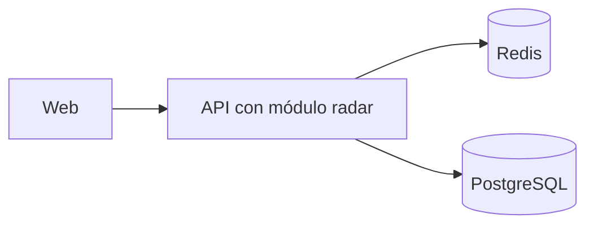
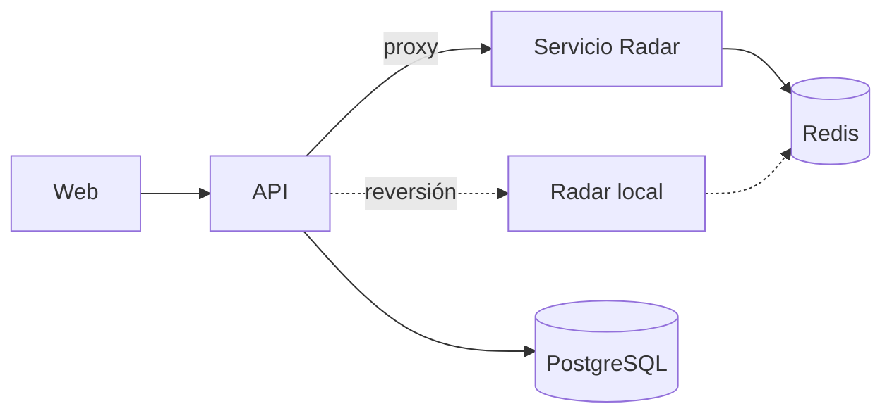
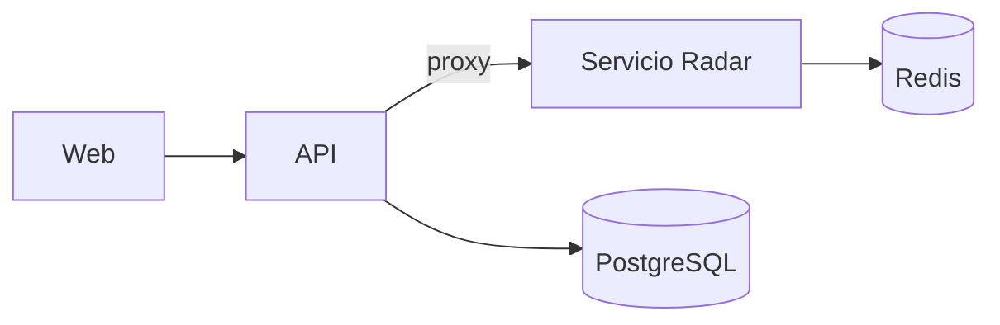

# Extracción de Radar

> Continuación vigente: [Etapa 5 — Operación](ETAPA_05_OPERACION_RADAR.md). No activar por seguir instrucciones históricas: primero gates técnicos y autorización. No usar latidos artificiales contra suspensión.

Documento vivo del estado de la extracción, actualizado el 2026-11-23 con el [cierre de la etapa 4](ETAPA_04_CIERRE_VALIDACION_RADAR.md). El registro histórico de la implementación es [ETAPA_04](ETAPA_04_EXTRACCION_RADAR.md); la decisión, [ADR-008](../06-decisiones-arquitectonicas/ADR-008-extraccion-radar-servicio-independiente.md). Si difieren, vale este documento y, por encima de él, el código.

## ¿Por qué Radar?

| Motivo | Evidencia |
|---|---|
| No usa PostgreSQL | Ninguna importación de `pg`; regla `radar-sin-pg` |
| No depende de otros módulos | Regla `modulos-aislados` |
| Su identidad basta con el token | Solo usa `user_id` |
| Sus datos son efímeros y reconstruibles | Vigencia de 900 s |
| Su fallo no debe afectar al resto | Readiness lo trata como dependencia no crítica |

Es el dominio con menor costo de separación. Sirve para validar el mecanismo antes de tocar dominios con datos relacionales.

## Estado actual

| Aspecto | Estado | Evidencia |
|---|---|---|
| Código de `apps/radar` | IMPLEMENTADO | En `main`, commit `b763885` |
| Fusión a `main` | IMPLEMENTADO | PR n.º 5, 2026-10-30 |
| Código de la etapa 4 en la API de producción | IMPLEMENTADO | La respuesta incluye `x-request-id` |
| CI, job `verify` | Correcto | Ejecuciones `39985651148` y `41060703064` |
| CI, job `test-real` | Corregido en el [cierre de la etapa 4](ETAPA_04_CIERRE_VALIDACION_RADAR.md) | Causa demostrada: conflicto de puertos |
| CI, job `e2e-radar` | Añadido en el [cierre de la etapa 4](ETAPA_04_CIERRE_VALIDACION_RADAR.md) | 14 escenarios con procesos y Redis reales |
| Pruebas E2E con infraestructura real | Correctas en local: 14 de 14 (2026-11-23) | [radar.e2e.test.js](../../tests/e2e/radar.e2e.test.js) |
| Despliegue en Render | NO IMPLEMENTADO | 404 el 2026-10-30 y el 2026-11-23 |
| Modo en producción | Local | `radar: up` con el servicio remoto inexistente. Valor de la variable: PENDIENTE DE VALIDACIÓN |

**Conclusión:** Radar es un servicio independiente **probado** (local y CI), pero **no está en operación**.

## Dependencias

| Dependencia | Uso |
|---|---|
| Redis | Único almacén |
| `@social-unsch/contracts` | Nodos, estados, umbral, vigencia y códigos de error |
| `JWT_PUBLIC_KEY` | Verificación de tokens |
| API principal | Solo como emisora de tokens y entrada del tráfico; sin llamadas en ejecución |

## Redis

| Clave | Tipo | Contenido | Vigencia |
|---|---|---|---|
| `radar:<nodo>:reports:<estado>` | Conjunto | Identificadores de quienes votaron | 900 s, renovados con cada voto |
| `radar:comedor:status`, `radar:rectorado:status`, `radar:campus_alert:status` | Hash | Estado, `report_count`, `last_updated` | 900 s |
| `radar:biblioteca:floor:<n>:occupancy` | Hash | Aforo, `report_count`, `last_updated` | 900 s |

El script Lua registra el voto, cuenta y publica con 3 votos iguales. Es texto idéntico en ambas implementaciones, pero **los argumentos difieren**: la API guarda `last_updated` en segundos Unix y Radar en ISO 8601. Hoy no tiene efecto porque `getStatus` no lee ese campo.

Cliente en ambos procesos: `enableOfflineQueue: false`, `maxRetriesPerRequest: 1` y reconexión con tope de 3 s.

## Base de datos

Radar no usa PostgreSQL y no se requiere ninguna migración para esta etapa.

## API

| Método y ruta | Autenticación | Respuesta |
|---|---|---|
| `GET /api/v1/radar/status` | Bearer | 200 con siete nodos |
| `POST /api/v1/radar/report` | Bearer | 200 con `updated` |
| `GET /health/live` | No | 200 |
| `GET /health/ready` | No | 200 o 503 según Redis |

El servicio monta además `/status` y `/report` en la raíz. Esas rutas no están en el contrato ni las usa el proxy (DT-49).

## Contratos

La fuente única es [radar.ts](../../packages/contracts/src/radar.ts).

| Elemento | Valor |
|---|---|
| Nodos | `comedor`, `rectorado`, `biblioteca_floor_1` a `4`, `campus_alert` |
| Umbral | 3 votos |
| Vigencia | 900 s |
| Sin estado vigente | `indefinido` |
| Errores | 400, 401, 500 y, solo en proxy, 502 y 504 |

Las constantes se usan en ejecución; los esquemas Zod, solo en pruebas. `zod` figura como dependencia de `apps/radar`, pero su código no lo importa.

## Proceso de extracción

```mermaid
flowchart LR
    A["Preparar CI y límites"] --> B["Crear apps/radar"]
    B --> C["Reforzar Redis y registros"]
    C --> D["Probar con dobles"]
    D --> F["Fusionar"]
    F --> E["Corregir test-real"]
    E --> G["Desplegar Radar"]
    G --> H["Medir"]
    H --> I["Activar proxy"]
    I --> J["Observar 2 semanas"]
    J --> K["Retirar Radar local"]

    classDef hecho stroke:#2e7d32,stroke-width:3px
    classDef pend stroke-dasharray: 5 5
    class A,B,C,D,F hecho
    class E,G,H,I,J,K pend
```

Trazo verde: hecho. Trazo discontinuo: pendiente.

## Arquitectura antes

Estado previo a la etapa 4.

## Arquitectura durante

Estado previsto al desplegar el servicio y activar el proxy. El código ya está en `main`.

## Arquitectura después

**PROPUESTO.**

## Activación

Requiere autorización. Orden:

1. Dejar la CI en verde.
2. Crear el servicio en Render con `NODE_ENV`, `REDIS_URL`, `JWT_PUBLIC_KEY` y `ALLOWED_ORIGINS`.
3. Comprobar `/health/ready` del servicio.
4. Definir en la API `RADAR_MODE=proxy` y `RADAR_PROXY_TARGET`, y reiniciarla.
5. Comprobar `/health/ready` de la API y `/api/v1/radar/status` con un token válido.

Ajustes de comandos de compilación en [ETAPA_04 §12](ETAPA_04_EXTRACCION_RADAR.md#12-procedimiento-de-despliegue-en-render-preparación-para-producción).

## Estrategia de rollback

1. En la API, definir `RADAR_MODE=local`. Dejar `REDIS_URL` definida.
2. Reiniciar la API: la configuración solo se lee al arrancar.
3. Comprobar `/health/ready` con `radar: up`.
4. Probar `GET /api/v1/radar/status` con un token válido.

| Aspecto | Comportamiento |
|---|---|
| Datos | Se conservan si ambos procesos usan el mismo Redis |
| Código | Sin cambios |
| Interrupción | La del reinicio de la API. Tiempo: PENDIENTE DE MEDICIÓN |
| Ensayo | **Sin realizar en producción** |

No eliminar `RADAR_PROXY_TARGET` ni dejarlo vacío con `RADAR_MODE=proxy`: la API rechaza esa configuración y no arranca. Corrige lo que indicaba ADR-008 ([prueba](../../apps/api/tests/unit/env.test.ts)).

## Riesgos

| Riesgo | Efecto | Mitigación | Estado |
|---|---|---|---|
| Arranque en frío de Radar mayor que el límite del proxy | Con suspensión por inactividad, las primeras solicitudes reciben 504: el límite máximo es 30 s y la API tardó 32,6 s en despertar | Instancia sin suspensión o latido programado; medir | Abierto |
| Implementaciones divergentes | Reversión con comportamiento distinto | Congelar cambios; retirar la copia local a tiempo | Abierto; ya hay una diferencia en `last_updated` |
| Dos entradas a Radar | El servicio queda expuesto en internet además de por la API | Exige token; valorar una restricción adicional | Abierto |
| CORS permisivo | Sin `ALLOWED_ORIGINS` en producción usa orígenes por defecto con `localhost`, solo con aviso | Definir la variable; endurecer `env.ts` | Abierto |
| Pruebas reales sin pasar en CI | La etapa 4 se fusionó sin la red de seguridad prevista | Corregido en el cierre | Resuelto en la rama |
| Sin pruebas de `apps/radar` con Redis real | El script Lua solo se probaba desde la API | E2E con Radar compilado y Redis real | Resuelto en la rama |
| Sobrecarga del proxy mayor que el umbral | p95 +156 % con 50 usuarios en local | Medir en la plataforma antes de activar; revisar el criterio | **Abierto** |
| Costo y operación | Un servicio más | Medir antes de seguir | Abierto |

## Pruebas requeridas

| Prueba | Estado | Evidencia |
|---|---|---|
| Unitarias, contrato y salud | Correctas con dobles | [apps/radar/tests](../../apps/radar/tests/unit/radar.service.test.ts) |
| Autenticación directa | Correcta con dobles | [radar.direct-auth.test.ts](../../apps/radar/tests/integration/radar.direct-auth.test.ts) |
| Proxy contra Radar por HTTP real | Correcta; Redis simulado | [proxy.e2e.test.ts](../../apps/radar/tests/integration/proxy.e2e.test.ts) |
| Paridad | Real en errores y contrato: la misma batería contra API local y API proxy (E2E, escenarios 3, 4, 9 y 10). La prueba con dobles sigue siendo limitada | [radar.e2e.test.js](../../tests/e2e/radar.e2e.test.js) |
| API contra PostgreSQL y Redis reales | Correcta en local; CI corregida | [tests/real](../../apps/api/tests/real/radar.real.test.ts) |
| `apps/radar` contra Redis real | Correcta: E2E | [radar.e2e.test.js](../../tests/e2e/radar.e2e.test.js) |
| Reversión en plataforma real | NO IMPLEMENTADO | — |

**Fallo de `test-real` (resuelto).** Confirmado y reproducido: el flujo declaraba servicios en 55432 y 56379 y el arnés lanzaba sus propios contenedores en esos mismos puertos. Detalle en el [cierre de la etapa 4](ETAPA_04_CIERRE_VALIDACION_RADAR.md).

## Métricas

| Métrica | Meta propuesta | Resultado |
|---|---|---|
| Latencia p95 por proxy frente a local | No peor en más de un 20 % | **NO CUMPLE en local**: +156 % (ver [Métricas](../07-evaluacion-y-evolucion/06-metricas.md)) |
| Tasa de 5xx en `/api/v1/radar/*` | No superior a la previa | PENDIENTE DE MEDICIÓN |
| Arranque en frío de Radar | Menor que `RADAR_PROXY_TIMEOUT_MS` | Proceso local 450 ms; en Render PENDIENTE DE MEDICIÓN |
| Tiempo de reversión | Por definir | PENDIENTE DE MEDICIÓN |
| Aislamiento: Radar caído, resto de la API sin errores | 0 % de errores | Cumple en local y CI con procesos reales; PENDIENTE en producción |

> Las cifras de latencia de ETAPA_04 (2026-10-23) **no miden el sistema**: el script de entonces simulaba los servidores. Lo sustituye el benchmark real del 2026-11-23.

Ver también: [Estrategia de migración](README.md) · [C2 de transición](../04-modelo-c4/05-contenedores-de-transicion.md) · [Nivel de código de Radar](../04-modelo-c4/Nivel4-DiagramadeCodigo.md) · [Pendientes](../07-evaluacion-y-evolucion/08-pendientes.md)

[← Índice](../README.md)
