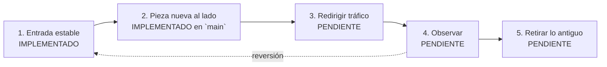

# Estrategia de migración

SOCIAL-UNSCH se encuentra evolucionando desde un monolito modular hacia una arquitectura con servicios extraídos progresivamente por dominio. Este documento explica con qué criterio, y sirve de índice de los informes de esta carpeta.

## Principio: no distribuir por distribuir

Distribuir un sistema tiene un costo real: más despliegues, fallos de red, consistencia más difícil y más operación para una sola persona. Por eso un dominio solo se extrae cuando se cumplen las seis condiciones:

| N.º | Condición | Pregunta de control | ¿Radar la cumple? |
|---|---|---|---|
| 1 | Límite de dominio claro | ¿Sus datos y reglas están separados del resto? | Sí: solo usa Redis y el identificador del token |
| 2 | Beneficio verificable | ¿Qué mejora, y cómo se mide? | **PENDIENTE DE VALIDACIÓN:** el aislamiento de fallos tiene pruebas con dobles; no hay medición en producción |
| 3 | Contrato estable | ¿Está escrito y probado? | Sí: [`packages/contracts`](../../packages/contracts/src/radar.ts) y pruebas de contrato |
| 4 | Capacidad de prueba | ¿Se puede probar el servicio nuevo? | Parcial: con dobles sí; sin pruebas de `apps/radar` contra Redis real |
| 5 | Observabilidad | ¿Se ve qué ocurre en ejecución? | Parcial: registros y salud sí; métricas y alertas no |
| 6 | Rollback | ¿Se puede volver atrás? | Parcial: implementado, sin ensayar en producción |

Detenerse también es un resultado válido. La [alternativa de alcance reducido](../07-evaluacion-y-evolucion/03-plan-de-migracion.md#alternativa-de-alcance-reducido) describe cómo quedaría el sistema.

## Strangler Fig

**Strangler Fig** (higuera estranguladora) reemplaza un sistema por partes: una entrada estable se coloca delante, la pieza nueva se construye al lado, se redirige una ruta cada vez y la pieza antigua se retira cuando deja de recibir tráfico. Es una estrategia de migración, no un estilo: describe el camino, no el destino.

| Paso | Realización en Radar | Estado |
|---|---|---|
| Entrada estable | La API monta Radar en `/api/v1/radar` como unidad reemplazable | IMPLEMENTADO en `main` |
| Pieza nueva al lado | `apps/radar` | IMPLEMENTADO en `main`, sin desplegar |
| Redirigir | `RADAR_MODE=proxy` | PENDIENTE: exige CI en verde, despliegue y autorización |
| Observar | Periodo mínimo de 2 semanas | PENDIENTE |
| Retirar | Borrar `apps/api/src/modules/radar` salvo el proxy | PENDIENTE |

## Etapas

| Etapa | Estado verificado | Informe |
|---|---|---|
| 1. Línea base e infraestructura | IMPLEMENTADO | [ETAPA_01](ETAPA_01_LINEA_BASE.md) |
| 2. Estabilización | IMPLEMENTADO; aplicación remota parcialmente verificada | [ETAPA_02](ETAPA_02_ESTABILIZACION.md) |
| 3. Monorepo, contratos y límites | IMPLEMENTADO: en `main` y en producción | [ETAPA_03](ETAPA_03_PREPARACION_SEPARACION.md) |
| 4. Extracción de Radar | IMPLEMENTADO PARCIALMENTE: en `main`, CI en rojo, servicio sin desplegar | [ETAPA_04](ETAPA_04_EXTRACCION_RADAR.md), [estado vigente](EXTRACCION_RADAR.md) |
| 5. Identidad y comunidad | PROPUESTO | [Plan](../07-evaluacion-y-evolucion/03-plan-de-migracion.md#etapa-5--identidad-y-comunidad) |
| 6. Movilidad | PROPUESTO | [Plan](../07-evaluacion-y-evolucion/03-plan-de-migracion.md#etapa-6--movilidad) |
| 7. Recursos, créditos y eventos selectivos | PROPUESTO | [Plan](../07-evaluacion-y-evolucion/03-plan-de-migracion.md#etapa-7--recursos-créditos-e-integración-asíncrona) |
| 8. Consolidación | PROPUESTO | [Plan](../07-evaluacion-y-evolucion/03-plan-de-migracion.md#etapa-8--consolidación) |

Objetivo, criterios de entrada y salida, riesgos y reversión de cada etapa: [Plan de migración](../07-evaluacion-y-evolucion/03-plan-de-migracion.md).

## Cómo leer esta carpeta

| Documento | Naturaleza |
|---|---|
| Este documento y [Extracción de Radar](EXTRACCION_RADAR.md) | Vivos: reflejan el estado vigente |
| Informes `ETAPA_*`, [Inventario de configuración](INVENTARIO_CONFIGURACION.md), [Resultados de verificación](RESULTADOS_VERIFICACION.md) | Registros de su momento. Donde difieren del código, vale el código |

Ver también: [Arquitectura de transición](../02-arquitectura-de-software/04-arquitectura-de-transicion.md) · [Riesgos y deuda técnica](../07-evaluacion-y-evolucion/02-riesgos-y-deuda-tecnica.md) · [Pendientes](../07-evaluacion-y-evolucion/08-pendientes.md)

[← Índice](../README.md)
