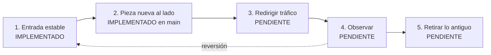

# Estrategia de migración

SOCIAL-UNSCH evoluciona desde un monolito modular hacia una arquitectura con servicios extraídos progresivamente por dominio. Este documento explica con qué criterio, y sirve de índice de los informes de esta carpeta.

> **Estado vigente (2026-11-25):** el código de las etapas 1 a 7 está integrado en `main` (`452f9d6`). Radar y Feed existen como servicios independientes **probados y sin desplegar**. En producción la API sigue atendiendo ambos dominios en proceso (`RADAR_MODE=local`, `FEED_MODE=local`). Ver [etapa 8](ETAPA_08_CIERRE_MIGRACION.md).

## Alcance final de esta fase

| Pieza | Destino acordado | Estado real |
|---|---|---|
| Frontend web (`apps/web`) | Aplicación propia en Vercel | Desplegada |
| API principal (`apps/api`) | Monolito modular con los demás dominios | Desplegada |
| Radar (`apps/radar`) | Servicio independiente | Implementado, **sin desplegar** |
| Feed (`apps/feed`) | Servicio independiente | Implementado, **sin desplegar** |
| PostgreSQL (Supabase) | Compartido entre API y Feed, con propiedad declarada | Compartido; ver [datos y propiedad](../02-arquitectura-software/06-datos-y-propiedad-por-dominio.md) |
| Redis (Upstash) | Exclusivo de Radar | En uso por la API en modo local |

**Identidad, Comunidad (salvo Feed), Movilidad, Recursos y Moderación permanecen dentro de `apps/api`.** Esta fase no extrae ningún otro dominio.

### Aclaración de numeración (dos esquemas conviven)

El [plan de migración](../07-evaluacion-y-evolucion/03-plan-de-migracion.md) se escribió antes de que el propietario decidiera adelantar Feed. Por eso numera sus etapas 6, 7 y 8 como *Movilidad*, *Recursos* y *Consolidación*, mientras que las etapas realmente ejecutadas con esos números fueron otras:

| N.º | Plan original (propuesta) | Ejecutado realmente | ADR |
|---|---|---|---|
| 6 | Movilidad | Desacoplamiento interno del dominio Feed | [ADR-009](../06-decisiones-arquitectonicas/ADR-009-desacoplamiento-dominio-feed.md) |
| 7 | Recursos, créditos e integración asíncrona | Extracción de Feed a servicio independiente | [ADR-010](../06-decisiones-arquitectonicas/ADR-010-extraccion-feed-servicio-independiente.md) |
| 8 | Consolidación | Integración, despliegue y cierre verificable | [ADR-011](../06-decisiones-arquitectonicas/ADR-011-cierre-de-la-migracion-y-alcance-final.md) |

Feed pertenece al dominio **Comunidad**, que el plan había marcado como *propuesta diferida*. Adelantarlo por delante de Movilidad y Recursos fue una decisión del propietario, no una desviación del equipo. Movilidad y Recursos **no se ejecutaron** y quedan fuera del alcance de este cierre. Cuando el plan y este documento difieran, vale este documento; cuando ambos difieran del código, vale el código.

## Principio: no distribuir por distribuir

Distribuir un sistema tiene un costo real: más despliegues, fallos de red, consistencia más difícil y más operación para una sola persona. Por eso un dominio solo se extrae cuando se cumplen las seis condiciones:

| N.º | Condición | Pregunta de control | ¿Radar la cumple? | ¿Feed la cumple? |
|---|---|---|---|---|
| 1 | Límite de dominio claro | ¿Sus datos y reglas están separados del resto? | Sí: solo usa Redis y el identificador del token | **Parcial:** comparte PostgreSQL con la API y hace `JOIN` con `users` |
| 2 | Beneficio verificable | ¿Qué mejora, y cómo se mide? | **PENDIENTE DE VALIDACIÓN:** sin medición en producción | **PENDIENTE DE VALIDACIÓN:** medido solo en local y sin umbrales aprobados |
| 3 | Contrato estable | ¿Está escrito y probado? | Sí: [`radar.ts`](../../packages/contracts/src/radar.ts) | Sí: [`feed.ts`](../../packages/contracts/src/feed.ts), con pruebas de contrato en los dos modos |
| 4 | Capacidad de prueba | ¿Se puede probar el servicio nuevo? | Sí: 14 escenarios E2E con procesos y Redis reales | Sí: E2E con procesos y PostgreSQL reales en modo local y proxy |
| 5 | Observabilidad | ¿Se ve qué ocurre en ejecución? | Parcial: registros/salud y resumen offline; recolección continua pendiente | Parcial: igual, más `feed` en `/health/ready` cuando el proxy está activo |
| 6 | Rollback | ¿Se puede volver atrás? | Parcial: implementado, sin ensayar en producción | Parcial: implementado (`FEED_MODE=local`), sin ensayar en producción |

Detenerse también es un resultado válido. La [alternativa de alcance reducido](../07-evaluacion-y-evolucion/03-plan-de-migracion.md#alternativa-de-alcance-reducido) describe cómo quedaría el sistema.

**Feed no alcanza independencia de datos.** Comparte la base de la API y lee `users`. Describirlo como «microservicio independiente» sería inexacto: es un proceso independiente sobre datos compartidos.

## Strangler Fig

**Strangler Fig** (higuera estranguladora) reemplaza un sistema por partes: una entrada estable se coloca delante, la pieza nueva se construye al lado, se redirige una ruta cada vez y la pieza antigua se retira cuando deja de recibir tráfico. Es una estrategia de migración, no un estilo: describe el camino, no el destino.

| Paso | Radar | Feed |
|---|---|---|
| Entrada estable | La API monta `/api/v1/radar` como unidad reemplazable | La API monta `/api/v1/feed` como unidad reemplazable |
| Pieza nueva al lado | `apps/radar` — en `main`, sin desplegar | `apps/feed` — en `main`, sin desplegar |
| Redirigir | `RADAR_MODE=proxy` — PENDIENTE: exige despliegue, presupuesto y autorización | `FEED_MODE=proxy` — PENDIENTE: exige que Radar esté estable primero |
| Observar | Periodo mínimo de 14 días — NO INICIADO | Periodo mínimo de 14 días — NO INICIADO |
| Retirar | Borrar `apps/api/src/modules/radar` salvo el proxy — PENDIENTE | Borrar el router local de Feed salvo el proxy — PENDIENTE |

El orden no es negociable: **Feed no se activa hasta que Radar lleve su periodo de observación en verde**, para no cambiar dos modos a la vez.

## Etapas

| Etapa | Estado verificado | Informe |
|---|---|---|
| 1. Línea base e infraestructura | IMPLEMENTADO | [ETAPA_01](ETAPA_01_LINEA_BASE.md) |
| 2. Estabilización | IMPLEMENTADO; aplicación remota parcialmente verificada | [ETAPA_02](ETAPA_02_ESTABILIZACION.md) |
| 3. Monorepo, contratos y límites | IMPLEMENTADO: en `main` y en producción | [ETAPA_03](ETAPA_03_PREPARACION_SEPARACION.md) |
| 4. Extracción de Radar | IMPLEMENTADO PARCIALMENTE: validado con infraestructura real; servicio sin desplegar | [ETAPA_04](ETAPA_04_EXTRACCION_RADAR.md), [cierre](ETAPA_04_CIERRE_VALIDACION_RADAR.md), [estado vigente](EXTRACCION_RADAR.md) |
| 5. Recuperación operativa y despliegue controlado de Radar | INTEGRADO EN `main` (PR #8, #9); activación y observación **pendientes** | [ETAPA_05](ETAPA_05_OPERACION_RADAR.md) |
| 6. Desacoplamiento interno del dominio Feed | IMPLEMENTADO: en `main` (PR #10) | [ETAPA_06](ETAPA_06_DESACOPLAMIENTO_DOMINIO.md) |
| 7. Extracción de Feed a servicio independiente | IMPLEMENTADO: en `main` (PR #11); servicio sin desplegar | [ETAPA_07](ETAPA_07_EXTRACCION_FEED.md) |
| 8. Integración, despliegue y cierre verificable | **ABIERTA:** código y pruebas completos; despliegue, activación y observación pendientes de autorización | [ETAPA_08](ETAPA_08_CIERRE_MIGRACION.md) |
| Movilidad, Recursos, Moderación | NO EJECUTADAS: fuera del alcance de este cierre | [Plan](../07-evaluacion-y-evolucion/03-plan-de-migracion.md) |

Objetivo, criterios de entrada y salida, riesgos y reversión de cada etapa: [Plan de migración](../07-evaluacion-y-evolucion/03-plan-de-migracion.md).

## Cómo leer esta carpeta

| Documento | Naturaleza |
|---|---|
| Este documento, [Extracción de Radar](EXTRACCION_RADAR.md) y [Etapa 8](ETAPA_08_CIERRE_MIGRACION.md) | Vivos: reflejan el estado vigente |
| [Cierre de la etapa 4](ETAPA_04_CIERRE_VALIDACION_RADAR.md) y [evidencias](evidencias/) | Registro de las validaciones con fecha |
| Informes `ETAPA_01`–`ETAPA_07`, [Inventario de configuración](INVENTARIO_CONFIGURACION.md), [Resultados de verificación](RESULTADOS_VERIFICACION.md) | Registros de su momento. Donde difieren del código, vale el código |

Ver también: [Arquitectura de transición](../02-arquitectura-software/04-arquitectura-de-transicion.md) · [Riesgos y deuda técnica](../07-evaluacion-y-evolucion/02-riesgos-y-deuda-tecnica.md) · [Pendientes](../07-evaluacion-y-evolucion/08-pendientes.md)

[← Índice](../README.md)
